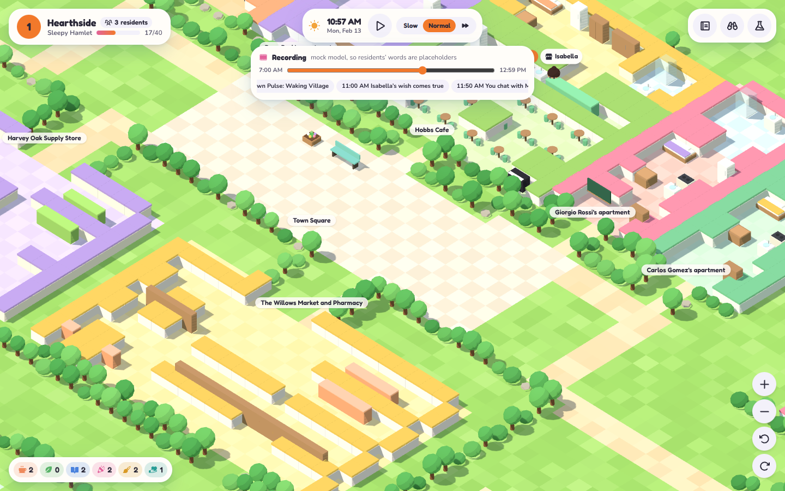
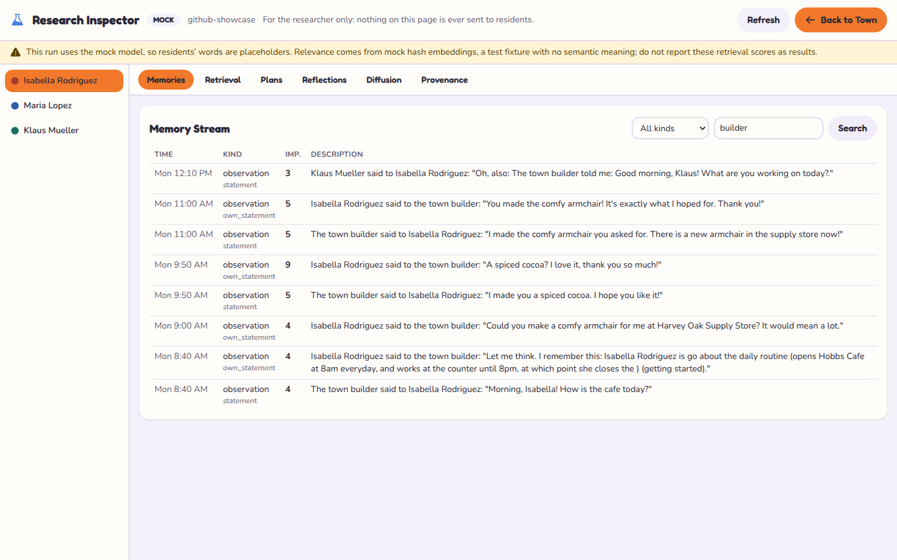

# Hearthside

**A simulation town with memory.**
[Nathan Lee Yang · @nathanu1](https://github.com/nathanu1).

Hearthside is a town simulation where residents remember conversations, plan their days, and respond to the people and places around them. You can talk to them, build things they ask for, and inspect the memories behind their decisions.

It brings together a reproduction of *Generative Agents* and a town-building interface that runs on your own computer.

[Get started](#quick-start) · [How it works](#how-it-works) · [Research notes](docs/reproduction_spec.md) · [Showcase guide](docs/showcase.md)



*The town interface, captured from an offline demo. Resident dialogue in this demo uses the deterministic MOCK model.*

## Why I built it

I wanted to take the memory, reflection, and planning loop from the Generative Agents paper and make it something I could run locally, inspect, and interact with. The town gives those mechanisms a setting you can explore; the inspector lets you follow what happened underneath.

The project focuses on two questions: how past experiences shape an agent's next action, and how to make that process visible enough to study.

## What you can do

- **Spend time in the town.** Follow residents through their schedules, read their conversations, and chat with them yourself.
- **Build around their requests.** Give gifts, collect motifs, and place or decorate objects residents can notice and use.
- **Look inside a decision.** Inspect memories, retrieval scores, plans, reflections, and recorded model calls.
- **Run an experiment.** Compare reflection settings, interview agents under different memory conditions, and measure information spread or event attendance.
- **Return to a saved run.** Resume from a checkpoint or replay a recording without making new model calls.

## Quick start

Requires Python 3.11+ and [uv](https://docs.astral.sh/uv/). The town's built frontend is included, so you can start without Node.js.

```bash
git clone https://github.com/nathanu1/artsoce.git hearthside
cd hearthside
uv sync --extra dev --extra viewer
source .venv/bin/activate
ga play --config configs/town_mock.yaml --open
```

This opens the town at [localhost:8080](http://127.0.0.1:8080). The offline demo needs no API key or model download. Its MOCK label identifies scripted model responses used to exercise the simulation and interface.

For installation alternatives and the full command list, see the [reference](docs/reference.md).

### Use a local model

With [Ollama](https://ollama.com/) installed and running:

```bash
ollama pull llama3.2:3b
ollama pull nomic-embed-text
ga play --config configs/town_ollama.yaml \
  --set providers.llm.model=llama3.2:3b --open
```

This starts with three residents. Llama 3.2 3B is the model used in the documented local runs; the config also supports its default `llama3.1:8b`. Local inference needs no hosted API key, and its speed depends on your hardware.

Scenarios for [25 residents](configs/town_n25_ollama.yaml) and [35 residents](configs/town_n35_ollama.yaml) are included. Start with three to see how the simulation runs on your machine. The [town guide](docs/game.md) covers controls, building, local providers, and the larger neighborhood.

### Run the research workflow

```bash
ga run --config configs/offline_pilot_2day.yaml --run-id first-town
ga evaluate --run-dir runs/first-town
ga interview --run-dir runs/first-town --protocol configs/interviews_reference.yaml
ga serve --run-dir runs/first-town
```

The viewer opens at [localhost:8000](http://127.0.0.1:8000). This workflow uses the offline mock provider. Experiment protocols and hosted-provider options are in the [reference](docs/reference.md) and [experiment guide](docs/experiment_protocol.md).

## How it works

Each resident has a memory stream and a plan. New experiences can change which memories are retrieved, which insights are formed, and what the resident does next.

| Stage | What happens |
| --- | --- |
| Perception | A resident notices nearby people, objects, and events within its view of the world. |
| Memory | Observations and conversations are stored with timestamps, importance scores, and embeddings. |
| Retrieval | Memories are ranked by recency, importance, and relevance to the current situation. |
| Reflection | Accumulated experiences lead to higher-level insights that cite the memories behind them. |
| Planning and action | Day plans become shorter tasks; encounters can trigger reactions, conversation, or replanning. |



*The inspector exposes the recorded state and evidence for a run. It provides a separate view for studying the simulation.*

### Engineering choices

The engine advances in shared snapshots so residents decide against the same world state. Model responses pass through schema validation, one repair attempt, and a request ledger. Checkpoints and recorded responses support resume and replay; failed calls remain visible in the run.

The interface uses **React, TypeScript, Three.js, and Tailwind CSS**. The simulation uses **Python, SQLite, and FastAPI**. Provider adapters cover Ollama, an OpenAI-compatible local server, Anthropic, OpenAI, and the offline mock model.

For a concrete example, the [walkthrough](docs/walkthrough.md) follows one conversation through memory, retrieval, reflection, and planning.

## Current status

The repository documents completed offline simulations with five and 25 agents, interview and evaluation workflows, replay, and a ten-run reflection experiment. It also records three runs with **Llama 3.2 3B through Ollama on four CPU cores**:

| Residents | Simulated time | Recorded model calls |
| --- | --- | ---: |
| 3 | 07:00–18:00 | 493 |
| 25 | 07:00–09:15 | 2,525 |
| 35 | 07:00–09:10 | 4,537 |

These runs check the local model path from start to finish. They do not establish human-like behavior or reproduce the paper's human-rated results. Detailed timings, validation failures, and limitations are in the [town guide](docs/game.md#running-it).

Hosted adapters are implemented but have not been exercised against their live APIs in the documented runs. LM Studio compatibility uses the OpenAI-compatible adapter; LM Studio itself has not been tested. The 35-resident neighborhood is an extension to the original 25-resident scenario.

### Development checks

```bash
uv run pytest
uv run ruff check src tests examples
cd frontend
npm ci
npm test
npm run typecheck
npm run build
```

For this update, **189 Python tests passed (one skipped)** and **34 frontend tests passed**. Python lint, TypeScript checks, and both frontend builds also passed.

The tests cover memory isolation, retrieval and reflection, plan validation, private dialogue, world constraints, replay, evaluation, local adapters, and building rules. See the [reference](docs/reference.md#tests) for prompt-example maintenance.

## Explore the repository

| Area | Start here |
| --- | --- |
| Simulation and cognition | [`src/generative_agents/`](src/generative_agents/) |
| Town interface | [`frontend/`](frontend/) |
| Model prompts and recorded examples | [`prompts/`](prompts/) |
| Smallville scenarios and the added neighborhood | [`scenarios/`](scenarios/) |
| Commands and configuration | [Reference](docs/reference.md) |
| Town controls and local-run details | [Town guide](docs/game.md) |
| Paper correspondence and deviations | [Reproduction specification](docs/reproduction_spec.md) |
| Interviews and reflection experiments | [Experiment protocol](docs/experiment_protocol.md) |
| Demo walkthrough and portfolio copy | [Showcase guide](docs/showcase.md) |

## Credits

**Nathan Yang (@nathanu1)** Creator and Maintainer. & **Claude* — AI development contributor, used for coding and documentation assistance.

The research foundation is *Generative Agents: Interactive Simulacra of Human Behavior* by Park et al. (UIST 2023). The [reproduction specification](docs/reproduction_spec.md) records how this implementation relates to the paper and [released code](https://github.com/joonspk-research/generative_agents), including its deviations and extensions.

Upstream persona data, map layers, and adapted prompts retain their attribution. See [contributors](CONTRIBUTORS.md), [NOTICE](NOTICE), and the [upstream Apache-2.0 license](third_party/generative_agents/LICENSE).
