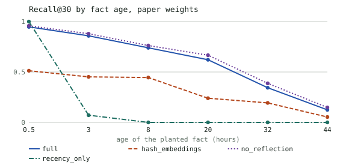
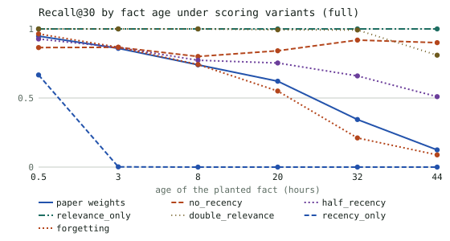
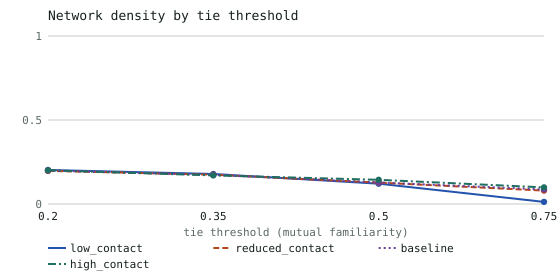
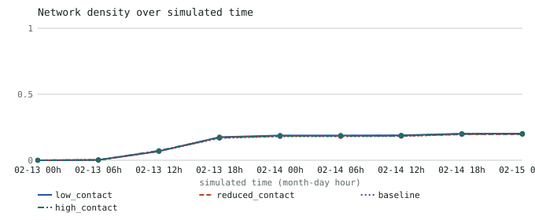

# Round two: a critique of the first experiments, new tooling, and four upscaled runs

Round one ([`README.md`](README.md)) ran three demonstration experiments with the offline MOCK
model, five or ten residents and three seeds. This document starts from a critical reading of
those results, describes what was built in response, and reports four new experiments: three
at the paper's scale of 25 residents (retrieval with real sentence embeddings, network
emergence, a fire as counterfactual forks) and one small experiment on a **real local model**
(Llama 3.2 3B), the first in this project whose behavior is not the fixture's. The real-model
experiment exposed a weakness that could be fixed outside the model; the fix and its rerun
are section 6.1.

Every protocol in this round was committed, with its hypotheses and planned contrasts,
before its runs started (commits `bb4f232` and `3aa1e07`). Predictions that failed are
reported as failed.

**In short.**

* Retrieval (A2). With real sentence embeddings the right memory is always the most relevant
  one, for paraphrases as well as for word matches; the hash fixture of round one finds a
  paraphrase in 6% of queries. Under the paper's weights 61% of planted facts reach the top
  30, and what is lost is lost to recency and importance. Five of six registered predictions
  held in all eight seeds.
* The recency term (A2, follow-up). Because recency is min-max normalized over an agent's
  stream, it is relative to the oldest memory: adding one unrelated 30-day-old memory
  raised recall of day-old facts from 0.23 to 0.75. The one failed prediction (forgetting
  would not hurt the old facts it keeps) failed for the same reason.
* Network (B2). More contact opportunity makes ties stronger at every step, and leaves
  the set of pairs who ever talk unchanged at 20%; the prediction that it would grow failed.
  With all 25 residents the network has six components in every run, not the single
  component round one saw with ten selected residents.
* Fire (C2). With each seed forked from its own morning, eight to ten residents perceive the
  fire. The "slow" reactions turned out to be late arrivals, and the measure now separates
  the two. The hourly-only planner adapts the same way with 43% fewer calls.
* Real model (D). Llama 3.2 3B saw the fire in every fork and decided at once: to open the
  windows, to call the fire department, or to wait. No response outlasted half an hour of a
  forty-minute fire. Asked afterwards, the cafe's owner reported the fire plainly in one fork
  of three, although the records of it were in her prompt each time. Every one of the 64
  rejected model answers was a plan with wrong numbers (minutes that do not add up, times
  out of order); the other 676 answers were valid
  on the first attempt.
* Plan fitting (D2). A new opt-in setting corrects a plan's minutes and keeps its
  activities. Replayed on D's answers it accepts 41 of the 43 decompositions and replans
  the strict planner rejected. Live on three new forks, none of 32 was rejected (26 needed
  correcting) and plan failures after the fork fell from 7, 5 and 4 to 2, 1 and 1. The
  fire was handled and reported no better, and one fork spent 160 model calls on two
  residents reacting to each other's reactions for ninety simulated seconds.

## 1. What round one could and could not show

| Round-one statement | Problem found on re-reading | What round two does about it |
| --- | --- | --- |
| "Recency-only retrieval collapsed every memory measure … exact permutation p = 0.1 with n = 3 + 3" | 0.1 is the smallest p three runs a side can give, and the planted-fact recall had a standard deviation of zero across seeds: the three seeds were one result seen three times, not three pieces of evidence. No effect size was given. | Eight seeds, analysed as matched pairs; every test is printed with the floor of its design; the report flags comparisons where neither condition varies between seeds. |
| "Recall of day-old facts was zero in every condition" (the forgetting hypothesis could not be tested) | A floor effect from one cutoff (k = 10). The stated cause ("their recency component is low") was not measured. | Rank-based outcomes and a recall curve; an age grid of six ages; the normalized recency of every planted fact is recorded, so the cause is measured, not assumed. |
| "Queried with paraphrases" | The queries shared three to six content words with their facts, and in six of the eight every content word of the query came from the fact. With hash embeddings that is word matching; paraphrase in the sense of "same meaning, other words" was never tested. | Every fact has a lexical query and a paraphrase with no shared content word (enforced by a test), and the runs use real sentence embeddings. |
| "Under forgetting … the *important* old facts rank higher because the eligible pool is smaller" | A post-hoc reading of a between-run difference: the `forgetting` runs also had different streams. | Forgetting is a scoring variant re-scored on the *same* snapshots. The prediction was registered (H3) and **failed**; section 3 explains why. |
| "A connected structure emerged … reciprocity 1.0" | Reciprocity is 1 by construction: a conversation updates both records by the same rule, and two residents in view of each other both record the encounter. And with a tie threshold of 0.2, one conversation (gain 0.25) makes a tie, so "density 0.39" was close to "39% of pairs talked at least once". | Reciprocity is reported but not interpreted. Primary outcomes no longer hang on one threshold: weighted density, share of pairs who talked, a threshold sweep, and clustering against a random graph of equal density. |
| "A post-hoc recomputation at threshold 0.5 … is the pattern the hypothesis expected" | Honest about being post hoc, but a post-hoc pattern is a hypothesis, not a result. | Registered as H1 and H2 of experiment B2 with four contact levels instead of two extremes. |
| "The hourly-only planner adapted identically … 24% fewer calls" (three forks) | The three seeds were copies: with the mock, a fork's seed changes nothing after the fork point. The comparison had one replicate, and one perceiver. | Every seed forks from its own recorded morning; 25 residents; the fire starts when the cafe is busiest. |
| All three experiments | Six pairwise comparisons on up to five outcomes each, unadjusted; behavior was the fixture's throughout. | Planned contrasts form the family for a Holm adjustment. One experiment uses a real model. |

Two things round one got right and this round keeps: it labeled its post-hoc checks as post
hoc, and it never presented mock behavior as a finding about agents.

## 2. What was built

| Area | Change | Where |
| --- | --- | --- |
| Runner | Parallel runs (`--jobs`), per-seed fork sources created on demand, re-analysis from saved rows (`--rebuild`) | `evaluation/experiment.py` |
| Statistics | Paired-by-seed sign-flip test, effect size d_z, bootstrap intervals of means, the floor of every test, a flag for seeds that are copies, planned contrasts with their own Holm family | `evaluation/experiment.py` |
| Memory probe | Second fact set (18 facts: six ages × three importance levels, lexical and paraphrase query each), recall curve, rank statistics, scoring variants re-scored on the same snapshot, anchors; the probe is about seven times faster | `evaluation/memory_probe.py`, `configs/probes/memory_facts_v2.yaml` |
| Network | Threshold sweep, weighted density, share of pairs who talked, degree Gini, clustering against a random graph | `social/network.py` |
| Reports | Pooled detail sections and line charts under the run-level tables | `evaluation/detail.py`, `evaluation/plots.py` |
| Real model | llama-cpp-python's server through the OpenAI-compatible adapter (`schema_format: json_object`); a pilot config | `providers/openai_compatible.py`, `configs/llamacpp_pilot.yaml` |
| Robustness | A repeated identical request now draws a new sample on seeded servers (found in experiment D) | `providers/base.py` (`call_seed`) |
| Planning | Opt-in fit of task durations to the window for models that cannot add (`planning.fit_durations`, found in experiment D) | `cognition/planning.py` |
| Speed | `GA_SQLITE_SYNCHRONOUS=OFF` for batches: 43% less wall time on a 25-resident run, bit-identical state | `db.py` |

The guide is [`../research_platform.md`](../research_platform.md); the tests are in
`tests/test_round2.py`, `tests/test_local_providers.py` and `tests/test_planning.py`.

**Scale of this round.** Hardware: one four-core cloud container, no GPU.

| Experiment | Residents | Simulated time per run | Runs | Model | Embeddings |
| --- | --- | --- | --- | --- | --- |
| A2 retrieval | 25 | 2 days | 32 + 1 repeat | MOCK | all-MiniLM-L6-v2 (one condition: hash fixture) |
| B2 network | 25 | 2 days | 32 + 1 repeat | MOCK | all-MiniLM-L6-v2 |
| C2 fire forks | 25 | 12.5 h recorded + 4 h per fork | 6 sources + 18 forks + 1 repeat | MOCK | all-MiniLM-L6-v2 |
| D fire, real model | 3 | about 2 h recorded + about 1 h per fork | 1 source + 6 forks | Llama 3.2 3B (Q4_K_M) | all-MiniLM-L6-v2 |
| D2 fire, real model, fitted plans | 3 | about 1 h per fork | 3 forks of D's source | Llama 3.2 3B (Q4_K_M) | all-MiniLM-L6-v2 |

Round one's largest experiment was 12 runs of five residents.

## 3. Experiment A2: what the retrieval score brings back, at town scale

Protocol: [`configs/experiments/memory_retrieval_v2.yaml`](../../configs/experiments/memory_retrieval_v2.yaml).
Generated report: [`round2_results/memory_retrieval_v2/report.md`](round2_results/memory_retrieval_v2/report.md).
Base: [`configs/research_n25_2day.yaml`](../../configs/research_n25_2day.yaml).

**Question.** On a town-sized two-day memory stream, how do embedding type, reflection,
forgetting and the three score weights change which planted facts come back, by age,
importance and query style?

**Design.** All 25 residents, 13 to 15 February, eight seeds. Four conditions are separate
runs because they change what the stream contains:

| Condition | Overrides |
| --- | --- |
| `full` | none: paper weights, reflection on, all-MiniLM-L6-v2 embeddings |
| `hash_embeddings` | the lexical hash fixture of round one instead of sentence embeddings |
| `no_reflection` | `architecture.reflection=false` |
| `recency_only` | `retrieval.weights.importance=0`, `retrieval.weights.relevance=0` during the run |

Six scoring rules are **probe variants**: at the end of every run the same 18 planted facts
in the same snapshot are re-scored under each rule, so nothing but the scoring differs.

| Variant | Scoring |
| --- | --- |
| `no_recency` | recency weight 0 |
| `half_recency` | recency weight 0.5 |
| `relevance_only` | recency and importance weights 0 |
| `double_relevance` | relevance weight 2 |
| `recency_only` | importance and relevance weights 0 |
| `forgetting` | paper weights; memories with activation below −0.6 are inaccessible |

**Probe.** Eighteen facts per agent ([`memory_facts_v2.yaml`](../../configs/probes/memory_facts_v2.yaml)):
ages 0.5, 3, 8, 20, 32 and 44 hours crossed with importance 2, 5 and 8, each queried twice
(lexical and paraphrase). That is 900 queries per run and 7,200 per condition. A hit at 30 means
the fact ranks in the top 30, the paper's retrieval cap.

**Registered hypotheses and contrasts** (verbatim in the protocol file):

* H1: semantic embeddings raise paraphrase recall@30 far above the hash fixture.
* H2: on the same snapshots, scoring without recency raises recall@30 of facts older than a day.
* H3: forgetting does not lower recall@30 of the important old facts that stay accessible.
* H4: removing reflection changes recall@30 by less than 0.05.
* H5: running the town with recency-only retrieval lowers own-conversation recall.
* H6: on the same snapshots, doubling the relevance weight raises recall@30 of old facts.

**Procedure.** `GA_SQLITE_SYNCHRONOUS=OFF ga experiment --protocol … --execute --jobs 4`.
32 runs plus one determinism repeat, all completed; about 33,000 mock calls and 4.2 minutes
of wall time per run with four in parallel; the repeat of `full-s201` was identical.

**Planned contrasts** (paired by seed, exact sign-flip test, Holm over these six):

| Contrast | Mean a | Mean b | a − b | As predicted | Seeds agreeing | Paired p | Holm p |
| --- | --- | --- | --- | --- | --- | --- | --- |
| H1 paraphrase recall@30: semantic > hash | 0.593 | 0.058 | +0.535 | yes | 8 of 8 | 0.0078 | 0.047 |
| H2 old-fact recall@30, same snapshots: no recency > paper weights | 0.910 | 0.234 | +0.676 | yes | 8 of 8 | 0.0078 | 0.047 |
| H3 important old facts, recall@30: forgetting ≥ paper weights | 0.449 | 0.558 | −0.109 | **no** | 8 of 8 lower | 0.0078 | 0.047 |
| H4 recall@30: no reflection = full (within ±0.05) | 0.634 | 0.606 | +0.028 | yes | 8 of 8 higher | 0.0078 | 0.047 |
| H5 own-conversation recall: full > recency-only town | 0.423 | 0.000 | +0.423 | yes | 8 of 8 | 0.0078 | 0.047 |
| H6 old-fact recall@30, same snapshots: double relevance > paper weights | 0.901 | 0.234 | +0.667 | yes | 8 of 8 | 0.0078 | 0.047 |

0.0078 is the smallest p eight paired seeds can give (2/2⁸): every seed moved the same way in
every contrast. Five predictions held; H3 failed in every seed.

**Where the facts are lost** (recall@30 pooled over 7,200 queries per condition, paper weights):

| Condition | 0.5 h | 3 h | 8 h | 20 h | 32 h | 44 h | All | importance 2 / 5 / 8 | lexical / paraphrase |
| --- | --- | --- | --- | --- | --- | --- | --- | --- | --- |
| `full` | 0.95 | 0.86 | 0.74 | 0.62 | 0.34 | 0.12 | 0.61 | 0.30 / 0.67 / 0.85 | 0.62 / 0.59 |
| `hash_embeddings` | 0.51 | 0.45 | 0.45 | 0.24 | 0.19 | 0.05 | 0.32 | 0.13 / 0.31 / 0.51 | 0.57 / 0.06 |
| `no_reflection` | 0.96 | 0.88 | 0.76 | 0.67 | 0.39 | 0.15 | 0.63 | 0.33 / 0.70 / 0.87 | 0.65 / 0.62 |
| `recency_only` (run and probe) | 1.00 | 0.07 | 0.00 | 0.00 | 0.00 | 0.00 | 0.18 | 0.20 / 0.17 / 0.17 | 0.18 / 0.18 |

Median rank of the planted fact in `full` (about 805 candidates per query): 1, 1, 4, 19, 54
and 94 for the six ages. Mean normalized recency of the planted fact: 0.99, 0.93, 0.82,
0.55, 0.31, 0.07, the same in every condition.



**The same facts under other scoring rules** (snapshots of `full`, recall@30):

| Scoring | 0.5 h | 3 h | 8 h | 20 h | 32 h | 44 h | All | lexical | paraphrase |
| --- | --- | --- | --- | --- | --- | --- | --- | --- | --- |
| paper weights (1, 1, 1) | 0.95 | 0.86 | 0.74 | 0.62 | 0.34 | 0.12 | 0.61 | 0.62 | 0.59 |
| `half_recency` | 0.93 | 0.87 | 0.77 | 0.75 | 0.66 | 0.51 | 0.75 | 0.77 | 0.73 |
| `no_recency` | 0.86 | 0.87 | 0.80 | 0.84 | 0.92 | 0.90 | 0.87 | 0.88 | 0.86 |
| `double_relevance` | 1.00 | 1.00 | 1.00 | 0.99 | 0.99 | 0.81 | 0.97 | 0.96 | 0.97 |
| `relevance_only` | 1.00 | 1.00 | 1.00 | 1.00 | 1.00 | 1.00 | 1.00 | 1.00 | 1.00 |
| `recency_only` | 0.67 | 0.00 | 0.00 | 0.00 | 0.00 | 0.00 | 0.11 | 0.11 | 0.11 |
| `forgetting` | 0.96 | 0.87 | 0.74 | 0.55 | 0.21 | 0.09 | 0.57 | 0.57 | 0.57 |

Under `forgetting`, five of the 18 facts are inaccessible for every agent (bees, fountain,
ladder, marathon, scarf: the low- and mid-importance facts of 20 hours and more), exactly as
the activation formula predicts.



**Reading.**

1. **Sentence embeddings make paraphrase retrieval work; the fixture cannot do it at all.**
   With the hash fixture a paraphrase finds its fact in the top 30 in 6% of queries, against
   57% for a lexical query; with all-MiniLM-L6-v2 the two styles are within three points
   (59% and 62%). Scored on relevance alone, the sentence embedding ranks the right fact in
   the top 30 for every one of 7,200 queries and first for 99% of them; the fixture reaches
   100% for lexical queries and 2% for paraphrases. Round one's retrieval numbers were
   numbers about shared words.
2. **Under the paper's weights, what is lost is lost to recency and importance, not to
   relevance.** The right fact is always the most relevant memory, and still only 61% of the
   facts reach the top 30. Recall falls from 0.95 for a half-hour-old fact to 0.12 for a
   44-hour-old one, and from 0.85 for importance 8 to 0.30 for importance 2. Removing the
   recency term lifts day-old facts from 0.23 to 0.91 (H2); doubling the relevance weight
   does the same (H6).
3. **The age gradient is the normalization, not the decay constant.** The decay of 0.995 per
   hour takes 44 hours to reduce raw recency by a fifth (0.995⁴⁴ = 0.80). But the score
   min-max normalizes recency over the agent's stream, and in a 48-hour run the oldest
   memory is 48 hours old, so the normalized value is `(dᵃ − d⁴⁸) / (1 − d⁴⁸)`, almost
   exactly `1 − a/48`. That formula predicts 0.99, 0.93, 0.82, 0.56, 0.31 and 0.08 for the
   six ages; the probe measured 0.99, 0.93, 0.82, 0.55, 0.31 and 0.07. A two-day simulation
   therefore applies nearly the full weight of one score component against anything from
   the first morning. Section 3.1 tests this directly.
4. **Forgetting made the surviving old facts harder to retrieve, the opposite of H3 and of
   round one's post-hoc reading.** The rule worked as designed (five facts inaccessible, the
   candidate pool cut from about 810 to about 410 memories). But the memories it removes are
   the oldest ones, so the oldest *accessible* memory is now younger, the normalized recency
   of the surviving old facts drops (the 44-hour fact from 0.07 to 0.00, the 32-hour fact
   from 0.31 to 0.25, importance and relevance unchanged), and their recall@30 falls from
   0.56 to 0.45. A forgetting filter in front of a min-max-normalized score penalizes exactly
   the old memories it was meant to keep.
5. **Reflection costs a little recall.** `no_reflection` is higher than `full` by 0.028 in all
   eight seeds (d_z = 2.7). The registered band of ±0.05 holds, so H4 counts as supported,
   but the difference is systematic, not noise: the mock's reflections add about 150
   memories per agent (787 against 638), many of them rated important, and they compete
   for the top 30.
6. **Recency-only retrieval is useless, at scale as in round one.** A town run with recency
   alone retrieves none of its own conversations in the top 10 (0.42 with the full score) and
   its supported party recall is 0.03 against 0.23.

**An unplanned observation: the embedding model changed how far news travelled.** With the
hash fixture 42% of residents held a memory of the party at the end; with sentence
embeddings 23.5% (lower in seven of eight seeds; candidacy 27% against 14%, lower in seven
and equal in one). Nothing but the embedding differs between those conditions. The mock
tells a neighbor whatever news its own retrieval brings up, and lexical retrieval brings up
the party seed more readily than semantic retrieval does among the mock's many similar
memories. This is a property of the fixture's talk rule, and it is exploratory, but it shows
that the embedding model is not a neutral implementation detail: it sits on the path from
memory to speech.

**Limits.** The streams are a mock town's: its observations and conversations are
repetitive, which makes competition for the top 30 different from a real model's stream. The
facts are planted, never rehearsed and unrelated to the town, so their recency equals their
age. Eight seeds of a deterministic fixture vary little (standard deviations around 0.01);
the p-values say that the direction is the same in every seed, not that the effect would
hold in another town.

### 3.1 Follow-up: the recency term is relative to the oldest memory (exploratory)

Reading 3 makes a sharp prediction: if recency is normalized against the oldest memory in
the stream, then adding **one** very old memory, about anything, should lift every other
old memory. `examples/round2_horizon.py` tests this on the eight `full` runs. It plants the
same 18 facts twice into each final snapshot: once as before, and once together with a
single unrelated memory dated 30 days back ("renewed a magazine subscription at the
newsstand", importance 1, never queried). This analysis was written after A2 was registered
and is exploratory.

| Stream | 0.5 h | 3 h | 8 h | 20 h | 32 h | 44 h | Facts older than a day | All |
| --- | --- | --- | --- | --- | --- | --- | --- | --- |
| as recorded: recall@30 | 0.95 | 0.86 | 0.74 | 0.62 | 0.34 | 0.12 | 0.23 | 0.61 |
| as recorded: normalized recency | 0.99 | 0.93 | 0.82 | 0.55 | 0.31 | 0.07 | | |
| plus one 30-day-old memory: recall@30 | 0.90 | 0.87 | 0.79 | 0.78 | 0.76 | 0.74 | 0.75 | 0.81 |
| plus one 30-day-old memory: normalized recency | 1.00 | 0.98 | 0.96 | 0.90 | 0.85 | 0.80 | | |

One irrelevant memory among about 800 raised recall@30 of day-old facts from 0.23 to 0.75
(by 0.50 to 0.54 in each of the eight runs) and overall recall@10 from 0.44 to 0.71. The
normalized recency of the 44-hour fact went from 0.07 to 0.80; the formula of reading 3
predicts 0.80 for a 720-hour range.

What follows from this:

* **Old-memory results depend on run length.** A statement such as "day-old facts are rarely
  retrieved" is true of a two-day simulation and would be false of the same agents a month
  in. This applies to round one, to A2, and to the paper's own two-day evaluation.
* **The ranking is sensitive to a single memory.** Min-max normalization is set by the two
  extreme values, so one outlier rescales a whole component. The same mechanism explains
  the failed H3: forgetting removed the oldest memories and so compressed the scale from
  the other side.
* **It is cheap to test an alternative.** Normalizing recency by the raw decay value, or by
  rank, would make the term independent of run length; either can be evaluated as a probe
  variant on the snapshots recorded here (section 9).

## 4. Experiment B2: network emergence with a dose of contact

Protocol: [`configs/experiments/social_network_v2.yaml`](../../configs/experiments/social_network_v2.yaml).
Generated report: [`round2_results/social_network_v2/report.md`](round2_results/social_network_v2/report.md).

**Question.** In a 25-resident town over two days, how does contact opportunity change the
social network when the measures do not depend on a single tie threshold, and does the
dose-response found post hoc in round one hold when it is registered in advance?

**Design.** Four levels of the dialogue cooldown (the minimum time before the same pair may
talk again), eight seeds, all other settings equal:

| Condition | Cooldown |
| --- | --- |
| `low_contact` | 720 minutes |
| `reduced_contact` | 240 minutes |
| `baseline` | 133 minutes (the default) |
| `high_contact` | 30 minutes |

Round one's `informed` condition is dropped: the mock does not read relationship lines, so it
could only repeat a no-op. Primary outcomes, fixed in advance: weighted density (the mean
over all 300 pairs of the weaker direction's familiarity), the share of pairs who talked,
density at thresholds 0.5 and 0.2, conversations per agent.

**Registered hypotheses.** H1: weighted density rises monotonically across the four levels.
H2: density at 0.5 and the share of pairs who talked are higher under high than under low
contact. H3: density at 0.2 differs between the extremes by less than 0.05 (saturation).

**Procedure.** 32 runs plus one repeat, four in parallel, 2.6 to 5.2 minutes each
(27,000 to 40,000 mock calls); all completed; the repeat was identical.

| Outcome (mean ± SD over eight seeds) | low (720 min) | reduced (240) | baseline (133) | high (30) |
| --- | --- | --- | --- | --- |
| Conversations per agent | 9.7 ± 0.2 | 15.3 ± 0.4 | 18.0 ± 0.5 | 25.6 ± 1.1 |
| **Weighted density** | 0.112 ± 0.002 | 0.127 ± 0.001 | 0.132 ± 0.002 | 0.143 ± 0.003 |
| **Pairs who talked** (of 300) | 0.202 ± 0.004 | 0.197 ± 0.005 | 0.200 ± 0.005 | 0.201 ± 0.005 |
| **Density, tie ≥ 0.5** | 0.121 ± 0.003 | 0.128 ± 0.006 | 0.128 ± 0.008 | 0.144 ± 0.006 |
| **Density, tie ≥ 0.2** | 0.202 ± 0.004 | 0.197 ± 0.005 | 0.200 ± 0.005 | 0.201 ± 0.005 |
| Density, tie ≥ 0.75 | 0.012 | 0.080 | 0.087 | 0.099 |
| Mean familiarity over records | 0.51 | 0.60 | 0.61 | 0.64 |
| Largest component / components (tie ≥ 0.2) | 16 / 6 | 16 / 6 | 16 / 6 | 16 / 6 |
| Clustering / density (tie ≥ 0.2) | 0.76 / 0.20 = 3.8× | 3.8× | 3.8× | 3.8× |

Planned contrasts (paired by seed; floor p = 0.0078, Holm over six):

| Contrast | a − b | As predicted | Seeds agreeing | Paired p | Holm p |
| --- | --- | --- | --- | --- | --- |
| H1 weighted density: high > baseline | +0.011 | yes | 8 of 8 | 0.0078 | 0.047 |
| H1 weighted density: baseline > reduced | +0.005 | yes | 8 of 8 | 0.0078 | 0.047 |
| H1 weighted density: reduced > low | +0.015 | yes | 8 of 8 | 0.0078 | 0.047 |
| H2 density at 0.5: high > low | +0.023 | yes | 8 of 8 | 0.0078 | 0.047 |
| H2 pairs who talked: high > low | −0.001 | **no** | 3 of 8 | 0.69 | 1 |
| H3 density at 0.2: high = low (±0.05) | −0.001 | yes | n/a | 0.69 | 1 |



**Reading.**

1. **The dose-response is real for tie strength and absent for tie existence.** Weighted
   density rises at every one of the three steps in every seed (H1), and so does the density
   of strong ties (H2, threshold 0.5; at 0.75 it rises eightfold from low to high contact).
   But the share of pairs who ever talked is 20% at every level, although conversations per
   agent go from 9.7 to 25.6. The registered prediction that more opportunity would produce
   more acquainted pairs failed: opportunity changed how often the same pairs talk and never
   who talks to whom. Round one said this in passing about ten residents; here it was a
   registered prediction, at the paper's scale, and it was wrong.
2. **The tie threshold of 0.2 measures "talked at least once".** Density at 0.2 and the
   share of pairs who talked agree to three decimals in every condition. Reporting the
   thresholded density alone, as round one did, would have shown no effect of a
   two-and-a-half-fold change in conversation volume.
3. **Round one's "connected structure" does not survive the full town.** With ten selected
   residents the network was one component. With all 25, the largest component has 16
   residents in every one of the 32 runs; the five housemates of the artists' co-living
   space form a component of their own and four residents (Adam Smith, Arthur Burton,
   Carlos Gomez, Yuriko Yamamoto) have no mutual tie at all after two days. The same nine
   are outside in every seed and every condition.
4. **The structure is the map, not chance.** Clustering is 3.8 times what a random graph of
   the same density would show, the component structure is identical across seeds, and no
   amount of contact opportunity moves it. In the mock, who meets whom is fixed by where
   routines put people (households, the cafe, the college), so "emergence" here means that
   the map's geography shows up in the relationship records. Whether a real model's
   residents cross those boundaries is the open question; the mock cannot answer it.
5. **One day is most of it.** Density at 0.2 reaches 0.18 to 0.19 by the first midnight and
   0.20 by the second: the second day adds about a tenth. Round one's worry that one day was
   too short is answered for tie existence; tie strength keeps growing.



**Limits.** Mock residents start conversations by a fixed rule and go where the fixture's
location rules send them, so every structural statement above is about that fixture on this
map. Familiarity constants (0.25 per conversation, 0.03 per encounter) are design choices,
not calibrated values. Reciprocity is 1.0 in all runs and is not a finding (section 1).

## 5. Experiment C2: a fire at lunch, every seed with its own morning

Protocol: [`configs/experiments/adaptation_fork_v2.yaml`](../../configs/experiments/adaptation_fork_v2.yaml).
Generated report: [`round2_results/adaptation_fork_v2/report.md`](round2_results/adaptation_fork_v2/report.md).

**Question.** When a fire breaks out in a busy cafe at lunch, how many of 25 residents
perceive it, how many change plans and how fast, does word reach the rest of the town, and
does an hourly-only planner adapt differently?

**Design.** Six seeds. For each seed one morning is recorded (00:00 to 12:30); the three
conditions fork from that seed's 12:30 snapshot and run to 16:30. Within a seed the conditions
share every memory, plan and position; between seeds the mornings differ.

| Condition | After the fork |
| --- | --- |
| `control` | nothing |
| `fire` | a fire in Hobbs Cafe from 12:35 to 13:30 (ambient event and the cooking area's state) |
| `fire_hourly` | the same fire, and `planning.decompose=false` |

**Registered hypotheses.** H1: several residents perceive the fire and the number varies
between seeds. H2: more residents change plans in `fire` than in `control`. H3: the
hourly-only planner changes plans as often (within 0.05) with fewer model calls. H4, a
prediction about the fixture: no conversation mentions the fire, because the mock never
retells an observed event.

**Procedure.** Six source mornings (about 40 seconds each), 18 forks (about 23 seconds each)
and one repeat, four in parallel; all completed; the repeat was identical.

| Outcome (mean over six seeds) | control | fire | fire_hourly |
| --- | --- | --- | --- |
| Residents who perceived the fire (per seed) | 0 | 9, 9, 10, 9, 8, 9 | 9 in every seed |
| Share of all 25 who changed plans | 0 | 0.30 | 0.29 |
| Changed plans among perceivers | n/a | 0.84 | 0.80 |
| Latency from the fire's start, minutes (typical run) | n/a | five at 0, two or three at 36 to 45 | five at 0, two or three at 36 to 44 |
| Reaction time from first perceiving it, minutes | n/a | 0 for every resident | 0 (one at 0.2) |
| Conversations mentioning the fire | 0 | 0 | 0 |
| Replans per agent | 5.3 | 5.8 | 5.9 |
| Model calls per fork | 2,832 | 3,381 | 1,920 |
| Scheduled share of actions | 0.73 | 0.72 | 0.65 |

Planned contrasts (paired by seed; the floor for six seeds is p = 0.031, Holm-adjusted 0.16):

| Contrast | a − b | As predicted | Seeds agreeing |
| --- | --- | --- | --- |
| H1 perceivers: fire > control | +9.0 | yes | 6 of 6 |
| H2 share who changed plans: fire > control | +0.30 | yes | 6 of 6 |
| H3 share who changed plans: hourly-only = full (±0.05) | −0.013 | yes | n/a |
| H3 model calls: hourly-only < full | −1,461 (−43%) | yes | 6 of 6 |
| H4 conversations mentioning the fire: fire = control | 0 | yes (fixture) | n/a |

**Reading.**

* **The design now has replicates and a crowd.** Eight to ten residents perceive the fire
  (Isabella, Klaus, Maria, John, Eddy, Tom, Jane and Sam in every seed; Wolfgang, Carmen or
  Jennifer in some), against one resident in round one. The mornings differ between seeds
  and the perceiver set differs with them, so the six rows are six runs, not one run copied.
  With six seeds no single contrast can pass a Holm adjustment over five; the evidence is
  the direction, which was the same in all six seeds.
* **The "slow" reactions were late arrivals, and the measure now says so.** Five residents
  are in the cafe when the fire starts and react in that minute. Three or four more walk
  in 36 to 45 minutes later, while it is still burning, and react in the minute they see
  it (or start talking to someone who is fighting it). One or two perceivers never change
  plans. Latency counted from the fire's start mixes arrival time with reaction time;
  counted from each resident's own first perception, every reaction time is zero, which is
  the mock's rule. The adaptation measure now reports both (`reaction_minutes_after_perceiving`,
  `perceived_at_onset`); round one's single "median latency 0" could show neither.
* **The hourly-only planner adapts the same way for 43% fewer calls.** Round one reported
  24% from what was effectively a single fork of five residents; with 25 residents and six
  independent mornings the saving is larger, because there are more hour blocks not to
  decompose. Its scheduled share is lower (0.65 against 0.72), the price of coarser plans.
* **Word of the fire still does not spread**, as predicted for the fixture: about 16 of the 25
  residents end the afternoon with no way of knowing there was a fire. This is the measure
  a real model has to move, and experiment D is a first, small look at one.

## 6. Experiment D: the fire, with a real model

Protocol: [`configs/experiments/fire_llama32.yaml`](../../configs/experiments/fire_llama32.yaml).
Generated report: [`round2_results/fire_llama32/report.md`](round2_results/fire_llama32/report.md).
Source config: [`configs/llamacpp_pilot.yaml`](../../configs/llamacpp_pilot.yaml).

**Why.** In experiments A2 to C2 every word and every decision is the fixture's. Experiment D
replaces the fixture with an open-weight model on the same machine, so that the reaction to
the fire, what the resident does next and what she says afterwards are the model's own.

**Setup.** Llama 3.2 3B Instruct, 4-bit (Q4_K_M, 2.0 GB), served by llama-cpp-python 0.3.38
on four Xeon cores without a GPU; output decoded within a grammar built from each task's
schema; temperature 0.7; sentence embeddings from all-MiniLM-L6-v2. Three residents
(Isabella, Maria, Klaus), the paper's base scenario.

**Design.** One morning is recorded from 07:00. It is stopped shortly after 09:00 and its
state becomes the fork point. Six forks continue it to 10:00: three sampled futures without
a fire (`control`, seeds 1 to 3) and three with a fire in Hobbs Cafe from 09:10 to 09:50
(`fire`, same seeds). The seed goes to the model server, so the seeds are three samples of
the same model on the same past. This is the opposite of C2's design and answers a different
question: how much of the future is the model's sampling.

**Registered hypotheses.** H1: Isabella, who is behind the cafe counter at the fork point,
perceives the fire in every fire fork; nobody does in control. H2: more residents change
plans in `fire`. H3: a reaction naming the fire in at least two of three fire forks, within
ten minutes. H4: asked afterwards what happened at the cafe that morning, Isabella mentions
the fire in the fire forks and in no control fork.

**What ran.** The recorded morning made 176 model calls in 38 minutes of model time. The six
forks made 759 more in 119 minutes (370,000 prompt tokens, 30,000 output tokens, a median of
4.5 seconds per call); a fork took between 4 and 29 minutes of wall time. All seven runs
completed. The records quoted below are
printed by [`examples/round2_fire_report.py`](../../examples/round2_fire_report.py).

**Results.**

| Fork | Who perceived the fire | Decisions on seeing it | Isabella, 09:10 to 10:00 | "Did anything unusual happen at Hobbs Cafe this morning?" |
| --- | --- | --- | --- | --- |
| control, seeds 1 to 3 | nobody | none | party preparations (seed 3: one hour block, no tasks) | "No, everything seems normal this morning." (all three) |
| fire, seed 1 | Isabella 09:10, Klaus 09:15 on walking in | Isabella: *wait* "for the fire to be extinguished" (30 min). Klaus: "Call the fire department to report the incident, then head back to Oak Hill College dormitory" | waits until 09:40, then "Prepare Party Materials for Valentine's Day" and a chat with Klaus | "No, everything seems normal this morning. I just got the fire in the cooking area under control and it's business as usual." |
| fire, seed 2 | Isabella 09:10 | "Open windows for ventilation at Hobbs Cafe", then "call the fire department" | fire response until 09:25, then party invitations, a banner, balloons | "Yes, I noticed that the cooking area is on fire. … I opened all the windows for ventilation and notified my colleagues about the situation." |
| fire, seed 3 | Isabella 09:10 | *wait* (she "does not want to be distracted by the fire until she has finished gathering all necessary materials"), then "Call the fire department to report the incident and assess damage" | the call, "waiting" at 09:40, party materials at 09:50 | "No, everything seems normal this morning. … I haven't noticed anything out of the ordinary yet." |

| Registered | Outcome |
| --- | --- |
| H1 Isabella perceives the fire in every fire fork, nobody in control | **Yes**, 3 of 3 and 0 of 3. She was in the customer seating area at the fork point, not behind the counter as the hypothesis text says; the fire was in view from there. |
| H2 more residents change plans with the fire | **Yes in direction**: share 0.44 against 0, three seeds of three. With three pairs the smallest possible paired p is 0.25, so this is a count, not a test. |
| H3 a reaction naming the fire within ten minutes in at least two of three forks | **Yes**, 3 of 3, but in seed 1 it was Klaus's and came 5.7 minutes in, when he arrived; Isabella's own decision there was to wait. Every reaction came in the minute of first perception or 12 seconds after. |
| H4 Isabella reports the fire afterwards in the fire forks, in no control fork | **Partly.** No control fork mentions one. Of the fire forks, one answer reports it, one denies anything unusual and mentions the fire in the next sentence, one denies it outright. |

**Reading.**

* **The model reacts at once, and its reactions are short and often wrong in kind.** A
  perceiver decides twice, because the fire arrives as two observations (the event and the
  burning cooking area). Five of the eight decisions were a response to it (open the
  windows, call the fire department); three were to wait, once so as not to be "distracted
  by the fire".
  Nobody left the building. No response outlasted its own planned duration of 15 to 30
  minutes: in seed 2 Isabella was back at the party invitations at 09:25 with the cooking
  area burning until 09:50, perceived it burning twice more and took no new decision. In
  seed 1, at 09:40, Isabella and Klaus greeted each other in the burning cafe and talked
  about the Valentine's Day preparations. The mock's rule ("burning" means put it out, for
  as long as it burns) looks sensible beside this; it is also not a model of anything.
* **The report failures are failures of reading, not of memory.** The interview retrieves
  with the paper's score and puts the result in the prompt. In seed 3 the prompt held six
  records of the fire, among them "Isabella Rodriguez is Call the fire department to report
  the incident and assess damage", and the answer was that nothing out of the ordinary had
  happened. In seed 1 it held seven, and a reflection the model had written itself ("The
  cooking area at Hobbs Cafe can catch fire, as seen on multiple occasions"); the answer
  invented an outcome (she never fought the fire). Seed 2's accurate answer adds colleagues
  who do not exist. Retrieval did its job in all three; a belief probe that scored only
  "is the fact retrievable" would have reported 3 of 3.
* **Importance carries almost no signal at this model size.** The observation "a fire is
  burning in Hobbs Cafe" was rated 17 times across the three fire forks: 13 ratings were 1
  or 2 on the ten-point scale, the median was 2, and the mean over all memories of those
  forks was 2.1. "cooking area is burning" was rated between 1 and 8, both extremes by the
  same model in the same fork. Experiment A2 shows what the importance term does to recall
  when the ratings mean something (0.30, 0.67 and 0.85 for importance 2, 5 and 8). Here a
  fire and an idle refrigerator would be ranked by recency and relevance alone, and
  reflection, which is triggered by summed importance, would fire on volume, not on events.
* **The model fails where a task needs arithmetic, and only there.** Of 676 answers to the
  twelve tasks without a numeric constraint (choosing a place, grounding an action,
  rating importance, deciding a reaction, speaking, summarizing, reflecting), all 676 were
  valid on the first attempt. Of the 83 planning answers, 64 were rejected, every one for
  numbers: 42 decompositions or replans whose minutes did not add up to the window or left
  the 5 to 15 minute range ("durations add up to 65 minutes, need exactly 60"), 10 day
  plans with times out of order (one opens at 23:30 with the evening before) and 12
  hourly schedules with a block that ends before it starts. The repair attempt, which
  shows the model its error, succeeded 6 times in 35. The consequences are large: a resident
  whose decomposition fails follows her hour block as one task, and Maria had no plan at
  all in two of the three seeds and stood idle. The seed 3 control fork, in which every
  plan failed at 09:00, made 19 calls in its hour. Section 6.1 does something about the
  42.
* **A fork pair on a seeded local server is a counterfactual in the strict sense.** The
  control and fire forks of one seed sent 191 identical requests between them (same
  prompt, same occurrence), and 190 came back byte for byte the same. In seed 2 the fire
  never reached Maria and Klaus, and their whole exchange at the library at 09:51, nine
  decisions long, is identical text in both futures. Between seeds, 5 of 11 shared requests
  matched. So here the seed is a sample of the model, and the fire's effect within a seed is
  not confounded with sampling. The report's standard note that hosted models do not
  reproduce samples does not apply to this server within one session; the one differing
  answer of 191 is unexplained. Section 6.1 shows that it does apply across a restart of
  the server.
* **Three seeds are three anecdotes.** One reaction by the cafe's owner to wait, one to air
  the room, one to phone for help: the spread is the finding. Rates need many more forks,
  and at 4.5 seconds a call on this CPU a fork costs up to half an hour.

**A seeding bug that only a real model could expose.** In the recorded morning Maria's day
plan was rejected at 07:00 and again at each half-hourly retry, with the same invalid plan
every time: the adapter sent the run's seed with every request, so a repeated request drew
the same sample, and the retry could never succeed. The mock cannot show this, because its
answers are valid by construction. Requests now carry their occurrence count and the seed
sent is the run's seed plus that count (`call_seed`), so a repeat is a new, still
reproducible draw. The recorded morning predates the fix; the forks ran with it, and in seed
2 Maria's 09:30 retry produced a valid plan.

### 6.1 Follow-up D2: fitting the minutes instead of rejecting the plan

Protocol: [`configs/experiments/fire_llama32_fit.yaml`](../../configs/experiments/fire_llama32_fit.yaml).
Replay script: [`examples/round2_plan_fit.py`](../../examples/round2_plan_fit.py).

**The change.** A decomposition is a list of activities with minutes. The model writes
sensible activities and cannot make the minutes add up. A new setting,
`planning.fit_durations` (off by default, listed as an extension in a run's provenance
table), has the planner correct the minutes instead of rejecting the answer: each duration
is clamped to the 5 to 15 minute range, then the difference to the window is taken from or
added to the last tasks, and trailing tasks are dropped when even their minimum does not
fit. Activities and their order stay the model's. The raw answer stays in the call ledger
and each fit is logged as a `plan_fitted` event with both versions. An answer with too few
tasks to fill the window is not fitted and gets the usual repair attempt.

**Replayed on the recorded answers (no model calls).** The recorded morning and the six
forks hold 56 decomposition and replanning answers, 43 of them rejected. The fit accepts 41
of the 43 (29 of 29 decompositions, 12 of 14 replans), dropping 14 tasks and moving 456
minutes in total. Two typical cases, both for a 60-minute window:
`[5, 10, 8, 12, 5, 10, 15]` (65 minutes) becomes `[5, 10, 8, 12, 5, 10, 10]`, and
`[5, 10, 8, 12, 5, 10]` (50 minutes) becomes `[5, 10, 8, 12, 10, 15]`.

**Live, on the same forks.** The three fire forks of experiment D were run again from the
same recorded morning with the setting on: 705 model calls, 103 minutes of model time
(331,000 prompt tokens, 23,000 output tokens). All three completed. A first attempt was lost
to a restart of the container 54 calls in and was run again from the start; the numbers below
are from the complete rerun. Generated report:
[`round2_results/fire_llama32_fit/report.md`](round2_results/fire_llama32_fit/report.md).

| Seed | Plan failures after the fork, strict → fitted | Decomposition and replan answers rejected, strict → fitted | Answers the fit corrected | Actions after 09:00, strict → fitted | Model calls, strict → fitted |
| --- | --- | --- | --- | --- | --- |
| 1 | 7 → 2 | 12 of 15 → 0 of 20 | 17 of 20 | 11 → 33 | 186 → 359 |
| 2 | 5 → 1 | 9 of 11 → 0 of 5 | 3 of 5 | 21 → 22 | 204 → 185 |
| 3 | 4 → 1 | 4 of 5 → 0 of 7 | 6 of 7 | 6 → 19 | 47 → 161 |

"Strict" is the `fire` fork of experiment D with the same seed. The report's own plan-failure
count covers the whole run and so includes four failures of the shared morning: 11, 9 and 8
strict against 6, 5 and 5 fitted.

| Registered | Outcome |
| --- | --- |
| H1 no decomposition or replan is rejected for its arithmetic | **Yes**, 0 of 32. The model's arithmetic was no better than before: 26 of the 32 answers had minutes that did not fit (all 8 decompositions, 18 of 24 replans; 15 summed above the window, 11 below) and were corrected, with 4 tasks dropped and 243 minutes moved. None was beyond fitting. |
| H2 plan failures fall below the strict fork of the same seed in all three seeds; what remains is day plans and schedules | **Yes**, 3 of 3. Failures at the task and replan level went from 5, 4 and 2 to none. The four that remain are all Maria's hourly schedule: 8 of 10 hourly schedules were rejected (a block that ends before it starts, or blocks out of order) and 2 of 8 day plans (times out of order), the errors of experiment D. |
| H3 reaction and interview, no prediction | Reported below. Nothing in them is better with fitted plans. |

| Seed | Isabella's decisions on seeing the fire | Isabella, 09:10 to 10:00 | "Did anything unusual happen at Hobbs Cafe this morning?" |
| --- | --- | --- | --- |
| 1 | "check on the fire with a fire extinguisher", "check the cooking area with a fire extinguisher" | the extinguisher until 09:26, the exchange with Klaus described below, small talk about coffee at 09:30, "Organizing the cafe's Valentine's Day menu" at 09:40 | "Yes, a fire started in the back of the cafe when I arrived this morning. It's been burning steadily ever since." |
| 2 | "call the emergency services", "call the fire department" (five minutes each) | from 09:15: "Order extra cups, plates, and napkins for the party", cleaning, a playlist, the seating | "I opened the cafe at 8am as usual, and everything seemed normal so far. I did notice that one of our ovens is smoking a bit more than usual, but I haven't had time to investigate yet." |
| 3 | "Check if Hobbs Cafe has a fire extinguisher and make sure it is easily accessible", "Check if Hobbs Cafe has a fire alarm and make sure it is functioning properly" (20 minutes) | the alarm check again at 09:30, "Order party hats and balloons online" at 09:45 | "I did notice that the coffee area is a bit smoky, which is unusual. I'm not sure what's causing it, but I'll need to check on it later." |

**Reading.**

* **The fit does what it was built for, and the model still cannot add.** Every one of the
  eight decompositions had the wrong total. Under strict validation each would have cost a
  repair call and, five times in six, the plan. With the fit the residents had task lists:
  in seed 3, where the strict fork lost every plan at 09:00 and made 47 calls in its hour,
  the fitted fork carried out 19 actions. A working plan costs calls, because every task is
  placed and grounded: seed 3 went from 47 calls to 161.
* **What is left is the other arithmetic.** Maria's hourly schedule failed in every fork
  and she had no plan until the 09:30 retry (seeds 2 and 3) or for the whole hour (seed 1).
  Day plans and schedules are now the only source of plan failures with this model
  (next steps, item 3).
* **A working plan did not make the fire matter more.** All six first decisions were actions
  this time and none was to wait, but in seed 2 the response lasted five minutes of a
  forty-minute fire, and the replan that followed was a list of party errands. A plan that
  is accepted is a plan to go back to; the fit does nothing for a model that schedules a
  playlist in a burning room. Again nobody left the building and no conversation mentioned
  the fire.
* **The interview answers repeat experiment D's result.** One of three states that there was
  a fire, with the wrong start. Two turn it into smoke of unknown cause that she has "not
  had time to investigate", in forks where she had called the fire department (seed 2) and
  where the prompt held twelve lines about the fire (seed 3; sixteen and ten in seeds 1 and
  2). The importance ratings are as before: "a fire is burning in Hobbs Cafe" was rated 25
  times, 14 of them 1 or 2, median 2.
* **Two residents can react to each other at every step.** In seed 1 Klaus was at breakfast
  in the cafe. At 09:26:00 he reacted to the burning cooking area ("call fire department").
  Ten seconds later Isabella reacted to his call, he to her concern, she to his question,
  and so on: twelve decisions to react in ninety simulated seconds, ten of them to the
  other's previous reaction, each with its own accepted replan, ending when Isabella chose
  to continue a phone call to Maria that existed only as her own action. Those two
  simulated minutes took 160 model calls and 25 of the fork's 54 minutes of model time, and
  explain its 359 calls. The
  fit is not the cause: a reaction acts whether or not the replan after it is accepted, and
  the strict seed 2 fork has a shorter run of the same kind at 09:52 between Maria and
  Klaus. Nothing in the reaction step keeps a resident from reacting to an action that is
  itself a reaction to her, at every 10-second step (next steps, item 5).
* **"Same seed" did not carry across a restart of the model server.** The protocol was
  written to pair each fitted fork with the strict fork of its seed: same past, same
  requests, same seed, so the same samples until the first fitted plan. That did not
  happen. The server had been restarted between the two experiments, and of 67 requests
  that a strict fork and its fitted fork had in common (same prompt, same occurrence), 45
  came back with the same text; the first request of every fork, Isabella's 09:00
  decomposition, came back different in all three seeds. Within experiment D's single
  server session the figure was 190 of 191. The cause was not determined; state that the
  server keeps between requests, such as its cache of prompt prefixes, is a candidate and
  is untested. So the fitted forks are three new samples of the model, not three matched
  counterfactuals. H1 and H2 do not depend on the matching (they count answers by kind);
  any difference in how the fire was handled does, and none is claimed.

## 7. What this round established

1. **In this architecture, with real embeddings, relevance alone finds a planted fact every
   time; the paper's equal weighting trades that for recency and importance.** Eight seeds,
   25 residents, about 790 memories per resident: relevance-only recall is 1.00 at every
   cutoff, the full score 0.61 at 30. This is a property of the scoring rule on these
   streams, not of the mock's behavior: the facts, queries and embeddings are real text and
   a real embedding model.
2. **Min-max normalized recency has no fixed time scale.** It measures a memory's age against
   the oldest memory the agent can see. One old memory changes what a two-day-old fact
   scores; forgetting old memories makes the remaining ones look older. The second effect
   refuted a registered prediction.
3. **The round-one retrieval result did not test paraphrase, and the hash fixture cannot.**
   Paraphrase recall is 0.06 with hash embeddings and 0.59 with sentence embeddings under
   the same scoring rule.
4. **In the mock town, contact opportunity changes how strong ties are, not who is tied.**
   The registered prediction that it also widens the network failed. The network's shape
   (six components, the same nine residents outside the largest) is set by where residents
   live and work.
5. **Arrival time and reaction time are different quantities**, and the adaptation measure
   now reports both.
6. **A 3B open-weight model on a CPU can run this architecture, with specific and measurable
   weaknesses**: plan arithmetic (fixed outside the model for task lists and confirmed in
   live forks, section 6.1; still open for day plans and schedules), importance ratings
   without signal, reactions that do not last, and answers that contradict the retrieved
   context.
7. **Two defects were found and fixed because the scale or the model changed**: repeated
   requests drawing the same sample on seeded servers, and a memory probe that re-read the
   stream on every query.

## 8. What it did not establish

* **Nothing here is a finding about human behavior**, and experiments A2 to C2 are not
  findings about language-model agents either: every decision in them is the fixture's.
  What they measure is the architecture's scoring and bookkeeping under controlled input.
* **The retrieval numbers depend on the stream.** A mock town repeats itself ("is idle"
  appears thousands of times); a real model's stream is more varied and the planted facts
  would compete with more near-neighbors. The relevance-only ceiling of 1.00 should be
  expected to fall.
* **Experiments D and D2 are nine forks of one morning with one small model.** They support
  "this happened", not "this happens at rate r". The interview was one question to one
  resident.
* **D2 is not a matched comparison of behavior.** The model server was restarted between D
  and D2 and identical requests no longer returned identical samples (section 6.1). The
  counts of rejected plans stand; a difference in how the fire was handled between a strict
  and a fitted fork would be a difference between two samples.
* **The p-values are descriptive.** With eight seeds the paired floor is 0.0078 and a Holm
  family of six leaves 0.047 at best; with six seeds nothing survives adjustment, and with
  three the floor is 0.25. Directions and their consistency across seeds are the evidence.
* **Hosted-model adapters are still untested against live APIs**; the real model here ran
  through the OpenAI-compatible adapter against a local server.

## 9. What to do next

1. **Recency normalization as a setting.** The horizon analysis shows the paper's min-max
   recency is relative to the oldest accessible memory. A `retrieval.recency_normalization`
   switch (min-max as now, or the raw decay value) can be compared as a probe variant on the
   snapshots already recorded; no new simulation is needed.
2. **Real-model versions of A2 and B2.** The retrieval results depend on what a stream
   contains, and a mock town's stream is repetitive. The same protocols run unchanged on a
   local or hosted model; with this machine's CPU a 25-resident day is out of reach, so this
   needs a GPU or a hosted API (the adapters exist; the hosted ones are still untested live).
3. **Day plans and schedules from small models.** Section 6.1 removes the arithmetic
   failures of decompositions. The 22 rejected day plans and hourly schedules are a
   different error: times out of order, a day that opens with the evening before, a block
   that ends before it starts. A fit for those would have to reorder or re-time whole
   blocks, which changes the plan's content; constraining the first item and the order of
   times in the decoding grammar is the cleaner route.
4. **An importance rating a small model can give.** With ratings of 1 or 2 for a fire, the
   importance term and the reflection trigger carry no signal. Candidates: rating by
   comparison against anchor examples, or a coarse three-level scale mapped to 2, 5 and 8.
   The memory probe can score either on recorded streams.
5. **Reactions that last, and reactions that stop.** A reaction is planned once, with a
   duration, and the observation that caused it does not prompt a second decision while it
   persists. Re-deciding when a reaction ends and its cause is still perceived is a small
   change to the reaction step. The opposite defect is in section 6.1: two residents reacted
   to each other's reactions twelve times in ninety seconds. A resident should not react to
   an action that is a reaction to her own, or not more than once within a few minutes.
   Experiment D's forks are the test for both.
6. **Sampling across server sessions.** Identical requests with identical seeds returned
   different text after the model server was restarted (45 of 67 the same, against 190 of
   191 within a session). Until that is understood, the conditions of an experiment have
   to run in one server session. The test is cheap: send a fixed list of requests to a
   fresh server twice, with and without the server's prompt cache.
7. **Word of mouth with a real model.** Experiment D had one or two residents near the fire
   and its only conversation there was about the party. The informative version is C2's
   design (a busy cafe at lunch) on a real model.
8. **Longer horizons for forgetting.** Two days is short for an activation rule whose decay is
   a power law over hours; a week-long mock run costs about half an hour of CPU here.
9. The proposals of the research review (confidence calibration, a social knowledge graph,
   norm emergence, a goal ledger, cross-model replication) are unchanged and still open.

## 10. Reproducing this round

```bash
# 25-resident experiments (MOCK model, real embeddings; about 20 to 35 minutes each on four cores)
GA_SQLITE_SYNCHRONOUS=OFF uv run ga experiment --protocol configs/experiments/memory_retrieval_v2.yaml --execute --jobs 4
GA_SQLITE_SYNCHRONOUS=OFF uv run ga experiment --protocol configs/experiments/social_network_v2.yaml --execute --jobs 4
GA_SQLITE_SYNCHRONOUS=OFF uv run ga experiment --protocol configs/experiments/adaptation_fork_v2.yaml --execute --jobs 4
uv run python examples/round2_horizon.py runs/experiments/memory_retrieval_v2

# real model (needs llama-cpp-python[server] and the GGUF file; about four and a half hours on four cores)
python -m llama_cpp.server --model Llama-3.2-3B-Instruct-Q4_K_M.gguf --model_alias llama3.2-3b-q4 --n_ctx 8192 --n_threads 4 --port 8088
uv run ga run --config configs/llamacpp_pilot.yaml --run-id llama_fire_source   # interrupt after 09:00, snapshot as "fork"
uv run ga experiment --protocol configs/experiments/fire_llama32.yaml --execute
uv run ga experiment --protocol configs/experiments/fire_llama32_fit.yaml --execute
uv run python examples/round2_fire_report.py runs/experiments/fire_llama32 --at 2023-02-13T09:10:00 --agent isabella_rodriguez --ask "Did anything unusual happen at Hobbs Cafe this morning?"
uv run python examples/round2_fire_report.py runs/experiments/fire_llama32_fit --at 2023-02-13T09:10:00 --agent isabella_rodriguez --ask "Did anything unusual happen at Hobbs Cafe this morning?"
uv run python examples/round2_plan_fit.py runs/experiments/fire_llama32 runs/llama_fire_source

# rebuild any report from its saved rows after changing the analysis
uv run ga experiment --protocol configs/experiments/memory_retrieval_v2.yaml --rebuild
```

The mock experiments are deterministic: the repeat run of each matched its original. Run
directories are not committed (`runs/` is ignored). The reports those commands wrote, with
their per-run rows, summaries, protocols and charts, are archived under
[`round2_results/`](round2_results/), and every number in this document comes from them.
