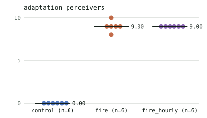
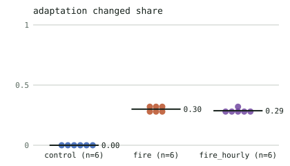
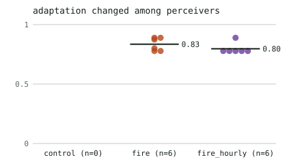
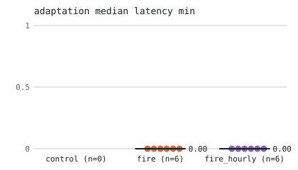
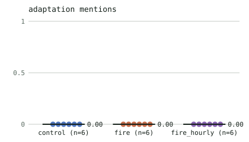
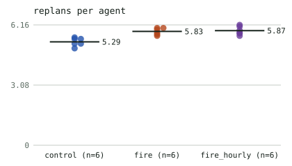
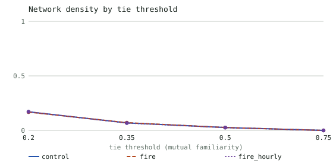
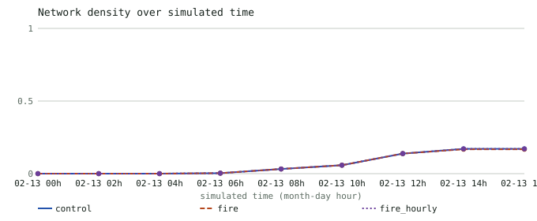

# Experiment: adaptation_fork_v2

When a fire breaks out in a busy cafe at lunch, how many of 25 residents perceive it, how many of them change plans and how fast, does word reach the rest of the town, and does an hourly-only planner adapt differently?

**Hypothesis (fixed before running):** H1: several residents perceive the fire (more than the single perceiver of round one) and the number varies between seeds, because each seed has its own morning. H2: the share of residents who change plans is higher in `fire` than in `control`. H3: the hourly-only planner changes plans as often as the full hierarchy (difference under 0.05) with fewer model calls. H4 (fixture prediction): no conversation mentions the fire, because the mock never retells an observed event; a real model is needed to move this measure.

> **MOCK RUNS.** These numbers exercise the pipeline with the offline mock; they say nothing about reflection.

## Conditions

* `control`: `scenario.end=2023-02-13T16:30:00`
* `fire`: `scenario.end=2023-02-13T16:30:00`; interventions: 2
* `fire_hourly`: `scenario.end=2023-02-13T16:30:00`, `planning.decompose=false`; interventions: 2

Every run is a fork of `runs/experiments/adaptation_fork_v2_sources/s{seed}` at snapshot `2023-02-13T12-30-00`: each seed has its own recorded past, and the conditions of one seed share that past and differ only after the fork point.

Seeds [221, 222, 223, 224, 225, 226]. Runs are matched by seed; a hosted model does not reproduce identical samples, so matching is of the initial world, not of the randomness. Metrics: adaptation, behavior, beliefs, network, usage.

Determinism check: the first configuration was run twice; committed state tables were **identical** (same seed and configuration run twice; state tables memories, plans, conversations, agent_state, spatial_memory, world_objects, relationships).

Each run links to its evaluation report when the `evaluation` metric ran.

| Run | Condition | Seed | Status | Agents who perceived the event | Agents who changed plans (share) | Changed plans among perceivers | Median adaptation latency (min) | Conversations mentioning the event | Replans per agent | Calls | Runtime (s) |
| --- | --- | --- | --- | --- | --- | --- | --- | --- | --- | --- | --- |
| control-s221 | control | 221 | completed | 0 | 0 | n/a | n/a | 0 | 5.2 | 2803 | 18.6 |
| fire-s221 | fire | 221 | completed | 9 | 0.32 | 0.889 | 0 | 0 | 5.68 | 3181 | 20.7 |
| fire_hourly-s221 | fire_hourly | 221 | completed | 9 | 0.28 | 0.778 | 0 | 0 | 5.76 | 1740 | 17.2 |
| control-s222 | control | 222 | completed | 0 | 0 | n/a | n/a | 0 | 5.44 | 2920 | 19.4 |
| fire-s222 | fire | 222 | completed | 9 | 0.28 | 0.778 | 0 | 0 | 5.92 | 3527 | 21.5 |
| fire_hourly-s222 | fire_hourly | 222 | completed | 9 | 0.28 | 0.778 | 0 | 0 | 6.08 | 2125 | 20 |
| control-s223 | control | 223 | completed | 0 | 0 | n/a | n/a | 0 | 5.52 | 2819 | 20.7 |
| fire-s223 | fire | 223 | completed | 10 | 0.32 | 0.8 | 0 | 0 | 6 | 3460 | 21.3 |
| fire_hourly-s223 | fire_hourly | 223 | completed | 9 | 0.28 | 0.778 | 0 | 0 | 5.88 | 1861 | 17.1 |
| control-s224 | control | 224 | completed | 0 | 0 | n/a | n/a | 0 | 4.96 | 3075 | 20.2 |
| fire-s224 | fire | 224 | completed | 9 | 0.28 | 0.778 | 0 | 0 | 5.76 | 3613 | 22.9 |
| fire_hourly-s224 | fire_hourly | 224 | completed | 9 | 0.28 | 0.778 | 0 | 0 | 5.72 | 2086 | 19.3 |
| control-s225 | control | 225 | completed | 0 | 0 | n/a | n/a | 0 | 5.2 | 2730 | 17.2 |
| fire-s225 | fire | 225 | completed | 8 | 0.28 | 0.875 | 0 | 0 | 5.6 | 3185 | 20.2 |
| fire_hourly-s225 | fire_hourly | 225 | completed | 9 | 0.32 | 0.889 | 0 | 0 | 5.6 | 1692 | 16.7 |
| control-s226 | control | 226 | completed | 0 | 0 | n/a | n/a | 0 | 5.44 | 2647 | 16.7 |
| fire-s226 | fire | 226 | completed | 9 | 0.32 | 0.889 | 0 | 0 | 6 | 3319 | 17.2 |
| fire_hourly-s226 | fire_hourly | 226 | completed | 9 | 0.28 | 0.778 | 0 | 0 | 6.16 | 2018 | 14.4 |

## By condition

| Outcome | control | fire | fire_hourly |
| --- | --- | --- | --- |
| **Agents who perceived the event** | 0 ± 0 (median 0; 0–0; 95% CI 0 to 0; n=6) | 9 ± 0.632 (median 9; 8–10; 95% CI 8.5 to 9.5; n=6) | 9 ± 0 (median 9; 9–9; 95% CI 9 to 9; n=6) |
| **Agents who changed plans (share)** | 0 ± 0 (median 0; 0–0; 95% CI 0 to 0; n=6) | 0.3 ± 0.022 (median 0.3; 0.28–0.32; 95% CI 0.287 to 0.313; n=6) | 0.287 ± 0.016 (median 0.28; 0.28–0.32; 95% CI 0.28 to 0.3; n=6) |
| **Changed plans among perceivers** | n/a | 0.835 ± 0.055 (median 0.8375; 0.778–0.889; 95% CI 0.796 to 0.872; n=6) | 0.796 ± 0.045 (median 0.778; 0.778–0.889; 95% CI 0.778 to 0.834; n=6) |
| **Median adaptation latency (min)** | n/a | 0 ± 0 (median 0; 0–0; 95% CI 0 to 0; n=6) | 0 ± 0 (median 0; 0–0; 95% CI 0 to 0; n=6) |
| **Conversations mentioning the event** | 0 ± 0 (median 0; 0–0; 95% CI 0 to 0; n=6) | 0 ± 0 (median 0; 0–0; 95% CI 0 to 0; n=6) | 0 ± 0 (median 0; 0–0; 95% CI 0 to 0; n=6) |
| **Replans per agent** | 5.293 ± 0.211 (median 5.32; 4.96–5.52; 95% CI 5.12 to 5.44; n=6) | 5.827 ± 0.171 (median 5.84; 5.6–6; 95% CI 5.693 to 5.947; n=6) | 5.867 ± 0.217 (median 5.82; 5.6–6.16; 95% CI 5.707 to 6.027; n=6) |
| adaptation agents mentioning | 0 ± 0 (median 0; 0–0; 95% CI 0 to 0; n=6) | 0 ± 0 (median 0; 0–0; 95% CI 0 to 0; n=6) | 0 ± 0 (median 0; 0–0; 95% CI 0 to 0; n=6) |
| Scheduled share of actions | 0.73 ± 0.009 (median 0.73165; 0.7179–0.7407; 95% CI 0.723 to 0.736; n=6) | 0.721 ± 0.006 (median 0.72165; 0.7147–0.73; 95% CI 0.717 to 0.726; n=6) | 0.646 ± 0.008 (median 0.64525; 0.6342–0.657; 95% CI 0.64 to 0.653; n=6) |
| Plan adherence (hour blocks followed) | 1 ± 0 (median 1; 1–1; 95% CI 1 to 1; n=6) | 1 ± 0 (median 1; 1–1; 95% CI 1 to 1; n=6) | 1 ± 0 (median 1; 1–1; 95% CI 1 to 1; n=6) |
| Idle share | 0 ± 0 (median 0; 0–0; 95% CI 0 to 0; n=6) | 0 ± 0 (median 0; 0–0; 95% CI 0 to 0; n=6) | 0 ± 0 (median 0; 0–0; 95% CI 0 to 0; n=6) |
| Reaction rate (non-continue) | 0.312 ± 0.035 (median 0.312; 0.2622–0.3656; 95% CI 0.285 to 0.338; n=6) | 0.29 ± 0.012 (median 0.29305; 0.2723–0.304; 95% CI 0.28 to 0.298; n=6) | 0.299 ± 0.019 (median 0.3073; 0.2734–0.3147; 95% CI 0.285 to 0.312; n=6) |
| Conversations per agent | 5.293 ± 0.211 (median 5.32; 4.96–5.52; 95% CI 5.12 to 5.44; n=6) | 5.267 ± 0.171 (median 5.28; 5.04–5.44; 95% CI 5.133 to 5.387; n=6) | 5.32 ± 0.213 (median 5.28; 5.04–5.6; 95% CI 5.16 to 5.467; n=6) |
| action failures | 0 ± 0 (median 0; 0–0; 95% CI 0 to 0; n=6) | 0 ± 0 (median 0; 0–0; 95% CI 0 to 0; n=6) | 0 ± 0 (median 0; 0–0; 95% CI 0 to 0; n=6) |
| constraint refusals | 0 ± 0 (median 0; 0–0; 95% CI 0 to 0; n=6) | 0.167 ± 0.408 (median 0; 0–1; 95% CI 0 to 0.5; n=6) | 0.167 ± 0.408 (median 0; 0–1; 95% CI 0 to 0.5; n=6) |
| plan failures | 0 ± 0 (median 0; 0–0; 95% CI 0 to 0; n=6) | 0 ± 0 (median 0; 0–0; 95% CI 0 to 0; n=6) | 0 ± 0 (median 0; 0–0; 95% CI 0 to 0; n=6) |
| valentines holders pct | 34 ± 10.354 (median 34; 16–44; 95% CI 25.333 to 40.667; n=6) | 34 ± 11.243 (median 32; 16–48; 95% CI 24 to 42; n=6) | 34.667 ± 10.633 (median 36; 16–48; 95% CI 26 to 42; n=6) |
| valentines knowledge coverage | 0.094 ± 0.019 (median 0.099; 0.062–0.114; 95% CI 0.08 to 0.107; n=6) | 0.093 ± 0.019 (median 0.099; 0.062–0.114; 95% CI 0.08 to 0.106; n=6) | 0.098 ± 0.022 (median 0.103; 0.062–0.118; 95% CI 0.081 to 0.113; n=6) |
| valentines conflicting details | 0 ± 0 (median 0; 0–0; 95% CI 0 to 0; n=6) | 0 ± 0 (median 0; 0–0; 95% CI 0 to 0; n=6) | 0 ± 0 (median 0; 0–0; 95% CI 0 to 0; n=6) |
| mayor holders pct | 11.333 ± 3.011 (median 12; 8–16; 95% CI 9.333 to 13.333; n=6) | 11.333 ± 3.011 (median 12; 8–16; 95% CI 9.333 to 13.333; n=6) | 11.333 ± 3.011 (median 12; 8–16; 95% CI 9.333 to 13.333; n=6) |
| mayor knowledge coverage | 0.064 ± 0.011 (median 0.059; 0.056–0.083; 95% CI 0.057 to 0.073; n=6) | 0.063 ± 0.007 (median 0.062; 0.056–0.073; 95% CI 0.058 to 0.068; n=6) | 0.065 ± 0.011 (median 0.062; 0.056–0.083; 95% CI 0.058 to 0.073; n=6) |
| mayor conflicting details | 0 ± 0 (median 0; 0–0; 95% CI 0 to 0; n=6) | 0 ± 0 (median 0; 0–0; 95% CI 0 to 0; n=6) | 0 ± 0 (median 0; 0–0; 95% CI 0 to 0; n=6) |
| Network density (mutual ties) | 0.171 ± 0.008 (median 0.1717; 0.16–0.18; 95% CI 0.164 to 0.176; n=6) | 0.168 ± 0.007 (median 0.17; 0.16–0.1733; 95% CI 0.162 to 0.172; n=6) | 0.171 ± 0.009 (median 0.16665; 0.1633–0.1833; 95% CI 0.163 to 0.177; n=6) |
| network edges | 51.167 ± 2.483 (median 51.5; 48–54; 95% CI 49.333 to 52.833; n=6) | 50.333 ± 1.966 (median 51; 48–52; 95% CI 48.667 to 51.667; n=6) | 51.167 ± 2.714 (median 50; 49–55; 95% CI 49 to 53.167; n=6) |
| Network components | 6 ± 0 (median 6; 6–6; 95% CI 6 to 6; n=6) | 6 ± 0 (median 6; 6–6; 95% CI 6 to 6; n=6) | 6 ± 0 (median 6; 6–6; 95% CI 6 to 6; n=6) |
| network largest component | 16 ± 0 (median 16; 16–16; 95% CI 16 to 16; n=6) | 16 ± 0 (median 16; 16–16; 95% CI 16 to 16; n=6) | 16 ± 0 (median 16; 16–16; 95% CI 16 to 16; n=6) |
| network isolates | 4 ± 0 (median 4; 4–4; 95% CI 4 to 4; n=6) | 4 ± 0 (median 4; 4–4; 95% CI 4 to 4; n=6) | 4 ± 0 (median 4; 4–4; 95% CI 4 to 4; n=6) |
| Reciprocity | 1 ± 0 (median 1; 1–1; 95% CI 1 to 1; n=6) | 1 ± 0 (median 1; 1–1; 95% CI 1 to 1; n=6) | 1 ± 0 (median 1; 1–1; 95% CI 1 to 1; n=6) |
| Clustering | 0.657 ± 0.031 (median 0.65405; 0.618–0.6932; 95% CI 0.633 to 0.679; n=6) | 0.649 ± 0.033 (median 0.6486; 0.6071–0.6832; 95% CI 0.624 to 0.672; n=6) | 0.662 ± 0.04 (median 0.648; 0.6232–0.7177; 95% CI 0.632 to 0.691; n=6) |
| Weighted density (mean mutual familiarity over all pairs) | 0.063 ± 0.002 (median 0.06275; 0.0593–0.0649; 95% CI 0.061 to 0.064; n=6) | 0.062 ± 0.002 (median 0.0622; 0.0593–0.0636; 95% CI 0.06 to 0.063; n=6) | 0.062 ± 0.003 (median 0.0621; 0.0583–0.0654; 95% CI 0.06 to 0.064; n=6) |
| Pairs who talked (share of all pairs) | 0.171 ± 0.008 (median 0.1717; 0.16–0.18; 95% CI 0.164 to 0.176; n=6) | 0.168 ± 0.007 (median 0.17; 0.16–0.1733; 95% CI 0.162 to 0.172; n=6) | 0.171 ± 0.009 (median 0.16665; 0.1633–0.1833; 95% CI 0.163 to 0.177; n=6) |
| Degree inequality (Gini) | 0.36 ± 0.009 (median 0.3617; 0.3464–0.3683; 95% CI 0.353 to 0.366; n=6) | 0.36 ± 0.007 (median 0.3602; 0.3525–0.3669; 95% CI 0.355 to 0.365; n=6) | 0.364 ± 0.011 (median 0.36235; 0.351–0.3782; 95% CI 0.356 to 0.372; n=6) |
| Mean familiarity | 0.317 ± 0.009 (median 0.318; 0.3014–0.3274; 95% CI 0.31 to 0.323; n=6) | 0.319 ± 0.008 (median 0.32115; 0.307–0.3281; 95% CI 0.312 to 0.324; n=6) | 0.322 ± 0.007 (median 0.32135; 0.3126–0.3306; 95% CI 0.317 to 0.326; n=6) |
| Mean valence | n/a | n/a | n/a |
| relationship records | 118.333 ± 1.966 (median 118; 116–122; 95% CI 117 to 120; n=6) | 116.667 ± 1.633 (median 117; 114–118; 95% CI 115.333 to 117.667; n=6) | 116 ± 3.347 (median 117; 112–120; 95% CI 113.333 to 118.333; n=6) |
| Density at tie threshold 0.20 | 0.171 ± 0.008 (median 0.1717; 0.16–0.18; 95% CI 0.164 to 0.176; n=6) | 0.168 ± 0.007 (median 0.17; 0.16–0.1733; 95% CI 0.162 to 0.172; n=6) | 0.171 ± 0.009 (median 0.16665; 0.1633–0.1833; 95% CI 0.163 to 0.177; n=6) |
| Density at tie threshold 0.35 | 0.069 ± 0.003 (median 0.07; 0.0633–0.0733; 95% CI 0.066 to 0.071; n=6) | 0.071 ± 0.002 (median 0.07; 0.07–0.0733; 95% CI 0.07 to 0.072; n=6) | 0.068 ± 0.007 (median 0.07; 0.0567–0.0733; 95% CI 0.062 to 0.072; n=6) |
| Density at tie threshold 0.50 | 0.027 ± 0.002 (median 0.0267; 0.0233–0.03; 95% CI 0.025 to 0.028; n=6) | 0.027 ± 0.002 (median 0.0267; 0.0233–0.03; 95% CI 0.025 to 0.028; n=6) | 0.026 ± 0.003 (median 0.0267; 0.0233–0.03; 95% CI 0.024 to 0.028; n=6) |
| Density at tie threshold 0.75 | 0 ± 0 (median 0; 0–0; 95% CI 0 to 0; n=6) | 0 ± 0 (median 0; 0–0; 95% CI 0 to 0; n=6) | 0 ± 0 (median 0; 0–0; 95% CI 0 to 0; n=6) |
| Model calls | 2,832 ± 149.954 (median 2,811; 2,647–3,075; 95% CI 2,730 to 2,949; n=6) | 3,381 ± 180.909 (median 3,390; 3,181–3,613; 95% CI 3,252 to 3,513; n=6) | 1,920 ± 182.784 (median 1,940; 1,692–2,125; 95% CI 1,782 to 2,045; n=6) |
| Input tokens | 1,615,822 ± 79,193 (median 1,620,480; 1,519,087–1,736,889; 95% CI 1,560,049 to 1,676,486; n=6) | 1,901,665 ± 98,912 (median 1,911,845; 1,759,848–2,006,676; 95% CI 1,829,875 to 1,969,430; n=6) | 1,097,795 ± 114,664 (median 1,101,973; 939,954–1,243,231; 95% CI 1,011,806 to 1,176,726; n=6) |
| Output tokens | 83,338 ± 3,490 (median 83,957; 78,234–88,370; 95% CI 80,830 to 85,848; n=6) | 94,125 ± 4,481 (median 94,332; 88,377–99,789; 95% CI 90,945 to 97,332; n=6) | 43,054 ± 4,202 (median 43,340; 37,122–48,478; 95% CI 39,760 to 45,847; n=6) |
| Cost (USD) | unpriced | unpriced | unpriced |
| Runtime (s) | 18.8 ± 1.609 (median 19; 16.7–20.7; 95% CI 17.633 to 19.967; n=6) | 20.633 ± 1.914 (median 21; 17.2–22.9; 95% CI 19.083 to 21.9; n=6) | 17.45 ± 1.999 (median 17.15; 14.4–20; 95% CI 16.05 to 18.85; n=6) |

Mean ± SD (median; range; bootstrap 95% interval of the mean from three runs up; runs with a value). Primary outcomes, fixed in the protocol before running, are in bold.

## Planned contrasts (registered with the hypothesis)

| Contrast | Mean a | Mean b | a − b | Direction as predicted | Seeds agreeing | d_z | Paired p | Holm p |
| --- | --- | --- | --- | --- | --- | --- | --- | --- |
| H1 perceivers: fire > control | 9 | 0 | 9 | yes | 6 of 6 | 14.23 | 0.03125 | 0.15625 |
| H2 share who changed plans: fire > control | 0.3 | 0 | 0.3 | yes | 6 of 6 | 13.693 | 0.03125 | 0.15625 |
| H3 share who changed plans: hourly-only = full hierarchy (within ±0.05) | 0.2867 | 0.3 | -0.0133 | yes | n/a | -0.408 | 0.625 | 1 |
| H3 model calls: hourly-only < full hierarchy | 1920.33 | 3380.83 | -1460.5 | yes | 6 of 6 | -14.066 | 0.03125 | 0.15625 |
| H4 conversations mentioning the fire: fire = control (within ±0) | 0 | 0 | 0 | yes | n/a | same on every seed | 1 | 1 |

Paired by seed (exact sign-flip permutation; smallest possible p = 0.03125), Holm-adjusted over these 5 contrasts only. "Direction as predicted" compares the observed mean difference with the registered expectation; for an expected equality it checks the stated band.

## Comparisons (exploratory)

* **adaptation_perceivers (control vs fire)**: control - fire = -9 (bootstrap 95% CI (-9.5, -8.5), exact permutation p = 0.0022, smallest possible 0.00216, n = [6, 6]); paired by seed: mean difference -9 over 6 seeds (6 in the direction of the mean), d_z = -14.23, exact sign-flip p = 0.03125 (smallest possible 0.03125; Holm-adjusted 0.4375)
* **adaptation_changed_share (control vs fire)**: control - fire = -0.3 (bootstrap 95% CI (-0.313, -0.287), exact permutation p = 0.0022, smallest possible 0.00216, n = [6, 6]); paired by seed: mean difference -0.3 over 6 seeds (6 in the direction of the mean), d_z = -13.693, exact sign-flip p = 0.03125 (smallest possible 0.03125; Holm-adjusted 0.4375)
* **adaptation_changed_among_perceivers (control vs fire)**: control - fire = None (bootstrap 95% CI None, exact permutation p = None, n = [0, 6])
* **adaptation_median_latency_min (control vs fire)**: control - fire = None (bootstrap 95% CI None, exact permutation p = None, n = [0, 6])
* **adaptation_mentions (control vs fire)**: control - fire = 0 (bootstrap 95% CI (0, 0), exact permutation p = 1.0, smallest possible 0.00216, n = [6, 6]); paired by seed: mean difference 0 over 6 seeds (0 in the direction of the mean), d_z = undefined (identical difference on every seed), all differences are zero p = 1.0 (smallest possible 0.03125; Holm-adjusted 1.0). **No between-seed variation in either condition: the seeds are copies here, so these p-values describe determinism, not sampling.**
* **replans_per_agent (control vs fire)**: control - fire = -0.533 (bootstrap 95% CI (-0.733, -0.347), exact permutation p = 0.0022, smallest possible 0.00216, n = [6, 6]); paired by seed: mean difference -0.5333 over 6 seeds (6 in the direction of the mean), d_z = -3.807, exact sign-flip p = 0.03125 (smallest possible 0.03125; Holm-adjusted 0.4375)
* **adaptation_perceivers (control vs fire_hourly)**: control - fire_hourly = -9 (bootstrap 95% CI (-9, -9), exact permutation p = 0.0022, smallest possible 0.00216, n = [6, 6]); paired by seed: mean difference -9 over 6 seeds (6 in the direction of the mean), d_z = undefined (identical difference on every seed), exact sign-flip p = 0.03125 (smallest possible 0.03125; Holm-adjusted 0.4375). **No between-seed variation in either condition: the seeds are copies here, so these p-values describe determinism, not sampling.**
* **adaptation_changed_share (control vs fire_hourly)**: control - fire_hourly = -0.287 (bootstrap 95% CI (-0.3, -0.28), exact permutation p = 0.0022, smallest possible 0.00216, n = [6, 6]); paired by seed: mean difference -0.2867 over 6 seeds (6 in the direction of the mean), d_z = -17.555, exact sign-flip p = 0.03125 (smallest possible 0.03125; Holm-adjusted 0.4375)
* **adaptation_changed_among_perceivers (control vs fire_hourly)**: control - fire_hourly = None (bootstrap 95% CI None, exact permutation p = None, n = [0, 6])
* **adaptation_median_latency_min (control vs fire_hourly)**: control - fire_hourly = None (bootstrap 95% CI None, exact permutation p = None, n = [0, 6])
* **adaptation_mentions (control vs fire_hourly)**: control - fire_hourly = 0 (bootstrap 95% CI (0, 0), exact permutation p = 1.0, smallest possible 0.00216, n = [6, 6]); paired by seed: mean difference 0 over 6 seeds (0 in the direction of the mean), d_z = undefined (identical difference on every seed), all differences are zero p = 1.0 (smallest possible 0.03125; Holm-adjusted 1.0). **No between-seed variation in either condition: the seeds are copies here, so these p-values describe determinism, not sampling.**
* **replans_per_agent (control vs fire_hourly)**: control - fire_hourly = -0.573 (bootstrap 95% CI (-0.807, -0.36), exact permutation p = 0.0022, smallest possible 0.00216, n = [6, 6]); paired by seed: mean difference -0.5733 over 6 seeds (6 in the direction of the mean), d_z = -3.47, exact sign-flip p = 0.03125 (smallest possible 0.03125; Holm-adjusted 0.4375)
* **adaptation_perceivers (fire vs fire_hourly)**: fire - fire_hourly = 0 (bootstrap 95% CI (-0.5, 0.5), exact permutation p = 1.0, smallest possible 0.00216, n = [6, 6]); paired by seed: mean difference 0 over 6 seeds (1 in the direction of the mean), d_z = 0.0, exact sign-flip p = 1.0 (smallest possible 0.03125; Holm-adjusted 1.0)
* **adaptation_changed_share (fire vs fire_hourly)**: fire - fire_hourly = 0.013 (bootstrap 95% CI (-0.007, 0.033), exact permutation p = 0.5455, smallest possible 0.00216, n = [6, 6]); paired by seed: mean difference 0.0133 over 6 seeds (3 in the direction of the mean), d_z = 0.408, exact sign-flip p = 0.625 (smallest possible 0.03125; Holm-adjusted 1.0)
* **adaptation_changed_among_perceivers (fire vs fire_hourly)**: fire - fire_hourly = 0.038 (bootstrap 95% CI (-0.017, 0.09), exact permutation p = 0.2424, smallest possible 0.00216, n = [6, 6]); paired by seed: mean difference 0.0383 over 6 seeds (3 in the direction of the mean), d_z = 0.667, exact sign-flip p = 0.25 (smallest possible 0.03125; Holm-adjusted 1.0)
* **adaptation_median_latency_min (fire vs fire_hourly)**: fire - fire_hourly = 0.0 (bootstrap 95% CI (0.0, 0.0), exact permutation p = 1.0, smallest possible 0.00216, n = [6, 6]); paired by seed: mean difference 0.0 over 6 seeds (0 in the direction of the mean), d_z = undefined (identical difference on every seed), all differences are zero p = 1.0 (smallest possible 0.03125; Holm-adjusted 1.0). **No between-seed variation in either condition: the seeds are copies here, so these p-values describe determinism, not sampling.**
* **adaptation_mentions (fire vs fire_hourly)**: fire - fire_hourly = 0 (bootstrap 95% CI (0, 0), exact permutation p = 1.0, smallest possible 0.00216, n = [6, 6]); paired by seed: mean difference 0 over 6 seeds (0 in the direction of the mean), d_z = undefined (identical difference on every seed), all differences are zero p = 1.0 (smallest possible 0.03125; Holm-adjusted 1.0). **No between-seed variation in either condition: the seeds are copies here, so these p-values describe determinism, not sampling.**
* **replans_per_agent (fire vs fire_hourly)**: fire - fire_hourly = -0.04 (bootstrap 95% CI (-0.253, 0.153), exact permutation p = 0.7597, smallest possible 0.00216, n = [6, 6]); paired by seed: mean difference -0.04 over 6 seeds (3 in the direction of the mean), d_z = -0.354, exact sign-flip p = 0.5 (smallest possible 0.03125; Holm-adjusted 1.0)

Paired p-values are Holm-adjusted over the 14 primary comparisons of this protocol. All tests are two-sided and descriptive.

One dot per run; the bar is the condition mean.

## Detail: the network at every threshold

Means over the runs of a condition. A tie is mutual familiarity at or above the threshold.

**Density by tie threshold**

| Condition | ≥ 0.2 | ≥ 0.35 | ≥ 0.5 | ≥ 0.75 |
| --- | --- | --- | --- | --- |
| control | 0.171 | 0.069 | 0.027 | 0.000 |
| fire | 0.168 | 0.071 | 0.027 | 0.000 |
| fire_hourly | 0.171 | 0.068 | 0.026 | 0.000 |

**Largest component (agents) and number of components by tie threshold**

| Condition | ≥ 0.2 | ≥ 0.35 | ≥ 0.5 | ≥ 0.75 |
| --- | --- | --- | --- | --- |
| control | 16.0 / 6.0 | 13.5 / 9.2 | 4.7 / 17.8 | 1.0 / 25.0 |
| fire | 16.0 / 6.0 | 14.7 / 9.0 | 4.7 / 17.8 | 1.0 / 25.0 |
| fire_hourly | 16.0 / 6.0 | 14.3 / 9.3 | 4.7 / 17.8 | 1.0 / 25.0 |

**Clustering against a random graph of the same density** (average local clustering / density; in a random graph the two are equal in expectation, so a ratio above 1 means more closed triangles than chance)

| Condition | ≥ 0.2 | ≥ 0.35 | ≥ 0.5 | ≥ 0.75 |
| --- | --- | --- | --- | --- |
| control | 0.66 / 0.17 = 3.9× | 0.42 / 0.07 = 6.1× | 0.40 / 0.03 = 14.9× | n/a |
| fire | 0.65 / 0.17 = 3.9× | 0.44 / 0.07 = 6.1× | 0.40 / 0.03 = 14.9× | n/a |
| fire_hourly | 0.66 / 0.17 = 3.9× | 0.42 / 0.07 = 6.2× | 0.32 / 0.03 = 12.3× | n/a |

**Measures without a threshold**

| Condition | Weighted density | Pairs who talked | Mean familiarity (records) | Degree Gini at the configured threshold | Relationship records |
| --- | --- | --- | --- | --- | --- |
| control | 0.063 | 0.171 | 0.317 | 0.360 | 118 |
| fire | 0.062 | 0.168 | 0.319 | 0.360 | 117 |
| fire_hourly | 0.062 | 0.171 | 0.322 | 0.364 | 116 |

**Density at the configured threshold over simulated time**

| Condition | 02-13 00h | 02-13 02h | 02-13 04h | 02-13 06h | 02-13 08h | 02-13 10h | 02-13 12h | 02-13 14h | 02-13 16h |
| --- | --- | --- | --- | --- | --- | --- | --- | --- | --- |
| control | 0.000 | 0.000 | 0.000 | 0.003 | 0.032 | 0.058 | 0.138 | 0.171 | 0.171 |
| fire | 0.000 | 0.000 | 0.000 | 0.003 | 0.032 | 0.058 | 0.138 | 0.168 | 0.168 |
| fire_hourly | 0.000 | 0.000 | 0.000 | 0.003 | 0.032 | 0.058 | 0.138 | 0.171 | 0.171 |

## Detail: who perceived the event and who changed course

| Run | Perceivers | Who | Changed plans | Latencies from the event's start (min) | Reaction times from first perceiving it (min) | Perceived it later than the first minute | Conversations mentioning it | First mention |
| --- | --- | --- | --- | --- | --- | --- | --- | --- |
| control-s221 | 0 | none | 0 | n/a | n/a | 0 | 0 |  |
| fire-s221 | 9 | isabella, klaus, maria, wolfgang, john, eddy, tom, jane, sam | 8 | 0, 0, 0, 0, 0, 36.7, 37.2, 40.7 | 0, 0, 0, 0, 0, 0, 0, 0 | 4 | 0 |  |
| fire_hourly-s221 | 9 | isabella, klaus, maria, wolfgang, john, eddy, tom, jane, sam | 7 | 0, 0, 0, 0, 0, 41, 43.7 | 0, 0, 0, 0, 0, 0, 0.2 | 4 | 0 |  |
| control-s222 | 0 | none | 0 | n/a | n/a | 0 | 0 |  |
| fire-s222 | 9 | isabella, klaus, maria, john, eddy, tom, jane, carmen, sam | 7 | 0, 0, 0, 0, 0, 45, 45 | 0, 0, 0, 0, 0, 0, 0 | 4 | 0 |  |
| fire_hourly-s222 | 9 | isabella, klaus, maria, john, eddy, tom, jane, carmen, sam | 7 | 0, 0, 0, 0, 0, 37.7, 38 | 0, 0, 0, 0, 0, 0, 0 | 4 | 0 |  |
| control-s223 | 0 | none | 0 | n/a | n/a | 0 | 0 |  |
| fire-s223 | 10 | isabella, klaus, maria, wolfgang, john, eddy, tom, jane, carmen, sam | 8 | 0, 0, 0, 0, 0, 38.8, 38.8, 45 | 0, 0, 0, 0, 0, 0, 0, 0 | 5 | 0 |  |
| fire_hourly-s223 | 9 | isabella, klaus, maria, john, eddy, tom, jane, carmen, sam | 7 | 0, 0, 0, 0, 0, 42, 42.3 | 0, 0, 0, 0, 0, 0, 0 | 4 | 0 |  |
| control-s224 | 0 | none | 0 | n/a | n/a | 0 | 0 |  |
| fire-s224 | 9 | isabella, klaus, maria, wolfgang, john, eddy, tom, jane, sam | 7 | 0, 0, 0, 0, 0, 39.5, 43 | 0, 0, 0, 0, 0, 0, 3 | 4 | 0 |  |
| fire_hourly-s224 | 9 | isabella, klaus, maria, john, eddy, tom, jane, sam, jennifer | 7 | 0, 0, 0, 0, 0, 37.7, 40.2 | 0, 0, 0, 0, 0, 0, 0 | 4 | 0 |  |
| control-s225 | 0 | none | 0 | n/a | n/a | 0 | 0 |  |
| fire-s225 | 8 | isabella, klaus, maria, john, eddy, tom, jane, sam | 7 | 0, 0, 0, 0, 0, 37, 40.5 | 0, 0, 0, 0, 0, 0, 0 | 3 | 0 |  |
| fire_hourly-s225 | 9 | isabella, klaus, maria, wolfgang, john, eddy, tom, jane, sam | 8 | 0, 0, 0, 0, 0, 36, 39.7, 40.5 | 0, 0, 0, 0, 0, 0, 0, 0 | 4 | 0 |  |
| control-s226 | 0 | none | 0 | n/a | n/a | 0 | 0 |  |
| fire-s226 | 9 | isabella, klaus, maria, wolfgang, john, eddy, tom, jane, sam | 8 | 0, 0, 0, 0, 0, 37.7, 38.5, 40.2 | 0, 0, 0, 0, 0, 0, 0, 2 | 4 | 0 |  |
| fire_hourly-s226 | 9 | isabella, klaus, maria, wolfgang, john, eddy, tom, jane, sam | 7 | 0, 0, 0, 0, 0, 42.3, 44.2 | 0, 0, 0, 0, 0, 0, 1.4 | 4 | 0 |  |

A latency counts from the start of the event, so it includes the time an agent took to arrive; the reaction time counts from that agent's own first perception.

_Run modes: mock × 18._

Simulated characters: plausible behavior here does not establish validity for real people.
