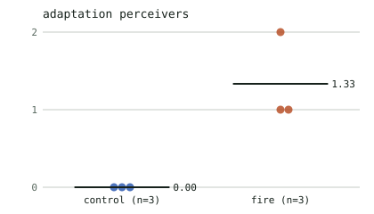
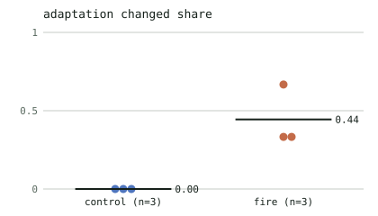
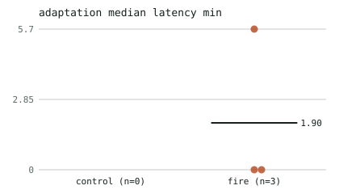
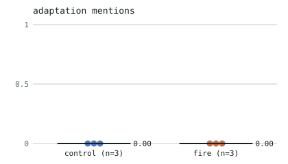
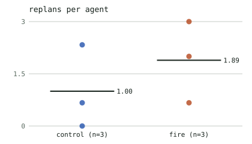
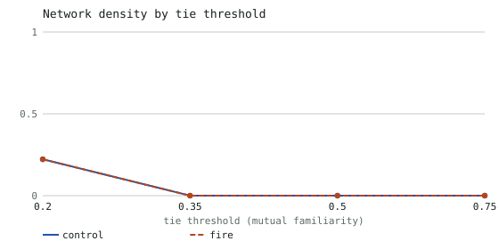
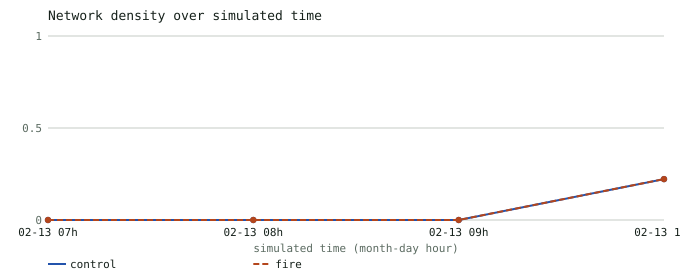

# Experiment: fire_llama32

With a real local model, does a resident who sees a fire in her cafe change course, how fast, does the change last while the fire burns, and does she report it afterwards? How much do three sampled futures of one recorded morning differ?

**Hypothesis (fixed before running):** H1 (manipulation check): Isabella, who is behind the cafe counter at the fork point, perceives the fire in every fire fork; nobody perceives one in control. H2: more residents change plans in `fire` than in `control`. H3: unlike the mock, the model's reaction is not guaranteed; we predict a reaction that names the fire in at least two of the three fire forks, within ten minutes of the fire's start. H4 (report): asked at the end of each fork what happened at the cafe that morning, Isabella mentions the fire in the fire forks and in no control fork. Conversations mentioning the fire are counted without a prediction: with three residents and fifty minutes, conversations are rare.

## Conditions

* `control`: `scenario.end=2023-02-13T10:00:00`
* `fire`: `scenario.end=2023-02-13T10:00:00`; interventions: 2

Every run is a fork of `runs/llama_fire_source` at snapshot `fork`: the same past, different futures.

Seeds [1, 2, 3]. Runs are matched by seed; a hosted model does not reproduce identical samples, so matching is of the initial world, not of the randomness. Metrics: adaptation, behavior, beliefs, network, usage.

Each run links to its evaluation report when the `evaluation` metric ran.

| Run | Condition | Seed | Status | Agents who perceived the event | Agents who changed plans (share) | Median adaptation latency (min) | Conversations mentioning the event | Replans per agent | Calls | Runtime (s) |
| --- | --- | --- | --- | --- | --- | --- | --- | --- | --- | --- |
| control-s1 | control | 1 | completed | 0 | 0 | n/a | 0 | 0.667 | 158 | 1416.7 |
| fire-s1 | fire | 1 | completed | 2 | 0.667 | 5.7 | 0 | 2 | 186 | 1763.6 |
| control-s2 | control | 2 | completed | 0 | 0 | n/a | 0 | 2.333 | 127 | 1284.2 |
| fire-s2 | fire | 2 | completed | 1 | 0.333 | 0 | 0 | 3 | 204 | 1761.1 |
| control-s3 | control | 3 | completed | 0 | 0 | n/a | 0 | 0 | 19 | 266.7 |
| fire-s3 | fire | 3 | completed | 1 | 0.333 | 0 | 0 | 0.667 | 47 | 440.9 |

## By condition

| Outcome | control | fire |
| --- | --- | --- |
| **Agents who perceived the event** | 0 ± 0 (median 0; 0–0; 95% CI 0 to 0; n=3) | 1.333 ± 0.577 (median 1; 1–2; 95% CI 1 to 2; n=3) |
| **Agents who changed plans (share)** | 0 ± 0 (median 0; 0–0; 95% CI 0 to 0; n=3) | 0.444 ± 0.193 (median 0.333; 0.333–0.667; 95% CI 0.333 to 0.667; n=3) |
| **Median adaptation latency (min)** | n/a | 1.9 ± 3.291 (median 0; 0–5.7; 95% CI 0 to 5.7; n=3) |
| **Conversations mentioning the event** | 0 ± 0 (median 0; 0–0; 95% CI 0 to 0; n=3) | 0 ± 0 (median 0; 0–0; 95% CI 0 to 0; n=3) |
| **Replans per agent** | 1 ± 1.202 (median 0.667; 0–2.333; 95% CI 0 to 2.333; n=3) | 1.889 ± 1.17 (median 2; 0.667–3; 95% CI 0.667 to 3; n=3) |
| Changed plans among perceivers | n/a | 1 ± 0 (median 1; 1–1; 95% CI 1 to 1; n=3) |
| Median reaction time after first perceiving it (min) | n/a | 0.067 ± 0.115 (median 0; 0–0.2; 95% CI 0 to 0.2; n=3) |
| Agents who perceived the event in its first minute | 0 ± 0 (median 0; 0–0; 95% CI 0 to 0; n=3) | 1 ± 0 (median 1; 1–1; 95% CI 1 to 1; n=3) |
| adaptation agents mentioning | 0 ± 0 (median 0; 0–0; 95% CI 0 to 0; n=3) | 0 ± 0 (median 0; 0–0; 95% CI 0 to 0; n=3) |
| Scheduled share of actions | 0.936 ± 0.11 (median 1; 0.8095–1; 95% CI 0.809 to 1; n=3) | 0.859 ± 0.055 (median 0.8824; 0.7959–0.8974; 95% CI 0.796 to 0.897; n=3) |
| Plan adherence (hour blocks followed) | 0.958 ± 0.072 (median 1; 0.875–1; 95% CI 0.875 to 1; n=3) | 0.958 ± 0.072 (median 1; 0.875–1; 95% CI 0.875 to 1; n=3) |
| Idle share | 0.31 ± 0.038 (median 0.3317; 0.2659–0.3323; 95% CI 0.266 to 0.332; n=3) | 0.306 ± 0.046 (median 0.3318; 0.2527–0.3325; 95% CI 0.253 to 0.333; n=3) |
| Reaction rate (non-continue) | 0.5 ± 0.393 (median 0.5; 0.2222–0.7778; n=2) | 0.806 ± 0.2 (median 0.8182; 0.6–1; 95% CI 0.6 to 1; n=3) |
| Conversations per agent | 0.445 ± 0.385 (median 0.667; 0–0.667; 95% CI 0 to 0.667; n=3) | 0.445 ± 0.385 (median 0.667; 0–0.667; 95% CI 0 to 0.667; n=3) |
| action failures | 0 ± 0 (median 0; 0–0; 95% CI 0 to 0; n=3) | 0 ± 0 (median 0; 0–0; 95% CI 0 to 0; n=3) |
| constraint refusals | 0.333 ± 0.577 (median 0; 0–1; 95% CI 0 to 1; n=3) | 0.333 ± 0.577 (median 0; 0–1; 95% CI 0 to 1; n=3) |
| plan failures | 8.333 ± 1.528 (median 8; 7–10; 95% CI 7 to 10; n=3) | 9.333 ± 1.528 (median 9; 8–11; 95% CI 8 to 11; n=3) |
| valentines holders pct | 44.433 ± 19.283 (median 33.3; 33.3–66.7; 95% CI 33.3 to 66.7; n=3) | 44.433 ± 19.283 (median 33.3; 33.3–66.7; 95% CI 33.3 to 66.7; n=3) |
| valentines knowledge coverage | 0 ± 0 (median 0; 0–0; 95% CI 0 to 0; n=3) | 0.167 ± 0.289 (median 0; 0–0.5; 95% CI 0 to 0.5; n=3) |
| valentines conflicting details | 0 ± 0 (median 0; 0–0; 95% CI 0 to 0; n=3) | 0.667 ± 0.577 (median 1; 0–1; 95% CI 0 to 1; n=3) |
| mayor holders pct | 0 ± 0 (median 0; 0–0; 95% CI 0 to 0; n=3) | 0 ± 0 (median 0; 0–0; 95% CI 0 to 0; n=3) |
| mayor knowledge coverage | n/a | n/a |
| mayor conflicting details | 0 ± 0 (median 0; 0–0; 95% CI 0 to 0; n=3) | 0 ± 0 (median 0; 0–0; 95% CI 0 to 0; n=3) |
| Network density (mutual ties) | 0.222 ± 0.192 (median 0.3333; 0–0.3333; 95% CI 0 to 0.333; n=3) | 0.222 ± 0.192 (median 0.3333; 0–0.3333; 95% CI 0 to 0.333; n=3) |
| network edges | 0.667 ± 0.577 (median 1; 0–1; 95% CI 0 to 1; n=3) | 0.667 ± 0.577 (median 1; 0–1; 95% CI 0 to 1; n=3) |
| Network components | 2.333 ± 0.577 (median 2; 2–3; 95% CI 2 to 3; n=3) | 2.333 ± 0.577 (median 2; 2–3; 95% CI 2 to 3; n=3) |
| network largest component | 1.667 ± 0.577 (median 2; 1–2; 95% CI 1 to 2; n=3) | 1.667 ± 0.577 (median 2; 1–2; 95% CI 1 to 2; n=3) |
| network isolates | 1.667 ± 1.155 (median 1; 1–3; 95% CI 1 to 3; n=3) | 1.667 ± 1.155 (median 1; 1–3; 95% CI 1 to 3; n=3) |
| Reciprocity | 1 ± 0 (median 1; 1–1; n=2) | 1 ± 0 (median 1; 1–1; n=2) |
| Clustering | n/a | n/a |
| Weighted density (mean mutual familiarity over all pairs) | 0.061 ± 0.052 (median 0.0908; 0–0.0908; 95% CI 0 to 0.091; n=3) | 0.061 ± 0.052 (median 0.0908; 0–0.0908; 95% CI 0 to 0.091; n=3) |
| Pairs who talked (share of all pairs) | 0.222 ± 0.192 (median 0.3333; 0–0.3333; 95% CI 0 to 0.333; n=3) | 0.222 ± 0.192 (median 0.3333; 0–0.3333; 95% CI 0 to 0.333; n=3) |
| Degree inequality (Gini) | 0.333 ± 0 (median 0.3333; 0.3333–0.3333; n=2) | 0.333 ± 0 (median 0.3333; 0.3333–0.3333; n=2) |
| Mean familiarity | 0.273 ± 0 (median 0.2725; 0.2725–0.2725; n=2) | 0.273 ± 0 (median 0.2725; 0.2725–0.2725; n=2) |
| Mean valence | n/a | n/a |
| relationship records | 1.333 ± 1.155 (median 2; 0–2; 95% CI 0 to 2; n=3) | 1.333 ± 1.155 (median 2; 0–2; 95% CI 0 to 2; n=3) |
| Density at tie threshold 0.20 | 0.222 ± 0.192 (median 0.3333; 0–0.3333; 95% CI 0 to 0.333; n=3) | 0.222 ± 0.192 (median 0.3333; 0–0.3333; 95% CI 0 to 0.333; n=3) |
| Density at tie threshold 0.35 | 0 ± 0 (median 0; 0–0; 95% CI 0 to 0; n=3) | 0 ± 0 (median 0; 0–0; 95% CI 0 to 0; n=3) |
| Density at tie threshold 0.50 | 0 ± 0 (median 0; 0–0; 95% CI 0 to 0; n=3) | 0 ± 0 (median 0; 0–0; 95% CI 0 to 0; n=3) |
| Density at tie threshold 0.75 | 0 ± 0 (median 0; 0–0; 95% CI 0 to 0; n=3) | 0 ± 0 (median 0; 0–0; 95% CI 0 to 0; n=3) |
| Model calls | 101.333 ± 72.968 (median 127; 19–158; 95% CI 19 to 158; n=3) | 145.667 ± 85.921 (median 186; 47–204; 95% CI 47 to 204; n=3) |
| Input tokens | 49,509 ± 34,566 (median 63,644; 10,116–74,767; 95% CI 10,116 to 74,767; n=3) | 71,104 ± 41,709 (median 90,398; 23,241–99,673; 95% CI 23,241 to 99,673; n=3) |
| Output tokens | 4,242 ± 2,523 (median 5,257; 1,370–6,100; 95% CI 1,370 to 6,100; n=3) | 5,545 ± 3,098 (median 7,305; 1,968–7,361; 95% CI 1,968 to 7,361; n=3) |
| Cost (USD) | 0 ± 0 (median 0; 0–0; 95% CI 0 to 0; n=3) | 0 ± 0 (median 0; 0–0; 95% CI 0 to 0; n=3) |
| Runtime (s) | 989.2 ± 629.201 (median 1,284; 266.7–1,417; 95% CI 266.7 to 1,417; n=3) | 1,322 ± 762.941 (median 1,761; 440.9–1,764; 95% CI 440.9 to 1,764; n=3) |

Mean ± SD (median; range; bootstrap 95% interval of the mean from three runs up; runs with a value). Primary outcomes, fixed in the protocol before running, are in bold.

## Planned contrasts (registered with the hypothesis)

| Contrast | Mean a | Mean b | a − b | Direction as predicted | Seeds agreeing | d_z | Paired p | Holm p |
| --- | --- | --- | --- | --- | --- | --- | --- | --- |
| H1 perceivers: fire > control | 1.3333 | 0 | 1.3333 | yes | 3 of 3 | 2.309 | 0.25 | 0.5 |
| H2 share who changed plans: fire > control | 0.4443 | 0 | 0.4443 | yes | 3 of 3 | 2.304 | 0.25 | 0.5 |

Paired by seed (exact sign-flip permutation; smallest possible p = 0.25), Holm-adjusted over these 2 contrasts only. "Direction as predicted" compares the observed mean difference with the registered expectation; for an expected equality it checks the stated band.

## Comparisons (exploratory)

* **adaptation_perceivers**: control - fire = -1.333 (bootstrap 95% CI (-2, -1), exact permutation p = 0.1, smallest possible 0.1, n = [3, 3]); paired by seed: mean difference -1.3333 over 3 seeds (3 in the direction of the mean), d_z = -2.309, exact sign-flip p = 0.25 (smallest possible 0.25; Holm-adjusted 1.0)
* **adaptation_changed_share**: control - fire = -0.444 (bootstrap 95% CI (-0.667, -0.333), exact permutation p = 0.1, smallest possible 0.1, n = [3, 3]); paired by seed: mean difference -0.4443 over 3 seeds (3 in the direction of the mean), d_z = -2.304, exact sign-flip p = 0.25 (smallest possible 0.25; Holm-adjusted 1.0)
* **adaptation_median_latency_min**: control - fire = None (bootstrap 95% CI None, exact permutation p = None, n = [0, 3])
* **adaptation_mentions**: control - fire = 0 (bootstrap 95% CI (0, 0), exact permutation p = 1.0, smallest possible 0.1, n = [3, 3]); paired by seed: mean difference 0 over 3 seeds (0 in the direction of the mean), d_z = undefined (identical difference on every seed), all differences are zero p = 1.0 (smallest possible 0.25; Holm-adjusted 1.0). **No between-seed variation in either condition: the seeds are copies here, so these p-values describe determinism, not sampling.**
* **replans_per_agent**: control - fire = -0.889 (bootstrap 95% CI (-2.222, 0.666), exact permutation p = 0.5, smallest possible 0.1, n = [3, 3]); paired by seed: mean difference -0.889 over 3 seeds (3 in the direction of the mean), d_z = -2.312, exact sign-flip p = 0.25 (smallest possible 0.25; Holm-adjusted 1.0)

Paired p-values are Holm-adjusted over the 4 primary comparisons of this protocol. All tests are two-sided and descriptive.

One dot per run; the bar is the condition mean.

## Detail: the network at every threshold

Means over the runs of a condition. A tie is mutual familiarity at or above the threshold.

**Density by tie threshold**

| Condition | ≥ 0.2 | ≥ 0.35 | ≥ 0.5 | ≥ 0.75 |
| --- | --- | --- | --- | --- |
| control | 0.222 | 0.000 | 0.000 | 0.000 |
| fire | 0.222 | 0.000 | 0.000 | 0.000 |

**Largest component (agents) and number of components by tie threshold**

| Condition | ≥ 0.2 | ≥ 0.35 | ≥ 0.5 | ≥ 0.75 |
| --- | --- | --- | --- | --- |
| control | 1.7 / 2.3 | 1.0 / 3.0 | 1.0 / 3.0 | 1.0 / 3.0 |
| fire | 1.7 / 2.3 | 1.0 / 3.0 | 1.0 / 3.0 | 1.0 / 3.0 |

**Clustering against a random graph of the same density** (average local clustering / density; in a random graph the two are equal in expectation, so a ratio above 1 means more closed triangles than chance)

| Condition | ≥ 0.2 | ≥ 0.35 | ≥ 0.5 | ≥ 0.75 |
| --- | --- | --- | --- | --- |
| control | n/a | n/a | n/a | n/a |
| fire | n/a | n/a | n/a | n/a |

**Measures without a threshold**

| Condition | Weighted density | Pairs who talked | Mean familiarity (records) | Degree Gini at the configured threshold | Relationship records |
| --- | --- | --- | --- | --- | --- |
| control | 0.061 | 0.222 | 0.273 | 0.333 | 1 |
| fire | 0.061 | 0.222 | 0.273 | 0.333 | 1 |

**Density at the configured threshold over simulated time**

| Condition | 02-13 07h | 02-13 08h | 02-13 09h | 02-13 10h |
| --- | --- | --- | --- | --- |
| control | 0.000 | 0.000 | 0.000 | 0.222 |
| fire | 0.000 | 0.000 | 0.000 | 0.222 |

## Detail: who perceived the event and who changed course

| Run | Perceivers | Who | Changed plans | Latencies from the event's start (min) | Reaction times from first perceiving it (min) | Perceived it later than the first minute | Conversations mentioning it | First mention |
| --- | --- | --- | --- | --- | --- | --- | --- | --- |
| control-s1 | 0 | none | 0 | n/a | n/a | 0 | 0 |  |
| fire-s1 | 2 | isabella, klaus | 2 | 0, 5.7 | 0, 0.2 | 1 | 0 |  |
| control-s2 | 0 | none | 0 | n/a | n/a | 0 | 0 |  |
| fire-s2 | 1 | isabella | 1 | 0 | 0 | 0 | 0 |  |
| control-s3 | 0 | none | 0 | n/a | n/a | 0 | 0 |  |
| fire-s3 | 1 | isabella | 1 | 0 | 0 | 0 | 0 |  |

A latency counts from the start of the event, so it includes the time an agent took to arrive; the reaction time counts from that agent's own first perception.

_Run modes: live × 6._

Simulated characters: plausible behavior here does not establish validity for real people.
