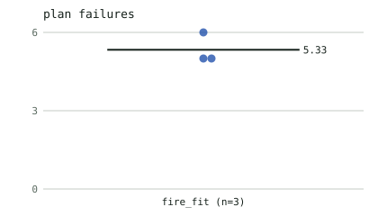
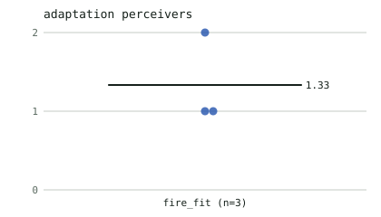
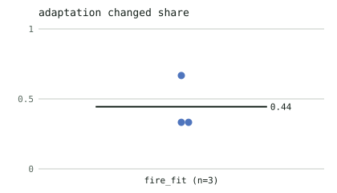
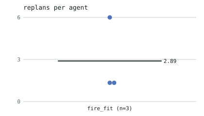
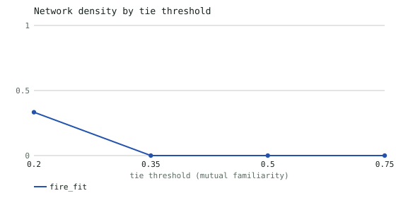
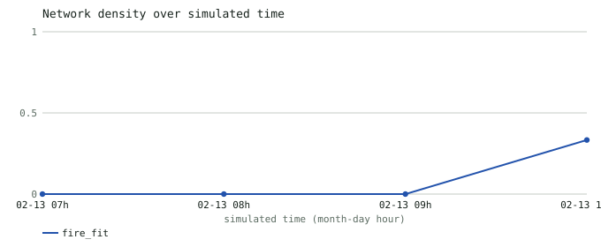

# Experiment: fire_llama32_fit

Does fitting task durations to the window remove the 3B model's decomposition failures in a live run, and does a resident with a working task plan respond to the fire differently?

**Hypothesis (fixed before running):** H1: no decomposition or replanning call is rejected for its arithmetic (experiment D: 43 of 56 such calls rejected; replayed offline, the fit accepts 41 of the 43). H2: plan failures per fork fall below those of the strict `fire` fork with the same seed in all three seeds; the failures that remain are day plans and hourly schedules with times out of order, which the fit does not touch. H3 (no prediction of direction): the reaction to the fire and the interview answer are reported next to those of the strict forks.

## Conditions

* `fire_fit`: `scenario.end=2023-02-13T10:00:00`, `planning.fit_durations=true`; interventions: 2

Every run is a fork of `runs/llama_fire_source` at snapshot `fork`: the same past, different futures.

Seeds [1, 2, 3]. Runs are matched by seed; a hosted model does not reproduce identical samples, so matching is of the initial world, not of the randomness. Metrics: adaptation, behavior, beliefs, network, usage.

Each run links to its evaluation report when the `evaluation` metric ran.

| Run | Condition | Seed | Status | plan failures | Agents who perceived the event | Agents who changed plans (share) | Replans per agent | Calls | Runtime (s) |
| --- | --- | --- | --- | --- | --- | --- | --- | --- | --- |
| fire_fit-s1 | fire_fit | 1 | completed | 6 | 2 | 0.667 | 6 | 359 | 3241 |
| fire_fit-s2 | fire_fit | 2 | completed | 5 | 1 | 0.333 | 1.333 | 185 | 1518.1 |
| fire_fit-s3 | fire_fit | 3 | completed | 5 | 1 | 0.333 | 1.333 | 161 | 1432.8 |

## By condition

| Outcome | fire_fit |
| --- | --- |
| **plan failures** | 5.333 ± 0.577 (median 5; 5–6; 95% CI 5 to 6; n=3) |
| **Agents who perceived the event** | 1.333 ± 0.577 (median 1; 1–2; 95% CI 1 to 2; n=3) |
| **Agents who changed plans (share)** | 0.444 ± 0.193 (median 0.333; 0.333–0.667; 95% CI 0.333 to 0.667; n=3) |
| **Replans per agent** | 2.889 ± 2.694 (median 1.333; 1.333–6; 95% CI 1.333 to 6; n=3) |
| Changed plans among perceivers | 1 ± 0 (median 1; 1–1; 95% CI 1 to 1; n=3) |
| Median adaptation latency (min) | 5.167 ± 8.949 (median 0; 0–15.5; 95% CI 0 to 15.5; n=3) |
| Median reaction time after first perceiving it (min) | 0 ± 0 (median 0; 0–0; 95% CI 0 to 0; n=3) |
| Agents who perceived the event in its first minute | 1 ± 0 (median 1; 1–1; 95% CI 1 to 1; n=3) |
| Conversations mentioning the event | 0 ± 0 (median 0; 0–0; 95% CI 0 to 0; n=3) |
| adaptation agents mentioning | 0 ± 0 (median 0; 0–0; 95% CI 0 to 0; n=3) |
| Scheduled share of actions | 0.714 ± 0.139 (median 0.766; 0.5574–0.82; 95% CI 0.557 to 0.82; n=3) |
| Plan adherence (hour blocks followed) | 0.884 ± 0.111 (median 0.875; 0.7778–1; 95% CI 0.778 to 1; n=3) |
| Idle share | 0.285 ± 0.041 (median 0.269; 0.2549–0.3323; 95% CI 0.255 to 0.332; n=3) |
| Reaction rate (non-continue) | 0.786 ± 0.185 (median 0.6923; 0.6667–1; 95% CI 0.667 to 1; n=3) |
| Conversations per agent | 0.667 ± 0 (median 0.667; 0.667–0.667; 95% CI 0.667 to 0.667; n=3) |
| action failures | 0 ± 0 (median 0; 0–0; 95% CI 0 to 0; n=3) |
| constraint refusals | 0 ± 0 (median 0; 0–0; 95% CI 0 to 0; n=3) |
| valentines holders pct | 44.433 ± 19.283 (median 33.3; 33.3–66.7; 95% CI 33.3 to 66.7; n=3) |
| valentines knowledge coverage | 0 ± 0 (median 0; 0–0; 95% CI 0 to 0; n=3) |
| valentines conflicting details | 0 ± 0 (median 0; 0–0; 95% CI 0 to 0; n=3) |
| mayor holders pct | 0 ± 0 (median 0; 0–0; 95% CI 0 to 0; n=3) |
| mayor knowledge coverage | n/a |
| mayor conflicting details | 0 ± 0 (median 0; 0–0; 95% CI 0 to 0; n=3) |
| Network density (mutual ties) | 0.333 ± 0 (median 0.3333; 0.3333–0.3333; 95% CI 0.333 to 0.333; n=3) |
| network edges | 1 ± 0 (median 1; 1–1; 95% CI 1 to 1; n=3) |
| Network components | 2 ± 0 (median 2; 2–2; 95% CI 2 to 2; n=3) |
| network largest component | 2 ± 0 (median 2; 2–2; 95% CI 2 to 2; n=3) |
| network isolates | 1 ± 0 (median 1; 1–1; 95% CI 1 to 1; n=3) |
| Reciprocity | 1 ± 0 (median 1; 1–1; 95% CI 1 to 1; n=3) |
| Clustering | n/a |
| Weighted density (mean mutual familiarity over all pairs) | 0.091 ± 0 (median 0.0908; 0.0908–0.0908; 95% CI 0.091 to 0.091; n=3) |
| Pairs who talked (share of all pairs) | 0.333 ± 0 (median 0.3333; 0.3333–0.3333; 95% CI 0.333 to 0.333; n=3) |
| Degree inequality (Gini) | 0.333 ± 0 (median 0.3333; 0.3333–0.3333; 95% CI 0.333 to 0.333; n=3) |
| Mean familiarity | 0.273 ± 0 (median 0.2725; 0.2725–0.2725; 95% CI 0.273 to 0.273; n=3) |
| Mean valence | n/a |
| relationship records | 2 ± 0 (median 2; 2–2; 95% CI 2 to 2; n=3) |
| Density at tie threshold 0.20 | 0.333 ± 0 (median 0.3333; 0.3333–0.3333; 95% CI 0.333 to 0.333; n=3) |
| Density at tie threshold 0.35 | 0 ± 0 (median 0; 0–0; 95% CI 0 to 0; n=3) |
| Density at tie threshold 0.50 | 0 ± 0 (median 0; 0–0; 95% CI 0 to 0; n=3) |
| Density at tie threshold 0.75 | 0 ± 0 (median 0; 0–0; 95% CI 0 to 0; n=3) |
| Model calls | 235 ± 108.056 (median 185; 161–359; 95% CI 161 to 359; n=3) |
| Input tokens | 110,491 ± 53,422 (median 85,298; 74,324–171,852; 95% CI 74,324 to 171,852; n=3) |
| Output tokens | 7,723 ± 3,643 (median 5,788; 5,456–11,926; 95% CI 5,456 to 11,926; n=3) |
| Cost (USD) | 0 ± 0 (median 0; 0–0; 95% CI 0 to 0; n=3) |
| Runtime (s) | 2,064 ± 1,020 (median 1,518; 1,433–3,241; 95% CI 1,433 to 3,241; n=3) |

Mean ± SD (median; range; bootstrap 95% interval of the mean from three runs up; runs with a value). Primary outcomes, fixed in the protocol before running, are in bold.

## Comparisons (exploratory)

* none (one condition, or more than six)

One dot per run; the bar is the condition mean.

## Detail: the network at every threshold

Means over the runs of a condition. A tie is mutual familiarity at or above the threshold.

**Density by tie threshold**

| Condition | ≥ 0.2 | ≥ 0.35 | ≥ 0.5 | ≥ 0.75 |
| --- | --- | --- | --- | --- |
| fire_fit | 0.333 | 0.000 | 0.000 | 0.000 |

**Largest component (agents) and number of components by tie threshold**

| Condition | ≥ 0.2 | ≥ 0.35 | ≥ 0.5 | ≥ 0.75 |
| --- | --- | --- | --- | --- |
| fire_fit | 2.0 / 2.0 | 1.0 / 3.0 | 1.0 / 3.0 | 1.0 / 3.0 |

**Clustering against a random graph of the same density** (average local clustering / density; in a random graph the two are equal in expectation, so a ratio above 1 means more closed triangles than chance)

| Condition | ≥ 0.2 | ≥ 0.35 | ≥ 0.5 | ≥ 0.75 |
| --- | --- | --- | --- | --- |
| fire_fit | n/a | n/a | n/a | n/a |

**Measures without a threshold**

| Condition | Weighted density | Pairs who talked | Mean familiarity (records) | Degree Gini at the configured threshold | Relationship records |
| --- | --- | --- | --- | --- | --- |
| fire_fit | 0.091 | 0.333 | 0.273 | 0.333 | 2 |

**Density at the configured threshold over simulated time**

| Condition | 02-13 07h | 02-13 08h | 02-13 09h | 02-13 10h |
| --- | --- | --- | --- | --- |
| fire_fit | 0.000 | 0.000 | 0.000 | 0.333 |

## Detail: who perceived the event and who changed course

| Run | Perceivers | Who | Changed plans | Latencies from the event's start (min) | Reaction times from first perceiving it (min) | Perceived it later than the first minute | Conversations mentioning it | First mention |
| --- | --- | --- | --- | --- | --- | --- | --- | --- |
| fire_fit-s1 | 2 | isabella, klaus | 2 | 0, 15.5 | 0, 0 | 1 | 0 |  |
| fire_fit-s2 | 1 | isabella | 1 | 0 | 0 | 0 | 0 |  |
| fire_fit-s3 | 1 | isabella | 1 | 0 | 0 | 0 | 0 |  |

A latency counts from the start of the event, so it includes the time an agent took to arrive; the reaction time counts from that agent's own first perception.

_Run modes: live × 3._

Simulated characters: plausible behavior here does not establish validity for real people.
