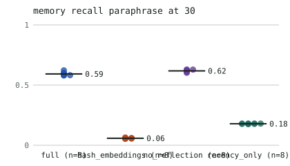
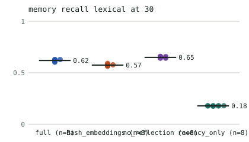
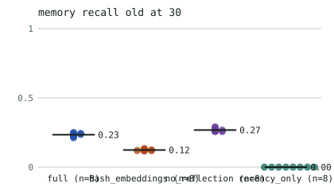
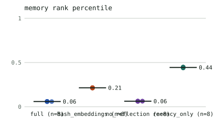
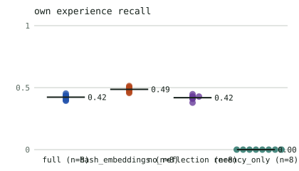
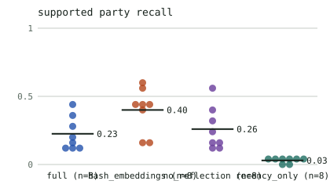
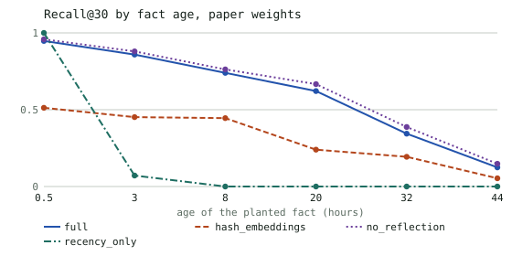
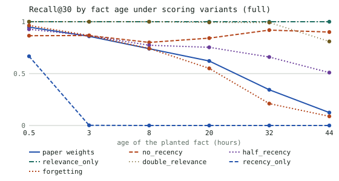
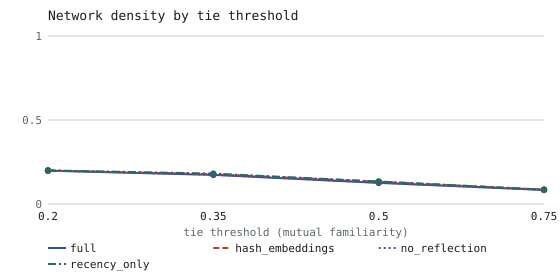
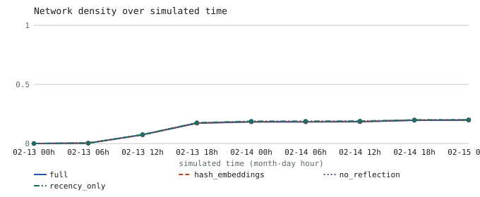

# Experiment: memory_retrieval_v2

On a town-sized two-day memory stream, how do embedding type, reflection, forgetting and the three score weights change which planted facts come back, by age, importance and query style?

**Hypothesis (fixed before running):** H1: semantic embeddings raise recall of paraphrase queries far above the hash fixture (full > hash_embeddings on recall@30 of paraphrase queries); lexical-query recall is expected to change little (described, not tested). H2: recall falls with a fact's age because min-max normalization spreads recency over the whole run; on the same snapshots, scoring without recency raises recall@30 of facts older than a day above the paper weights. H3: forgetting (threshold -0.6) makes the low- and mid-importance facts older than about a day inaccessible (5 of 18 facts per agent) and does not lower recall@30 of the important old facts that stay accessible. H4: removing reflection changes planted-fact recall@30 by less than 0.05 in either direction. H5: running the town with recency-only retrieval lowers own-conversation recall, as in round one (supported party recall is expected to fall too; described, not tested). H6: doubling the relevance weight raises recall@30 of old facts above the paper weights.

> **MOCK RUNS.** These numbers exercise the pipeline with the offline mock; they say nothing about reflection.

## Conditions

* `full`: base configuration
* `hash_embeddings`: `providers.embeddings.kind=mock-hash`, `providers.embeddings.model=mock-hash-256`, `providers.embeddings.dims=256`
* `no_reflection`: `architecture.reflection=false`
* `recency_only`: `retrieval.weights.importance=0`, `retrieval.weights.relevance=0`

Seeds [201, 202, 203, 204, 205, 206, 207, 208]. Runs are matched by seed; a hosted model does not reproduce identical samples, so matching is of the initial world, not of the randomness. Metrics: memory_probe, behavior, evaluation, beliefs, network, usage.

Determinism check: the first configuration was run twice; committed state tables were **identical** (same seed and configuration run twice; state tables memories, plans, conversations, agent_state, spatial_memory, world_objects, relationships).

Each run links to its evaluation report when the `evaluation` metric ran.

| Run | Condition | Seed | Status | Recall@30, paraphrase queries | Recall@30, lexical queries | Recall@30 of facts older than a day | Mean rank percentile (0 = top) | Own-conversation recall@k | Party recall (supported) | Calls | Runtime (s) |
| --- | --- | --- | --- | --- | --- | --- | --- | --- | --- | --- | --- |
| [full-s201](full-s201/exports/evaluation/report.md) | full | 201 | completed | 0.5911 | 0.6289 | 0.2367 | 0.0581 | 0.3941 | 0.16 | 33206 | 312.3 |
| [hash_embeddings-s201](hash_embeddings-s201/exports/evaluation/report.md) | hash_embeddings | 201 | completed | 0.06 | 0.5733 | 0.1233 | 0.2143 | 0.4849 | 0.6 | 33582 | 240.4 |
| [no_reflection-s201](no_reflection-s201/exports/evaluation/report.md) | no_reflection | 201 | completed | 0.6067 | 0.6467 | 0.2633 | 0.0635 | 0.4156 | 0.4 | 28420 | 278.8 |
| [recency_only-s201](recency_only-s201/exports/evaluation/report.md) | recency_only | 201 | completed | 0.18 | 0.18 | 0 | 0.4431 | 0 | 0.04 | 32496 | 242.2 |
| [full-s202](full-s202/exports/evaluation/report.md) | full | 202 | completed | 0.5978 | 0.6244 | 0.2433 | 0.0603 | 0.4111 | 0.44 | 33576 | 254.6 |
| [hash_embeddings-s202](hash_embeddings-s202/exports/evaluation/report.md) | hash_embeddings | 202 | completed | 0.0578 | 0.5778 | 0.1233 | 0.2133 | 0.5135 | 0.56 | 33362 | 229.9 |
| [no_reflection-s202](no_reflection-s202/exports/evaluation/report.md) | no_reflection | 202 | completed | 0.62 | 0.6444 | 0.2667 | 0.0636 | 0.4159 | 0.56 | 28859 | 212.7 |
| [recency_only-s202](recency_only-s202/exports/evaluation/report.md) | recency_only | 202 | completed | 0.18 | 0.18 | 0 | 0.4403 | 0 | 0.04 | 33176 | 238 |
| [full-s203](full-s203/exports/evaluation/report.md) | full | 203 | completed | 0.58 | 0.6133 | 0.22 | 0.06 | 0.3996 | 0.28 | 33554 | 265.6 |
| [hash_embeddings-s203](hash_embeddings-s203/exports/evaluation/report.md) | hash_embeddings | 203 | completed | 0.0556 | 0.5644 | 0.12 | 0.2146 | 0.487 | 0.44 | 33428 | 234.6 |
| [no_reflection-s203](no_reflection-s203/exports/evaluation/report.md) | no_reflection | 203 | completed | 0.6289 | 0.6578 | 0.29 | 0.0631 | 0.4279 | 0.24 | 28059 | 208.8 |
| [recency_only-s203](recency_only-s203/exports/evaluation/report.md) | recency_only | 203 | completed | 0.1778 | 0.1778 | 0 | 0.448 | 0 | 0.04 | 32278 | 227.5 |
| [full-s204](full-s204/exports/evaluation/report.md) | full | 204 | completed | 0.5867 | 0.6022 | 0.2133 | 0.0591 | 0.4339 | 0.2 | 33311 | 256.9 |
| [hash_embeddings-s204](hash_embeddings-s204/exports/evaluation/report.md) | hash_embeddings | 204 | completed | 0.06 | 0.5778 | 0.13 | 0.2103 | 0.4567 | 0.44 | 33502 | 234.6 |
| [no_reflection-s204](no_reflection-s204/exports/evaluation/report.md) | no_reflection | 204 | completed | 0.6022 | 0.6422 | 0.2567 | 0.0628 | 0.4474 | 0.16 | 28708 | 211.3 |
| [recency_only-s204](recency_only-s204/exports/evaluation/report.md) | recency_only | 204 | completed | 0.1756 | 0.1756 | 0 | 0.4475 | 0 | 0.04 | 32569 | 235.6 |
| [full-s205](full-s205/exports/evaluation/report.md) | full | 205 | completed | 0.5822 | 0.62 | 0.2367 | 0.0609 | 0.4312 | 0.36 | 32898 | 258 |
| [hash_embeddings-s205](hash_embeddings-s205/exports/evaluation/report.md) | hash_embeddings | 205 | completed | 0.0578 | 0.5689 | 0.1167 | 0.214 | 0.4644 | 0.16 | 33808 | 251.5 |
| [no_reflection-s205](no_reflection-s205/exports/evaluation/report.md) | no_reflection | 205 | completed | 0.6133 | 0.6467 | 0.26 | 0.0626 | 0.3788 | 0.32 | 28913 | 221.4 |
| [recency_only-s205](recency_only-s205/exports/evaluation/report.md) | recency_only | 205 | completed | 0.1778 | 0.1778 | 0 | 0.4486 | 0 | 0 | 32550 | 237 |
| [full-s206](full-s206/exports/evaluation/report.md) | full | 206 | completed | 0.6222 | 0.6267 | 0.25 | 0.059 | 0.4524 | 0.12 | 32584 | 257.5 |
| [hash_embeddings-s206](hash_embeddings-s206/exports/evaluation/report.md) | hash_embeddings | 206 | completed | 0.0533 | 0.5667 | 0.12 | 0.2163 | 0.5043 | 0.44 | 33658 | 246.8 |
| [no_reflection-s206](no_reflection-s206/exports/evaluation/report.md) | no_reflection | 206 | completed | 0.6267 | 0.6578 | 0.2667 | 0.0636 | 0.4085 | 0.12 | 28486 | 217.8 |
| [recency_only-s206](recency_only-s206/exports/evaluation/report.md) | recency_only | 206 | completed | 0.18 | 0.18 | 0 | 0.4437 | 0 | 0 | 33919 | 238.2 |
| [full-s207](full-s207/exports/evaluation/report.md) | full | 207 | completed | 0.5822 | 0.6111 | 0.23 | 0.0589 | 0.4367 | 0.12 | 33379 | 249.9 |
| [hash_embeddings-s207](hash_embeddings-s207/exports/evaluation/report.md) | hash_embeddings | 207 | completed | 0.0556 | 0.5711 | 0.12 | 0.2156 | 0.5 | 0.16 | 32913 | 217.5 |
| [no_reflection-s207](no_reflection-s207/exports/evaluation/report.md) | no_reflection | 207 | completed | 0.6289 | 0.6422 | 0.2567 | 0.0609 | 0.4292 | 0.12 | 28596 | 199.1 |
| [recency_only-s207](recency_only-s207/exports/evaluation/report.md) | recency_only | 207 | completed | 0.18 | 0.18 | 0 | 0.4383 | 0 | 0.04 | 32700 | 210.3 |
| [full-s208](full-s208/exports/evaluation/report.md) | full | 208 | completed | 0.6 | 0.6289 | 0.2433 | 0.0589 | 0.4243 | 0.12 | 33045 | 229.2 |
| [hash_embeddings-s208](hash_embeddings-s208/exports/evaluation/report.md) | hash_embeddings | 208 | completed | 0.0644 | 0.5911 | 0.1333 | 0.215 | 0.48 | 0.4 | 32802 | 207.7 |
| [no_reflection-s208](no_reflection-s208/exports/evaluation/report.md) | no_reflection | 208 | completed | 0.6178 | 0.66 | 0.2833 | 0.0626 | 0.4279 | 0.16 | 28383 | 194.5 |
| [recency_only-s208](recency_only-s208/exports/evaluation/report.md) | recency_only | 208 | completed | 0.1778 | 0.1778 | 0 | 0.4449 | 0 | 0.04 | 33242 | 206.7 |

## By condition

| Outcome | full | hash_embeddings | no_reflection | recency_only |
| --- | --- | --- | --- | --- |
| **Recall@30, paraphrase queries** | 0.593 ± 0.014 (median 0.5889; 0.58–0.6222; 95% CI 0.584 to 0.603; n=8) | 0.058 ± 0.003 (median 0.0578; 0.0533–0.0644; 95% CI 0.056 to 0.06; n=8) | 0.618 ± 0.01 (median 0.6189; 0.6022–0.6289; 95% CI 0.611 to 0.624; n=8) | 0.179 ± 0.002 (median 0.1789; 0.1756–0.18; 95% CI 0.178 to 0.18; n=8) |
| **Recall@30, lexical queries** | 0.619 ± 0.01 (median 0.6222; 0.6022–0.6289; 95% CI 0.612 to 0.626; n=8) | 0.574 ± 0.008 (median 0.5722; 0.5644–0.5911; 95% CI 0.569 to 0.58; n=8) | 0.65 ± 0.008 (median 0.6467; 0.6422–0.66; 95% CI 0.645 to 0.655; n=8) | 0.179 ± 0.002 (median 0.1789; 0.1756–0.18; 95% CI 0.178 to 0.18; n=8) |
| **Recall@30 of facts older than a day** | 0.234 ± 0.012 (median 0.2367; 0.2133–0.25; 95% CI 0.225 to 0.242; n=8) | 0.123 ± 0.006 (median 0.12165; 0.1167–0.1333; 95% CI 0.12 to 0.127; n=8) | 0.268 ± 0.012 (median 0.265; 0.2567–0.29; 95% CI 0.26 to 0.277; n=8) | 0 ± 0 (median 0; 0–0; 95% CI 0 to 0; n=8) |
| **Mean rank percentile (0 = top)** | 0.059 ± 0.001 (median 0.05905; 0.0581–0.0609; 95% CI 0.059 to 0.06; n=8) | 0.214 ± 0.002 (median 0.21445; 0.2103–0.2163; 95% CI 0.213 to 0.215; n=8) | 0.063 ± 0.001 (median 0.06295; 0.0609–0.0636; 95% CI 0.062 to 0.063; n=8) | 0.444 ± 0.004 (median 0.4443; 0.4383–0.4486; 95% CI 0.442 to 0.447; n=8) |
| **Own-conversation recall@k** | 0.423 ± 0.02 (median 0.42775; 0.3941–0.4524; 95% CI 0.41 to 0.436; n=8) | 0.486 ± 0.019 (median 0.48595; 0.4567–0.5135; 95% CI 0.474 to 0.499; n=8) | 0.419 ± 0.02 (median 0.4219; 0.3788–0.4474; 95% CI 0.405 to 0.431; n=8) | 0 ± 0 (median 0; 0–0; 95% CI 0 to 0; n=8) |
| **Party recall (supported)** | 0.225 ± 0.123 (median 0.18; 0.12–0.44; 95% CI 0.15 to 0.305; n=8) | 0.4 ± 0.163 (median 0.44; 0.16–0.6; 95% CI 0.285 to 0.5; n=8) | 0.26 ± 0.157 (median 0.2; 0.12–0.56; 95% CI 0.165 to 0.37; n=8) | 0.03 ± 0.019 (median 0.04; 0–0.04; 95% CI 0.015 to 0.04; n=8) |
| Planted-fact recall@k | 0.443 ± 0.007 (median 0.4433; 0.4333–0.4578; 95% CI 0.439 to 0.448; n=8) | 0.241 ± 0.003 (median 0.24; 0.2367–0.2456; 95% CI 0.239 to 0.243; n=8) | 0.45 ± 0.003 (median 0.45; 0.4433–0.4533; 95% CI 0.447 to 0.452; n=8) | 0 ± 0 (median 0; 0–0; 95% CI 0 to 0; n=8) |
| Planted-fact recall@30 (paper cap) | 0.606 ± 0.011 (median 0.60555; 0.5944–0.6244; 95% CI 0.599 to 0.613; n=8) | 0.316 ± 0.006 (median 0.315; 0.31–0.3278; 95% CI 0.313 to 0.32; n=8) | 0.634 ± 0.007 (median 0.6339; 0.6222–0.6433; 95% CI 0.629 to 0.639; n=8) | 0.179 ± 0.002 (median 0.1789; 0.1756–0.18; 95% CI 0.178 to 0.18; n=8) |
| Planted-fact MRR | 0.376 ± 0.002 (median 0.37625; 0.3726–0.3787; 95% CI 0.375 to 0.377; n=8) | 0.205 ± 0.002 (median 0.2049; 0.2008–0.2066; 95% CI 0.203 to 0.206; n=8) | 0.38 ± 0.003 (median 0.3792; 0.3745–0.3858; 95% CI 0.378 to 0.382; n=8) | 0.011 ± 0 (median 0.01135; 0.0111–0.0115; 95% CI 0.011 to 0.011; n=8) |
| Median rank of the planted fact | 17.75 ± 0.886 (median 18; 16–19; 95% CI 17.125 to 18.25; n=8) | 70.062 ± 2.06 (median 70.25; 66.5–73.5; 95% CI 68.812 to 71.375; n=8) | 16.875 ± 0.641 (median 17; 16–18; 95% CI 16.5 to 17.25; n=8) | 234 ± 13.771 (median 237.25; 215–252.5; 95% CI 224.688 to 242.75; n=8) |
| Recall of facts older than a day | 0.077 ± 0.004 (median 0.07835; 0.07–0.0833; 95% CI 0.075 to 0.08; n=8) | 0.053 ± 0.006 (median 0.05335; 0.0433–0.06; 95% CI 0.049 to 0.057; n=8) | 0.081 ± 0.003 (median 0.08; 0.0767–0.0867; 95% CI 0.079 to 0.083; n=8) | 0 ± 0 (median 0; 0–0; 95% CI 0 to 0; n=8) |
| memory recall old important at 30 | 0.557 ± 0.032 (median 0.555; 0.51–0.62; 95% CI 0.537 to 0.58; n=8) | 0.302 ± 0.012 (median 0.305; 0.29–0.32; 95% CI 0.295 to 0.31; n=8) | 0.615 ± 0.02 (median 0.61; 0.59–0.65; 95% CI 0.603 to 0.629; n=8) | 0 ± 0 (median 0; 0–0; 95% CI 0 to 0; n=8) |
| Recall of facts under an hour old | 0.762 ± 0.016 (median 0.76; 0.7467–0.8; 95% CI 0.754 to 0.774; n=8) | 0.412 ± 0.007 (median 0.4133; 0.4067–0.4267; 95% CI 0.408 to 0.417; n=8) | 0.766 ± 0.012 (median 0.7667; 0.7467–0.78; 95% CI 0.758 to 0.773; n=8) | 0 ± 0 (median 0; 0–0; 95% CI 0 to 0; n=8) |
| memory forgotten | 0 ± 0 (median 0; 0–0; 95% CI 0 to 0; n=8) | 0 ± 0 (median 0; 0–0; 95% CI 0 to 0; n=8) | 0 ± 0 (median 0; 0–0; 95% CI 0 to 0; n=8) | 0 ± 0 (median 0; 0–0; 95% CI 0 to 0; n=8) |
| Memories per agent at the probe | 786.85 ± 10.464 (median 787.9; 768.1–799.6; 95% CI 779.8 to 793.4; n=8) | 788.3 ± 12.554 (median 790.95; 763.9–804.8; 95% CI 780.025 to 795.85; n=8) | 638.275 ± 10.813 (median 638.35; 617–651.7; 95% CI 630.812 to 644.85; n=8) | 734.987 ± 16.032 (median 729.75; 717–764.2; 95% CI 724.987 to 746.338; n=8) |
| Recall@k, queries sharing words with the fact | 0.441 ± 0.01 (median 0.44; 0.4311–0.4622; 95% CI 0.435 to 0.448; n=8) | 0.457 ± 0.004 (median 0.4556; 0.4511–0.4622; 95% CI 0.454 to 0.459; n=8) | 0.443 ± 0.005 (median 0.4422; 0.4356–0.4511; 95% CI 0.44 to 0.447; n=8) | 0 ± 0 (median 0; 0–0; 95% CI 0 to 0; n=8) |
| Recall@k, paraphrase queries (no shared content words) | 0.446 ± 0.005 (median 0.4467; 0.4356–0.4533; 95% CI 0.442 to 0.449; n=8) | 0.025 ± 0.004 (median 0.0244; 0.0178–0.0311; 95% CI 0.022 to 0.027; n=8) | 0.456 ± 0.004 (median 0.4556; 0.4511–0.4622; 95% CI 0.454 to 0.458; n=8) | 0 ± 0 (median 0; 0–0; 95% CI 0 to 0; n=8) |
| memory recall at k  no recency | 0.747 ± 0.006 (median 0.74945; 0.7378–0.7533; 95% CI 0.743 to 0.751; n=8) | 0.41 ± 0.005 (median 0.4089; 0.4044–0.4189; 95% CI 0.407 to 0.413; n=8) | 0.756 ± 0.009 (median 0.7533; 0.7456–0.7689; 95% CI 0.75 to 0.761; n=8) | 0 ± 0 (median 0; 0–0; 95% CI 0 to 0; n=8) |
| memory recall at 30  no recency | 0.866 ± 0.012 (median 0.8628; 0.8511–0.88; 95% CI 0.858 to 0.873; n=8) | 0.493 ± 0.008 (median 0.49275; 0.48–0.5056; 95% CI 0.488 to 0.498; n=8) | 0.883 ± 0.006 (median 0.8822; 0.8756–0.8944; 95% CI 0.879 to 0.887; n=8) | 0.179 ± 0.002 (median 0.1789; 0.1756–0.18; 95% CI 0.178 to 0.18; n=8) |
| memory recall old at 30  no recency | 0.91 ± 0.013 (median 0.905; 0.8933–0.9267; 95% CI 0.902 to 0.918; n=8) | 0.519 ± 0.008 (median 0.52; 0.5067–0.53; 95% CI 0.514 to 0.525; n=8) | 0.931 ± 0.012 (median 0.9333; 0.9167–0.9467; 95% CI 0.923 to 0.939; n=8) | 0 ± 0 (median 0; 0–0; 95% CI 0 to 0; n=8) |
| memory recall old important at 30  no recency | 1 ± 0 (median 1; 1–1; 95% CI 1 to 1; n=8) | 0.815 ± 0.016 (median 0.815; 0.79–0.84; 95% CI 0.805 to 0.825; n=8) | 1 ± 0 (median 1; 1–1; 95% CI 1 to 1; n=8) | 0 ± 0 (median 0; 0–0; 95% CI 0 to 0; n=8) |
| memory forgotten  no recency | 0 ± 0 (median 0; 0–0; 95% CI 0 to 0; n=8) | 0 ± 0 (median 0; 0–0; 95% CI 0 to 0; n=8) | 0 ± 0 (median 0; 0–0; 95% CI 0 to 0; n=8) | 0 ± 0 (median 0; 0–0; 95% CI 0 to 0; n=8) |
| memory recall at k  half recency | 0.62 ± 0.003 (median 0.62; 0.6156–0.6256; 95% CI 0.618 to 0.622; n=8) | 0.319 ± 0.003 (median 0.32; 0.3144–0.3233; 95% CI 0.317 to 0.322; n=8) | 0.624 ± 0.006 (median 0.6244; 0.6144–0.6356; 95% CI 0.62 to 0.628; n=8) | 0 ± 0 (median 0; 0–0; 95% CI 0 to 0; n=8) |
| memory recall at 30  half recency | 0.748 ± 0.012 (median 0.745; 0.7344–0.7656; 95% CI 0.741 to 0.756; n=8) | 0.403 ± 0.006 (median 0.40165; 0.3933–0.4122; 95% CI 0.399 to 0.407; n=8) | 0.77 ± 0.006 (median 0.77165; 0.7622–0.7767; 95% CI 0.767 to 0.774; n=8) | 0.179 ± 0.002 (median 0.1789; 0.1756–0.18; 95% CI 0.178 to 0.18; n=8) |
| memory recall old at 30  half recency | 0.585 ± 0.017 (median 0.585; 0.5533–0.6067; 95% CI 0.573 to 0.595; n=8) | 0.286 ± 0.012 (median 0.28835; 0.2667–0.3033; 95% CI 0.278 to 0.293; n=8) | 0.618 ± 0.005 (median 0.6167; 0.61–0.6233; 95% CI 0.615 to 0.621; n=8) | 0 ± 0 (median 0; 0–0; 95% CI 0 to 0; n=8) |
| memory recall old important at 30  half recency | 1 ± 0 (median 1; 1–1; 95% CI 1 to 1; n=8) | 0.575 ± 0.011 (median 0.58; 0.56–0.59; 95% CI 0.568 to 0.581; n=8) | 1 ± 0 (median 1; 1–1; 95% CI 1 to 1; n=8) | 0 ± 0 (median 0; 0–0; 95% CI 0 to 0; n=8) |
| memory forgotten  half recency | 0 ± 0 (median 0; 0–0; 95% CI 0 to 0; n=8) | 0 ± 0 (median 0; 0–0; 95% CI 0 to 0; n=8) | 0 ± 0 (median 0; 0–0; 95% CI 0 to 0; n=8) | 0 ± 0 (median 0; 0–0; 95% CI 0 to 0; n=8) |
| memory recall at k  relevance only | 0.994 ± 0 (median 0.9944; 0.9944–0.9944; 95% CI 0.994 to 0.994; n=8) | 0.503 ± 0.001 (median 0.50275; 0.5022–0.5044; 95% CI 0.502 to 0.504; n=8) | 0.995 ± 0 (median 0.9944; 0.9944–0.9956; 95% CI 0.994 to 0.995; n=8) | 0 ± 0 (median 0; 0–0; 95% CI 0 to 0; n=8) |
| memory recall at 30  relevance only | 1 ± 0 (median 1; 1–1; 95% CI 1 to 1; n=8) | 0.51 ± 0.001 (median 0.51; 0.51–0.5111; 95% CI 0.51 to 0.511; n=8) | 1 ± 0 (median 1; 1–1; 95% CI 1 to 1; n=8) | 0.179 ± 0.002 (median 0.1789; 0.1756–0.18; 95% CI 0.178 to 0.18; n=8) |
| memory recall old at 30  relevance only | 1 ± 0 (median 1; 1–1; 95% CI 1 to 1; n=8) | 0.523 ± 0 (median 0.5233; 0.5233–0.5233; 95% CI 0.523 to 0.523; n=8) | 1 ± 0 (median 1; 1–1; 95% CI 1 to 1; n=8) | 0 ± 0 (median 0; 0–0; 95% CI 0 to 0; n=8) |
| memory recall old important at 30  relevance only | 1 ± 0 (median 1; 1–1; 95% CI 1 to 1; n=8) | 0.57 ± 0 (median 0.57; 0.57–0.57; 95% CI 0.57 to 0.57; n=8) | 1 ± 0 (median 1; 1–1; 95% CI 1 to 1; n=8) | 0 ± 0 (median 0; 0–0; 95% CI 0 to 0; n=8) |
| memory forgotten  relevance only | 0 ± 0 (median 0; 0–0; 95% CI 0 to 0; n=8) | 0 ± 0 (median 0; 0–0; 95% CI 0 to 0; n=8) | 0 ± 0 (median 0; 0–0; 95% CI 0 to 0; n=8) | 0 ± 0 (median 0; 0–0; 95% CI 0 to 0; n=8) |
| memory recall at k  double relevance | 0.904 ± 0.008 (median 0.9067; 0.8878–0.91; 95% CI 0.898 to 0.908; n=8) | 0.447 ± 0.003 (median 0.4467; 0.4433–0.4522; 95% CI 0.445 to 0.45; n=8) | 0.915 ± 0.005 (median 0.915; 0.9067–0.9211; 95% CI 0.912 to 0.918; n=8) | 0.965 ± 0.002 (median 0.9644; 0.9622–0.9678; 95% CI 0.963 to 0.966; n=8) |
| memory recall at 30  double relevance | 0.966 ± 0.004 (median 0.9661; 0.9611–0.9711; 95% CI 0.963 to 0.969; n=8) | 0.491 ± 0.003 (median 0.4911; 0.4844–0.4944; 95% CI 0.489 to 0.493; n=8) | 0.974 ± 0.002 (median 0.9744; 0.9711–0.9767; 95% CI 0.973 to 0.975; n=8) | 0.981 ± 0.002 (median 0.9811; 0.9778–0.9833; 95% CI 0.98 to 0.982; n=8) |
| memory recall old at 30  double relevance | 0.901 ± 0.013 (median 0.9; 0.8867–0.92; 95% CI 0.893 to 0.91; n=8) | 0.416 ± 0.006 (median 0.4167; 0.4067–0.4267; 95% CI 0.412 to 0.42; n=8) | 0.925 ± 0.004 (median 0.925; 0.92–0.9333; 95% CI 0.922 to 0.928; n=8) | 0.942 ± 0.006 (median 0.9433; 0.9333–0.95; 95% CI 0.939 to 0.946; n=8) |
| memory recall old important at 30  double relevance | 1 ± 0 (median 1; 1–1; 95% CI 1 to 1; n=8) | 0.51 ± 0 (median 0.51; 0.51–0.51; 95% CI 0.51 to 0.51; n=8) | 1 ± 0 (median 1; 1–1; 95% CI 1 to 1; n=8) | 0.969 ± 0.014 (median 0.97; 0.94–0.98; 95% CI 0.959 to 0.976; n=8) |
| memory forgotten  double relevance | 0 ± 0 (median 0; 0–0; 95% CI 0 to 0; n=8) | 0 ± 0 (median 0; 0–0; 95% CI 0 to 0; n=8) | 0 ± 0 (median 0; 0–0; 95% CI 0 to 0; n=8) | 0 ± 0 (median 0; 0–0; 95% CI 0 to 0; n=8) |
| memory recall at k  recency only | 0 ± 0 (median 0; 0–0; 95% CI 0 to 0; n=8) | 0 ± 0 (median 0; 0–0; 95% CI 0 to 0; n=8) | 0 ± 0 (median 0; 0–0; 95% CI 0 to 0; n=8) | 0 ± 0 (median 0; 0–0; 95% CI 0 to 0; n=8) |
| memory recall at 30  recency only | 0.111 ± 0.013 (median 0.1122; 0.0844–0.1267; 95% CI 0.102 to 0.119; n=8) | 0.019 ± 0.011 (median 0.0189; 0.0044–0.0378; 95% CI 0.012 to 0.026; n=8) | 0.13 ± 0.01 (median 0.1278; 0.12–0.1467; 95% CI 0.125 to 0.137; n=8) | 0.179 ± 0.002 (median 0.1789; 0.1756–0.18; 95% CI 0.178 to 0.18; n=8) |
| memory recall old at 30  recency only | 0 ± 0 (median 0; 0–0; 95% CI 0 to 0; n=8) | 0 ± 0 (median 0; 0–0; 95% CI 0 to 0; n=8) | 0 ± 0 (median 0; 0–0; 95% CI 0 to 0; n=8) | 0 ± 0 (median 0; 0–0; 95% CI 0 to 0; n=8) |
| memory recall old important at 30  recency only | 0 ± 0 (median 0; 0–0; 95% CI 0 to 0; n=8) | 0 ± 0 (median 0; 0–0; 95% CI 0 to 0; n=8) | 0 ± 0 (median 0; 0–0; 95% CI 0 to 0; n=8) | 0 ± 0 (median 0; 0–0; 95% CI 0 to 0; n=8) |
| memory forgotten  recency only | 0 ± 0 (median 0; 0–0; 95% CI 0 to 0; n=8) | 0 ± 0 (median 0; 0–0; 95% CI 0 to 0; n=8) | 0 ± 0 (median 0; 0–0; 95% CI 0 to 0; n=8) | 0 ± 0 (median 0; 0–0; 95% CI 0 to 0; n=8) |
| memory recall at k  forgetting | 0.433 ± 0.006 (median 0.4322; 0.4278–0.4456; 95% CI 0.43 to 0.438; n=8) | 0.241 ± 0.003 (median 0.24165; 0.2356–0.2456; 95% CI 0.239 to 0.243; n=8) | 0.439 ± 0.005 (median 0.4389; 0.4333–0.4489; 95% CI 0.437 to 0.443; n=8) | 0 ± 0 (median 0; 0–0; 95% CI 0 to 0; n=8) |
| memory recall at 30  forgetting | 0.571 ± 0.007 (median 0.57055; 0.56–0.5833; 95% CI 0.566 to 0.576; n=8) | 0.307 ± 0.005 (median 0.30725; 0.2989–0.3156; 95% CI 0.304 to 0.31; n=8) | 0.591 ± 0.005 (median 0.59055; 0.5833–0.5989; 95% CI 0.587 to 0.594; n=8) | 0.179 ± 0.002 (median 0.1789; 0.1756–0.18; 95% CI 0.178 to 0.18; n=8) |
| memory recall old at 30  forgetting | 0.15 ± 0.008 (median 0.15; 0.1333–0.16; 95% CI 0.144 to 0.155; n=8) | 0.092 ± 0.005 (median 0.0933; 0.0833–0.0967; 95% CI 0.089 to 0.095; n=8) | 0.168 ± 0.006 (median 0.16835; 0.1567–0.1733; 95% CI 0.163 to 0.171; n=8) | 0 ± 0 (median 0; 0–0; 95% CI 0 to 0; n=8) |
| memory recall old important at 30  forgetting | 0.449 ± 0.025 (median 0.45; 0.4–0.48; 95% CI 0.431 to 0.464; n=8) | 0.276 ± 0.014 (median 0.28; 0.25–0.29; 95% CI 0.266 to 0.284; n=8) | 0.502 ± 0.017 (median 0.505; 0.47–0.52; 95% CI 0.49 to 0.512; n=8) | 0 ± 0 (median 0; 0–0; 95% CI 0 to 0; n=8) |
| memory forgotten  forgetting | 250 ± 0 (median 250; 250–250; 95% CI 250 to 250; n=8) | 250 ± 0 (median 250; 250–250; 95% CI 250 to 250; n=8) | 250 ± 0 (median 250; 250–250; 95% CI 250 to 250; n=8) | 250 ± 0 (median 250; 250–250; 95% CI 250 to 250; n=8) |
| Scheduled share of actions | 0.743 ± 0.006 (median 0.74345; 0.7336–0.7499; 95% CI 0.739 to 0.746; n=8) | 0.732 ± 0.005 (median 0.73275; 0.7234–0.7383; 95% CI 0.729 to 0.735; n=8) | 0.743 ± 0.005 (median 0.74275; 0.7362–0.7499; 95% CI 0.74 to 0.746; n=8) | 0.737 ± 0.008 (median 0.7347; 0.7275–0.7487; 95% CI 0.732 to 0.742; n=8) |
| Plan adherence (hour blocks followed) | 1 ± 0 (median 1; 1–1; 95% CI 1 to 1; n=8) | 1 ± 0 (median 1; 1–1; 95% CI 1 to 1; n=8) | 1 ± 0 (median 1; 1–1; 95% CI 1 to 1; n=8) | 1 ± 0 (median 1; 1–1; 95% CI 1 to 1; n=8) |
| Idle share | 0 ± 0 (median 0; 0–0; 95% CI 0 to 0; n=8) | 0 ± 0 (median 0; 0–0; 95% CI 0 to 0; n=8) | 0 ± 0 (median 0; 0–0; 95% CI 0 to 0; n=8) | 0 ± 0 (median 0; 0–0; 95% CI 0 to 0; n=8) |
| Replans per agent | 17.7 ± 0.483 (median 17.72; 16.8–18.32; 95% CI 17.37 to 18.01; n=8) | 18.2 ± 0.331 (median 18.24; 17.76–18.56; 95% CI 17.99 to 18.41; n=8) | 17.97 ± 0.302 (median 17.96; 17.52–18.48; 95% CI 17.78 to 18.17; n=8) | 17.4 ± 0.546 (median 17.44; 16.64–18.16; 95% CI 17.05 to 17.76; n=8) |
| Reaction rate (non-continue) | 0.282 ± 0.011 (median 0.2839; 0.2672–0.2957; 95% CI 0.275 to 0.289; n=8) | 0.284 ± 0.012 (median 0.28005; 0.271–0.3103; 95% CI 0.278 to 0.293; n=8) | 0.286 ± 0.016 (median 0.2926; 0.2555–0.3068; 95% CI 0.275 to 0.296; n=8) | 0.213 ± 0.011 (median 0.2149; 0.1949–0.229; 95% CI 0.206 to 0.22; n=8) |
| Conversations per agent | 17.7 ± 0.483 (median 17.72; 16.8–18.32; 95% CI 17.37 to 18.01; n=8) | 18.2 ± 0.331 (median 18.24; 17.76–18.56; 95% CI 17.99 to 18.41; n=8) | 17.97 ± 0.302 (median 17.96; 17.52–18.48; 95% CI 17.78 to 18.17; n=8) | 17.4 ± 0.546 (median 17.44; 16.64–18.16; 95% CI 17.05 to 17.76; n=8) |
| action failures | 0 ± 0 (median 0; 0–0; 95% CI 0 to 0; n=8) | 0 ± 0 (median 0; 0–0; 95% CI 0 to 0; n=8) | 0 ± 0 (median 0; 0–0; 95% CI 0 to 0; n=8) | 0 ± 0 (median 0; 0–0; 95% CI 0 to 0; n=8) |
| constraint refusals | 16 ± 0 (median 16; 16–16; 95% CI 16 to 16; n=8) | 16 ± 0 (median 16; 16–16; 95% CI 16 to 16; n=8) | 16 ± 0 (median 16; 16–16; 95% CI 16 to 16; n=8) | 16 ± 0 (median 16; 16–16; 95% CI 16 to 16; n=8) |
| plan failures | 0 ± 0 (median 0; 0–0; 95% CI 0 to 0; n=8) | 0 ± 0 (median 0; 0–0; 95% CI 0 to 0; n=8) | 0 ± 0 (median 0; 0–0; 95% CI 0 to 0; n=8) | 0 ± 0 (median 0; 0–0; 95% CI 0 to 0; n=8) |
| Candidacy recall (supported) | 0.095 ± 0.021 (median 0.08; 0.08–0.12; 95% CI 0.08 to 0.11; n=8) | 0.18 ± 0.111 (median 0.12; 0.08–0.36; 95% CI 0.11 to 0.255; n=8) | 0.11 ± 0.041 (median 0.1; 0.08–0.2; 95% CI 0.085 to 0.14; n=8) | 0 ± 0 (median 0; 0–0; 95% CI 0 to 0; n=8) |
| Attendance among invited guests | 0.582 ± 0.309 (median 0.4; 0.3–1; 95% CI 0.377 to 0.81; n=7) | 0.317 ± 0.179 (median 0.2655; 0.133–0.667; 95% CI 0.215 to 0.443; n=8) | 0.534 ± 0.345 (median 0.4765; 0.2–1; 95% CI 0.32 to 0.769; n=8) | 0.952 ± 0.126 (median 1; 0.667–1; 95% CI 0.857 to 1; n=7) |
| Invited guests | 4.5 ± 3.381 (median 4; 0–10; 95% CI 2.375 to 6.625; n=8) | 9.375 ± 4.104 (median 10; 3–15; 95% CI 6.5 to 11.875; n=8) | 5.5 ± 3.928 (median 4; 2–13; 95% CI 3.125 to 8.25; n=8) | 1.75 ± 0.886 (median 2; 0–3; 95% CI 1.125 to 2.25; n=8) |
| invited attended | 2 ± 0.926 (median 2; 0–3; 95% CI 1.375 to 2.5; n=8) | 2.375 ± 0.518 (median 2; 2–3; 95% CI 2.125 to 2.75; n=8) | 2 ± 0.535 (median 2; 1–3; 95% CI 1.625 to 2.375; n=8) | 1.625 ± 0.744 (median 2; 0–2; 95% CI 1.125 to 2; n=8) |
| Agents exposed to the party | 4.875 ± 3.137 (median 4; 2–10; 95% CI 2.875 to 7; n=8) | 9.375 ± 4.104 (median 10; 3–15; 95% CI 6.5 to 11.875; n=8) | 5.625 ± 3.926 (median 4.5; 2–13; 95% CI 3.25 to 8.375; n=8) | 2.125 ± 0.354 (median 2; 2–3; 95% CI 2 to 2.375; n=8) |
| Unsupported claims | 0 ± 0 (median 0; 0–0; 95% CI 0 to 0; n=8) | 0 ± 0 (median 0; 0–0; 95% CI 0 to 0; n=8) | 0 ± 0 (median 0; 0–0; 95% CI 0 to 0; n=8) | 0 ± 0 (median 0; 0–0; 95% CI 0 to 0; n=8) |
| Model calls | 33,194 ± 339.222 (median 33,258; 32,584–33,576; 95% CI 32,971 to 33,406; n=8) | 33,382 ± 352.73 (median 33,465; 32,802–33,808; 95% CI 33,154 to 33,600; n=8) | 28,553 ± 278.83 (median 28,541; 28,059–28,913; 95% CI 28,364 to 28,728; n=8) | 32,866 ± 540.443 (median 32,634; 32,278–33,919; 95% CI 32,538 to 33,251; n=8) |
| Input tokens | 18,630,344 ± 254,213 (median 18,745,378; 18,191,707–18,906,883; 95% CI 18,450,750 to 18,783,756; n=8) | 18,359,430 ± 277,726 (median 18,401,109; 17,896,706–18,729,225; 95% CI 18,179,723 to 18,530,247; n=8) | 16,741,391 ± 181,635 (median 16,779,124; 16,430,018–16,925,831; 95% CI 16,618,223 to 16,851,794; n=8) | 15,256,814 ± 262,127 (median 15,145,800; 15,001,792–15,780,043; 95% CI 15,100,761 to 15,447,692; n=8) |
| Output tokens | 871,710 ± 9,577 (median 874,799; 858,486–883,273; 95% CI 865,131 to 877,581; n=8) | 856,157 ± 8,252 (median 859,282; 842,031–865,719; 95% CI 850,676 to 861,216; n=8) | 781,317 ± 6,666 (median 782,871; 770,924–789,161; 95% CI 776,781 to 785,521; n=8) | 770,821 ± 12,054 (median 767,196; 758,617–793,017; 95% CI 763,440 to 779,324; n=8) |
| Cost (USD) | unpriced | unpriced | unpriced | unpriced |
| Runtime (s) | 260.5 ± 23.496 (median 257.2; 229.2–312.3; 95% CI 246.85 to 277.9; n=8) | 232.875 ± 14.552 (median 234.6; 207.7–251.5; 95% CI 223.312 to 241.875; n=8) | 218.05 ± 26.119 (median 212; 194.5–278.8; 95% CI 204.725 to 237.925; n=8) | 229.438 ± 13.602 (median 236.3; 206.7–242.2; 95% CI 220.35 to 237.712; n=8) |
| valentines holders pct | 23.5 ± 12.547 (median 20; 12–44; 95% CI 15.5 to 32; n=8) | 42 ± 16.423 (median 44; 16–64; 95% CI 30.5 to 52; n=8) | 26.5 ± 15.703 (median 22; 12–56; 95% CI 17 to 37.5; n=8) | 12.5 ± 1.414 (median 12; 12–16; 95% CI 12 to 13.5; n=8) |
| valentines knowledge coverage | 0.078 ± 0.039 (median 0.083; 0–0.136; 95% CI 0.052 to 0.102; n=8) | 0.124 ± 0.035 (median 0.1295; 0.067–0.174; 95% CI 0.101 to 0.146; n=8) | 0.093 ± 0.035 (median 0.0885; 0.056–0.167; 95% CI 0.072 to 0.117; n=8) | 0.056 ± 0.03 (median 0.056; 0–0.083; 95% CI 0.035 to 0.073; n=8) |
| valentines conflicting details | 1.875 ± 1.246 (median 2; 0–4; 95% CI 1.125 to 2.75; n=8) | 1.625 ± 0.744 (median 1.5; 1–3; 95% CI 1.125 to 2.125; n=8) | 1.75 ± 0.707 (median 2; 1–3; 95% CI 1.375 to 2.25; n=8) | 1.125 ± 0.641 (median 1; 0–2; 95% CI 0.75 to 1.5; n=8) |
| mayor holders pct | 14 ± 5.237 (median 14; 8–24; 95% CI 11 to 17.5; n=8) | 27 ± 12.048 (median 30; 12–40; 95% CI 19 to 34; n=8) | 15.5 ± 5.425 (median 16; 8–24; 95% CI 12 to 19; n=8) | 8 ± 0 (median 8; 8–8; 95% CI 8 to 8; n=8) |
| mayor knowledge coverage | 0.063 ± 0.017 (median 0.0655; 0.042–0.094; 95% CI 0.052 to 0.074; n=8) | 0.106 ± 0.036 (median 0.1085; 0.056–0.167; 95% CI 0.083 to 0.13; n=8) | 0.064 ± 0.018 (median 0.062; 0.042–0.094; 95% CI 0.053 to 0.075; n=8) | 0.045 ± 0.007 (median 0.042; 0.042–0.062; 95% CI 0.042 to 0.05; n=8) |
| mayor conflicting details | 0 ± 0 (median 0; 0–0; 95% CI 0 to 0; n=8) | 0 ± 0 (median 0; 0–0; 95% CI 0 to 0; n=8) | 0 ± 0 (median 0; 0–0; 95% CI 0 to 0; n=8) | 0 ± 0 (median 0; 0–0; 95% CI 0 to 0; n=8) |
| Network density (mutual ties) | 0.198 ± 0.004 (median 0.19835; 0.19–0.2033; 95% CI 0.195 to 0.201; n=8) | 0.199 ± 0.007 (median 0.1967; 0.19–0.21; 95% CI 0.195 to 0.203; n=8) | 0.199 ± 0.004 (median 0.2; 0.1933–0.2033; 95% CI 0.196 to 0.202; n=8) | 0.2 ± 0.003 (median 0.2; 0.1967–0.2067; 95% CI 0.198 to 0.202; n=8) |
| network edges | 59.5 ± 1.309 (median 59.5; 57–61; 95% CI 58.625 to 60.25; n=8) | 59.625 ± 1.996 (median 59; 57–63; 95% CI 58.375 to 61; n=8) | 59.75 ± 1.282 (median 60; 58–61; 95% CI 58.875 to 60.5; n=8) | 60 ± 0.926 (median 60; 59–62; 95% CI 59.5 to 60.625; n=8) |
| Network components | 6 ± 0 (median 6; 6–6; 95% CI 6 to 6; n=8) | 6 ± 0 (median 6; 6–6; 95% CI 6 to 6; n=8) | 6 ± 0 (median 6; 6–6; 95% CI 6 to 6; n=8) | 6 ± 0 (median 6; 6–6; 95% CI 6 to 6; n=8) |
| network largest component | 16 ± 0 (median 16; 16–16; 95% CI 16 to 16; n=8) | 16 ± 0 (median 16; 16–16; 95% CI 16 to 16; n=8) | 16 ± 0 (median 16; 16–16; 95% CI 16 to 16; n=8) | 16 ± 0 (median 16; 16–16; 95% CI 16 to 16; n=8) |
| network isolates | 4 ± 0 (median 4; 4–4; 95% CI 4 to 4; n=8) | 4 ± 0 (median 4; 4–4; 95% CI 4 to 4; n=8) | 4 ± 0 (median 4; 4–4; 95% CI 4 to 4; n=8) | 4 ± 0 (median 4; 4–4; 95% CI 4 to 4; n=8) |
| Reciprocity | 1 ± 0 (median 1; 1–1; 95% CI 1 to 1; n=8) | 1 ± 0 (median 1; 1–1; 95% CI 1 to 1; n=8) | 1 ± 0 (median 1; 1–1; 95% CI 1 to 1; n=8) | 1 ± 0 (median 1; 1–1; 95% CI 1 to 1; n=8) |
| Clustering | 0.748 ± 0.015 (median 0.748; 0.7221–0.7644; 95% CI 0.738 to 0.757; n=8) | 0.756 ± 0.019 (median 0.7629; 0.7336–0.7855; 95% CI 0.743 to 0.769; n=8) | 0.751 ± 0.02 (median 0.7517; 0.7245–0.782; 95% CI 0.738 to 0.764; n=8) | 0.759 ± 0.008 (median 0.7551; 0.7503–0.7725; 95% CI 0.754 to 0.764; n=8) |
| Weighted density (mean mutual familiarity over all pairs) | 0.131 ± 0.002 (median 0.13135; 0.1279–0.1334; 95% CI 0.13 to 0.132; n=8) | 0.133 ± 0.002 (median 0.13335; 0.1304–0.1373; 95% CI 0.132 to 0.135; n=8) | 0.132 ± 0.002 (median 0.13195; 0.13–0.1354; 95% CI 0.131 to 0.133; n=8) | 0.133 ± 0.002 (median 0.13285; 0.1292–0.1355; 95% CI 0.131 to 0.134; n=8) |
| Pairs who talked (share of all pairs) | 0.198 ± 0.004 (median 0.19835; 0.19–0.2033; 95% CI 0.195 to 0.201; n=8) | 0.199 ± 0.007 (median 0.1967; 0.19–0.21; 95% CI 0.195 to 0.203; n=8) | 0.199 ± 0.004 (median 0.2; 0.1933–0.2033; 95% CI 0.196 to 0.202; n=8) | 0.2 ± 0.003 (median 0.2; 0.1967–0.2067; 95% CI 0.198 to 0.202; n=8) |
| Degree inequality (Gini) | 0.392 ± 0.007 (median 0.38935; 0.3803–0.4027; 95% CI 0.387 to 0.396; n=8) | 0.393 ± 0.005 (median 0.3929; 0.386–0.4019; 95% CI 0.389 to 0.396; n=8) | 0.393 ± 0.005 (median 0.3944; 0.3867–0.4007; 95% CI 0.39 to 0.396; n=8) | 0.393 ± 0.001 (median 0.39245; 0.3905–0.394; 95% CI 0.392 to 0.393; n=8) |
| Mean familiarity | 0.608 ± 0.009 (median 0.6086; 0.5929–0.619; 95% CI 0.601 to 0.614; n=8) | 0.637 ± 0.011 (median 0.63435; 0.6184–0.6567; 95% CI 0.63 to 0.644; n=8) | 0.617 ± 0.018 (median 0.61725; 0.5908–0.6454; 95% CI 0.606 to 0.629; n=8) | 0.643 ± 0.017 (median 0.64525; 0.6202–0.6768; 95% CI 0.632 to 0.655; n=8) |
| Mean valence | n/a | n/a | n/a | n/a |
| relationship records | 129.25 ± 2.375 (median 130; 124–132; 95% CI 127.5 to 130.5; n=8) | 125.5 ± 2.976 (median 125; 122–130; 95% CI 123.5 to 127.5; n=8) | 128.5 ± 3.665 (median 129; 122–132; 95% CI 126 to 130.75; n=8) | 124 ± 2.619 (median 124; 120–128; 95% CI 122.25 to 125.75; n=8) |
| Density at tie threshold 0.20 | 0.198 ± 0.004 (median 0.19835; 0.19–0.2033; 95% CI 0.195 to 0.201; n=8) | 0.199 ± 0.007 (median 0.1967; 0.19–0.21; 95% CI 0.195 to 0.203; n=8) | 0.199 ± 0.004 (median 0.2; 0.1933–0.2033; 95% CI 0.196 to 0.202; n=8) | 0.2 ± 0.003 (median 0.2; 0.1967–0.2067; 95% CI 0.198 to 0.202; n=8) |
| Density at tie threshold 0.35 | 0.173 ± 0.004 (median 0.1733; 0.1667–0.1767; 95% CI 0.171 to 0.175; n=8) | 0.178 ± 0.008 (median 0.1767; 0.17–0.19; 95% CI 0.173 to 0.183; n=8) | 0.175 ± 0.005 (median 0.175; 0.1667–0.18; 95% CI 0.171 to 0.178; n=8) | 0.181 ± 0.008 (median 0.18165; 0.1667–0.19; 95% CI 0.175 to 0.186; n=8) |
| Density at tie threshold 0.50 | 0.125 ± 0.005 (median 0.12665; 0.1167–0.13; 95% CI 0.122 to 0.129; n=8) | 0.133 ± 0.005 (median 0.13165; 0.1267–0.14; 95% CI 0.13 to 0.137; n=8) | 0.127 ± 0.004 (median 0.1267; 0.1233–0.1333; 95% CI 0.125 to 0.13; n=8) | 0.134 ± 0.007 (median 0.135; 0.12–0.14; 95% CI 0.129 to 0.138; n=8) |
| Density at tie threshold 0.75 | 0.083 ± 0.004 (median 0.08165; 0.08–0.09; 95% CI 0.081 to 0.086; n=8) | 0.085 ± 0.003 (median 0.0867; 0.08–0.09; 95% CI 0.083 to 0.087; n=8) | 0.085 ± 0.005 (median 0.085; 0.0767–0.09; 95% CI 0.081 to 0.087; n=8) | 0.085 ± 0.004 (median 0.085; 0.08–0.09; 95% CI 0.083 to 0.088; n=8) |

Mean ± SD (median; range; bootstrap 95% interval of the mean from three runs up; runs with a value). Primary outcomes, fixed in the protocol before running, are in bold.

## Planned contrasts (registered with the hypothesis)

| Contrast | Mean a | Mean b | a − b | Direction as predicted | Seeds agreeing | d_z | Paired p | Holm p |
| --- | --- | --- | --- | --- | --- | --- | --- | --- |
| H1 paraphrase recall@30: semantic > hash | 0.5928 | 0.0581 | 0.5347 | yes | 8 of 8 | 35.896 | 0.00781 | 0.04686 |
| H2 old-fact recall@30 on the same snapshots: no recency > paper weights | 0.91 | 0.2342 | 0.6758 | yes | 8 of 8 | 54.28 | 0.00781 | 0.04686 |
| H3 important old facts, recall@30: forgetting >= paper weights | 0.4487 | 0.5575 | -0.1088 | **no** | 8 of 8 | -4.5 | 0.00781 | 0.04686 |
| H4 recall@30: no reflection = full (within ±0.05) | 0.6339 | 0.6061 | 0.0278 | yes | n/a | 2.672 | 0.00781 | 0.04686 |
| H5 own-conversation recall: full > recency-only town | 0.4229 | 0 | 0.4229 | yes | 8 of 8 | 21.282 | 0.00781 | 0.04686 |
| H6 old-fact recall@30 on the same snapshots: double relevance > paper weights | 0.9013 | 0.2342 | 0.6671 | yes | 8 of 8 | 40.775 | 0.00781 | 0.04686 |

Paired by seed (exact sign-flip permutation; smallest possible p = 0.00781), Holm-adjusted over these 6 contrasts only. "Direction as predicted" compares the observed mean difference with the registered expectation; for an expected equality it checks the stated band.

## Comparisons (exploratory)

* **memory_recall_paraphrase_at_30 (full vs hash_embeddings)**: full - hash_embeddings = 0.535 (bootstrap 95% CI (0.526, 0.545), exact permutation p = 0.0002, smallest possible 0.00016, n = [8, 8]); paired by seed: mean difference 0.5347 over 8 seeds (8 in the direction of the mean), d_z = 35.896, exact sign-flip p = 0.00781 (smallest possible 0.00781; Holm-adjusted 0.28116)
* **memory_recall_lexical_at_30 (full vs hash_embeddings)**: full - hash_embeddings = 0.046 (bootstrap 95% CI (0.037, 0.054), exact permutation p = 0.0002, smallest possible 0.00016, n = [8, 8]); paired by seed: mean difference 0.0455 over 8 seeds (8 in the direction of the mean), d_z = 4.037, exact sign-flip p = 0.00781 (smallest possible 0.00781; Holm-adjusted 0.28116)
* **memory_recall_old_at_30 (full vs hash_embeddings)**: full - hash_embeddings = 0.111 (bootstrap 95% CI (0.101, 0.119), exact permutation p = 0.0002, smallest possible 0.00016, n = [8, 8]); paired by seed: mean difference 0.1108 over 8 seeds (8 in the direction of the mean), d_z = 7.785, exact sign-flip p = 0.00781 (smallest possible 0.00781; Holm-adjusted 0.28116)
* **memory_rank_percentile (full vs hash_embeddings)**: full - hash_embeddings = -0.155 (bootstrap 95% CI (-0.156, -0.153), exact permutation p = 0.0002, smallest possible 0.00016, n = [8, 8]); paired by seed: mean difference -0.1548 over 8 seeds (8 in the direction of the mean), d_z = -71.682, exact sign-flip p = 0.00781 (smallest possible 0.00781; Holm-adjusted 0.28116)
* **own_experience_recall (full vs hash_embeddings)**: full - hash_embeddings = -0.063 (bootstrap 95% CI (-0.082, -0.045), exact permutation p = 0.0002, smallest possible 0.00016, n = [8, 8]); paired by seed: mean difference -0.0634 over 8 seeds (8 in the direction of the mean), d_z = -2.243, exact sign-flip p = 0.00781 (smallest possible 0.00781; Holm-adjusted 0.28116)
* **supported_party_recall (full vs hash_embeddings)**: full - hash_embeddings = -0.175 (bootstrap 95% CI (-0.305, -0.045), exact permutation p = 0.0376, smallest possible 0.00016, n = [8, 8]); paired by seed: mean difference -0.175 over 8 seeds (7 in the direction of the mean), d_z = -0.893, exact sign-flip p = 0.05469 (smallest possible 0.00781; Holm-adjusted 0.28116)
* **memory_recall_paraphrase_at_30 (full vs no_reflection)**: full - no_reflection = -0.025 (bootstrap 95% CI (-0.036, -0.013), exact permutation p = 0.0026, smallest possible 0.00016, n = [8, 8]); paired by seed: mean difference -0.0253 over 8 seeds (8 in the direction of the mean), d_z = -1.605, exact sign-flip p = 0.00781 (smallest possible 0.00781; Holm-adjusted 0.28116)
* **memory_recall_lexical_at_30 (full vs no_reflection)**: full - no_reflection = -0.03 (bootstrap 95% CI (-0.039, -0.023), exact permutation p = 0.0002, smallest possible 0.00016, n = [8, 8]); paired by seed: mean difference -0.0303 over 8 seeds (8 in the direction of the mean), d_z = -3.348, exact sign-flip p = 0.00781 (smallest possible 0.00781; Holm-adjusted 0.28116)
* **memory_recall_old_at_30 (full vs no_reflection)**: full - no_reflection = -0.034 (bootstrap 95% CI (-0.046, -0.023), exact permutation p = 0.0002, smallest possible 0.00016, n = [8, 8]); paired by seed: mean difference -0.0338 over 8 seeds (8 in the direction of the mean), d_z = -1.971, exact sign-flip p = 0.00781 (smallest possible 0.00781; Holm-adjusted 0.28116)
* **memory_rank_percentile (full vs no_reflection)**: full - no_reflection = -0.003 (bootstrap 95% CI (-0.004, -0.003), exact permutation p = 0.0003, smallest possible 0.00016, n = [8, 8]); paired by seed: mean difference -0.0034 over 8 seeds (8 in the direction of the mean), d_z = -2.799, exact sign-flip p = 0.00781 (smallest possible 0.00781; Holm-adjusted 0.28116)
* **own_experience_recall (full vs no_reflection)**: full - no_reflection = 0.004 (bootstrap 95% CI (-0.014, 0.023), exact permutation p = 0.6925, smallest possible 0.00016, n = [8, 8]); paired by seed: mean difference 0.004 over 8 seeds (3 in the direction of the mean), d_z = 0.136, exact sign-flip p = 0.70312 (smallest possible 0.00781; Holm-adjusted 1.0)
* **supported_party_recall (full vs no_reflection)**: full - no_reflection = -0.035 (bootstrap 95% CI (-0.17, 0.09), exact permutation p = 0.6785, smallest possible 0.00016, n = [8, 8]); paired by seed: mean difference -0.035 over 8 seeds (3 in the direction of the mean), d_z = -0.354, exact sign-flip p = 0.5 (smallest possible 0.00781; Holm-adjusted 1.0)
* **memory_recall_paraphrase_at_30 (full vs recency_only)**: full - recency_only = 0.414 (bootstrap 95% CI (0.406, 0.424), exact permutation p = 0.0002, smallest possible 0.00016, n = [8, 8]); paired by seed: mean difference 0.4142 over 8 seeds (8 in the direction of the mean), d_z = 30.818, exact sign-flip p = 0.00781 (smallest possible 0.00781; Holm-adjusted 0.28116)
* **memory_recall_lexical_at_30 (full vs recency_only)**: full - recency_only = 0.441 (bootstrap 95% CI (0.434, 0.447), exact permutation p = 0.0002, smallest possible 0.00016, n = [8, 8]); paired by seed: mean difference 0.4408 over 8 seeds (8 in the direction of the mean), d_z = 49.947, exact sign-flip p = 0.00781 (smallest possible 0.00781; Holm-adjusted 0.28116)
* **memory_recall_old_at_30 (full vs recency_only)**: full - recency_only = 0.234 (bootstrap 95% CI (0.225, 0.242), exact permutation p = 0.0002, smallest possible 0.00016, n = [8, 8]); paired by seed: mean difference 0.2342 over 8 seeds (8 in the direction of the mean), d_z = 18.818, exact sign-flip p = 0.00781 (smallest possible 0.00781; Holm-adjusted 0.28116)
* **memory_rank_percentile (full vs recency_only)**: full - recency_only = -0.385 (bootstrap 95% CI (-0.387, -0.382), exact permutation p = 0.0002, smallest possible 0.00016, n = [8, 8]); paired by seed: mean difference -0.3849 over 8 seeds (8 in the direction of the mean), d_z = -110.313, exact sign-flip p = 0.00781 (smallest possible 0.00781; Holm-adjusted 0.28116)
* **own_experience_recall (full vs recency_only)**: full - recency_only = 0.423 (bootstrap 95% CI (0.409, 0.435), exact permutation p = 0.0002, smallest possible 0.00016, n = [8, 8]); paired by seed: mean difference 0.4229 over 8 seeds (8 in the direction of the mean), d_z = 21.282, exact sign-flip p = 0.00781 (smallest possible 0.00781; Holm-adjusted 0.28116)
* **supported_party_recall (full vs recency_only)**: full - recency_only = 0.195 (bootstrap 95% CI (0.12, 0.28), exact permutation p = 0.0002, smallest possible 0.00016, n = [8, 8]); paired by seed: mean difference 0.195 over 8 seeds (8 in the direction of the mean), d_z = 1.554, exact sign-flip p = 0.00781 (smallest possible 0.00781; Holm-adjusted 0.28116)
* **memory_recall_paraphrase_at_30 (hash_embeddings vs no_reflection)**: hash_embeddings - no_reflection = -0.56 (bootstrap 95% CI (-0.567, -0.553), exact permutation p = 0.0002, smallest possible 0.00016, n = [8, 8]); paired by seed: mean difference -0.56 over 8 seeds (8 in the direction of the mean), d_z = -44.76, exact sign-flip p = 0.00781 (smallest possible 0.00781; Holm-adjusted 0.28116)
* **memory_recall_lexical_at_30 (hash_embeddings vs no_reflection)**: hash_embeddings - no_reflection = -0.076 (bootstrap 95% CI (-0.083, -0.069), exact permutation p = 0.0002, smallest possible 0.00016, n = [8, 8]); paired by seed: mean difference -0.0758 over 8 seeds (8 in the direction of the mean), d_z = -6.932, exact sign-flip p = 0.00781 (smallest possible 0.00781; Holm-adjusted 0.28116)
* **memory_recall_old_at_30 (hash_embeddings vs no_reflection)**: hash_embeddings - no_reflection = -0.145 (bootstrap 95% CI (-0.154, -0.137), exact permutation p = 0.0002, smallest possible 0.00016, n = [8, 8]); paired by seed: mean difference -0.1446 over 8 seeds (8 in the direction of the mean), d_z = -11.61, exact sign-flip p = 0.00781 (smallest possible 0.00781; Holm-adjusted 0.28116)
* **memory_rank_percentile (hash_embeddings vs no_reflection)**: hash_embeddings - no_reflection = 0.151 (bootstrap 95% CI (0.15, 0.153), exact permutation p = 0.0002, smallest possible 0.00016, n = [8, 8]); paired by seed: mean difference 0.1513 over 8 seeds (8 in the direction of the mean), d_z = 70.761, exact sign-flip p = 0.00781 (smallest possible 0.00781; Holm-adjusted 0.28116)
* **own_experience_recall (hash_embeddings vs no_reflection)**: hash_embeddings - no_reflection = 0.067 (bootstrap 95% CI (0.05, 0.086), exact permutation p = 0.0002, smallest possible 0.00016, n = [8, 8]); paired by seed: mean difference 0.0674 over 8 seeds (8 in the direction of the mean), d_z = 2.355, exact sign-flip p = 0.00781 (smallest possible 0.00781; Holm-adjusted 0.28116)
* **supported_party_recall (hash_embeddings vs no_reflection)**: hash_embeddings - no_reflection = 0.14 (bootstrap 95% CI (-0.01, 0.275), exact permutation p = 0.1105, smallest possible 0.00016, n = [8, 8]); paired by seed: mean difference 0.14 over 8 seeds (6 in the direction of the mean), d_z = 0.852, exact sign-flip p = 0.04688 (smallest possible 0.00781; Holm-adjusted 0.28116)
* **memory_recall_paraphrase_at_30 (hash_embeddings vs recency_only)**: hash_embeddings - recency_only = -0.121 (bootstrap 95% CI (-0.123, -0.118), exact permutation p = 0.0002, smallest possible 0.00016, n = [8, 8]); paired by seed: mean difference -0.1206 over 8 seeds (8 in the direction of the mean), d_z = -27.523, exact sign-flip p = 0.00781 (smallest possible 0.00781; Holm-adjusted 0.28116)
* **memory_recall_lexical_at_30 (hash_embeddings vs recency_only)**: hash_embeddings - recency_only = 0.395 (bootstrap 95% CI (0.39, 0.401), exact permutation p = 0.0002, smallest possible 0.00016, n = [8, 8]); paired by seed: mean difference 0.3953 over 8 seeds (8 in the direction of the mean), d_z = 43.927, exact sign-flip p = 0.00781 (smallest possible 0.00781; Holm-adjusted 0.28116)
* **memory_recall_old_at_30 (hash_embeddings vs recency_only)**: hash_embeddings - recency_only = 0.123 (bootstrap 95% CI (0.12, 0.127), exact permutation p = 0.0002, smallest possible 0.00016, n = [8, 8]); paired by seed: mean difference 0.1233 over 8 seeds (8 in the direction of the mean), d_z = 21.943, exact sign-flip p = 0.00781 (smallest possible 0.00781; Holm-adjusted 0.28116)
* **memory_rank_percentile (hash_embeddings vs recency_only)**: hash_embeddings - recency_only = -0.23 (bootstrap 95% CI (-0.233, -0.227), exact permutation p = 0.0002, smallest possible 0.00016, n = [8, 8]); paired by seed: mean difference -0.2301 over 8 seeds (8 in the direction of the mean), d_z = -48.915, exact sign-flip p = 0.00781 (smallest possible 0.00781; Holm-adjusted 0.28116)
* **own_experience_recall (hash_embeddings vs recency_only)**: hash_embeddings - recency_only = 0.486 (bootstrap 95% CI (0.474, 0.498), exact permutation p = 0.0002, smallest possible 0.00016, n = [8, 8]); paired by seed: mean difference 0.4864 over 8 seeds (8 in the direction of the mean), d_z = 24.999, exact sign-flip p = 0.00781 (smallest possible 0.00781; Holm-adjusted 0.28116)
* **supported_party_recall (hash_embeddings vs recency_only)**: hash_embeddings - recency_only = 0.37 (bootstrap 95% CI (0.26, 0.475), exact permutation p = 0.0002, smallest possible 0.00016, n = [8, 8]); paired by seed: mean difference 0.37 over 8 seeds (8 in the direction of the mean), d_z = 2.36, exact sign-flip p = 0.00781 (smallest possible 0.00781; Holm-adjusted 0.28116)
* **memory_recall_paraphrase_at_30 (no_reflection vs recency_only)**: no_reflection - recency_only = 0.439 (bootstrap 95% CI (0.433, 0.446), exact permutation p = 0.0002, smallest possible 0.00016, n = [8, 8]); paired by seed: mean difference 0.4394 over 8 seeds (8 in the direction of the mean), d_z = 46.637, exact sign-flip p = 0.00781 (smallest possible 0.00781; Holm-adjusted 0.28116)
* **memory_recall_lexical_at_30 (no_reflection vs recency_only)**: no_reflection - recency_only = 0.471 (bootstrap 95% CI (0.466, 0.476), exact permutation p = 0.0002, smallest possible 0.00016, n = [8, 8]); paired by seed: mean difference 0.4711 over 8 seeds (8 in the direction of the mean), d_z = 61.121, exact sign-flip p = 0.00781 (smallest possible 0.00781; Holm-adjusted 0.28116)
* **memory_recall_old_at_30 (no_reflection vs recency_only)**: no_reflection - recency_only = 0.268 (bootstrap 95% CI (0.26, 0.277), exact permutation p = 0.0002, smallest possible 0.00016, n = [8, 8]); paired by seed: mean difference 0.2679 over 8 seeds (8 in the direction of the mean), d_z = 21.743, exact sign-flip p = 0.00781 (smallest possible 0.00781; Holm-adjusted 0.28116)
* **memory_rank_percentile (no_reflection vs recency_only)**: no_reflection - recency_only = -0.381 (bootstrap 95% CI (-0.384, -0.379), exact permutation p = 0.0002, smallest possible 0.00016, n = [8, 8]); paired by seed: mean difference -0.3815 over 8 seeds (8 in the direction of the mean), d_z = -107.527, exact sign-flip p = 0.00781 (smallest possible 0.00781; Holm-adjusted 0.28116)
* **own_experience_recall (no_reflection vs recency_only)**: no_reflection - recency_only = 0.419 (bootstrap 95% CI (0.405, 0.43), exact permutation p = 0.0002, smallest possible 0.00016, n = [8, 8]); paired by seed: mean difference 0.4189 over 8 seeds (8 in the direction of the mean), d_z = 20.884, exact sign-flip p = 0.00781 (smallest possible 0.00781; Holm-adjusted 0.28116)
* **supported_party_recall (no_reflection vs recency_only)**: no_reflection - recency_only = 0.23 (bootstrap 95% CI (0.135, 0.335), exact permutation p = 0.0002, smallest possible 0.00016, n = [8, 8]); paired by seed: mean difference 0.23 over 8 seeds (8 in the direction of the mean), d_z = 1.481, exact sign-flip p = 0.00781 (smallest possible 0.00781; Holm-adjusted 0.28116)

Paired p-values are Holm-adjusted over the 36 primary comparisons of this protocol. All tests are two-sided and descriptive.

One dot per run; the bar is the condition mean.

## Detail: planted-fact retrieval

Pooled over every run, agent, fact and query of a condition (the unit here is the query, so these tables describe; the run-level tables above test). Embedding model per condition: `full` sentence-transformers/all-MiniLM-L6-v2@none:384; `hash_embeddings` mock-hash-256@v1:256; `no_reflection` sentence-transformers/all-MiniLM-L6-v2@none:384; `recency_only` sentence-transformers/all-MiniLM-L6-v2@none:384.

**Recall@30 by fact age (hours before the probe), paper weights**

| Condition | 0.5 h | 3 h | 8 h | 20 h | 32 h | 44 h | All |
| --- | --- | --- | --- | --- | --- | --- | --- |
| full | 0.95 | 0.86 | 0.74 | 0.62 | 0.34 | 0.12 | 0.61 |
| hash_embeddings | 0.51 | 0.45 | 0.45 | 0.24 | 0.19 | 0.05 | 0.32 |
| no_reflection | 0.96 | 0.88 | 0.76 | 0.67 | 0.39 | 0.15 | 0.63 |
| recency_only | 1.00 | 0.07 | 0.00 | 0.00 | 0.00 | 0.00 | 0.18 |

**Median rank of the planted fact by age** (lower is better; candidates per query: `full` 805, `hash_embeddings` 806, `no_reflection` 656, `recency_only` 753)

| Condition | 0.5 h | 3 h | 8 h | 20 h | 32 h | 44 h |
| --- | --- | --- | --- | --- | --- | --- |
| full | 1 | 1 | 4 | 19 | 54 | 94 |
| hash_embeddings | 27 | 38 | 39 | 109 | 143 | 242 |
| no_reflection | 1 | 1 | 5 | 17 | 47 | 82 |
| recency_only | 28 | 69 | 167 | 413 | 554 | 802 |

**Mean normalized recency of the planted fact by age** (the recency term after min-max normalization; 1 = most recent memory in the stream)

| Condition | 0.5 h | 3 h | 8 h | 20 h | 32 h | 44 h |
| --- | --- | --- | --- | --- | --- | --- |
| full | 0.99 | 0.93 | 0.82 | 0.55 | 0.31 | 0.07 |
| hash_embeddings | 0.99 | 0.93 | 0.82 | 0.55 | 0.31 | 0.07 |
| no_reflection | 0.99 | 0.93 | 0.82 | 0.55 | 0.31 | 0.07 |
| recency_only | 0.99 | 0.93 | 0.82 | 0.55 | 0.31 | 0.07 |

**By query style** (recall@10 / recall@30 / median rank)

| Condition | lexical | paraphrase |
| --- | --- | --- |
| full | 0.44 / 0.62 / 17 | 0.45 / 0.59 / 19 |
| hash_embeddings | 0.46 / 0.57 / 18 | 0.02 / 0.06 / 181 |
| no_reflection | 0.44 / 0.65 / 17 | 0.46 / 0.62 / 17 |
| recency_only | 0.00 / 0.18 / 231 | 0.00 / 0.18 / 231 |

**Recall@30 by importance of the fact**

| Condition | importance 2 | importance 5 | importance 8 |
| --- | --- | --- | --- |
| full | 0.30 | 0.67 | 0.85 |
| hash_embeddings | 0.13 | 0.31 | 0.51 |
| no_reflection | 0.33 | 0.70 | 0.87 |
| recency_only | 0.20 | 0.17 | 0.17 |

**Recall curve** (share of planted facts ranked at or above k)

| Condition | k = 1 | k = 3 | k = 5 | k = 10 | k = 20 | k = 30 | k = 50 | k = 100 |
| --- | --- | --- | --- | --- | --- | --- | --- | --- |
| full | 0.32 | 0.39 | 0.41 | 0.44 | 0.52 | 0.61 | 0.72 | 0.86 |
| hash_embeddings | 0.18 | 0.20 | 0.22 | 0.24 | 0.28 | 0.32 | 0.42 | 0.58 |
| no_reflection | 0.33 | 0.39 | 0.41 | 0.45 | 0.54 | 0.63 | 0.75 | 0.88 |
| recency_only | 0.00 | 0.00 | 0.00 | 0.00 | 0.00 | 0.18 | 0.23 | 0.33 |

**Scoring variants on the snapshots of `full`** (the same planted facts in the same streams, re-scored; recall@30 by age, then by query style)

| Scoring | 0.5 h | 3 h | 8 h | 20 h | 32 h | 44 h | All | lexical | paraphrase | Queries excluded as forgotten |
| --- | --- | --- | --- | --- | --- | --- | --- | --- | --- | --- |
| paper weights | 0.95 | 0.86 | 0.74 | 0.62 | 0.34 | 0.12 | 0.61 | 0.62 | 0.59 | 0 |
| no_recency | 0.86 | 0.87 | 0.80 | 0.84 | 0.92 | 0.90 | 0.87 | 0.88 | 0.86 | 0 |
| half_recency | 0.93 | 0.87 | 0.77 | 0.75 | 0.66 | 0.51 | 0.75 | 0.77 | 0.73 | 0 |
| relevance_only | 1.00 | 1.00 | 1.00 | 1.00 | 1.00 | 1.00 | 1.00 | 1.00 | 1.00 | 0 |
| double_relevance | 1.00 | 1.00 | 1.00 | 0.99 | 0.99 | 0.81 | 0.97 | 0.96 | 0.97 | 0 |
| recency_only | 0.67 | 0.00 | 0.00 | 0.00 | 0.00 | 0.00 | 0.11 | 0.11 | 0.11 | 0 |
| forgetting | 0.96 | 0.87 | 0.74 | 0.55 | 0.21 | 0.09 | 0.57 | 0.57 | 0.57 | 2000 |

Facts made inaccessible under `forgetting`: bees, fountain, ladder, marathon, scarf.

## Detail: the network at every threshold

Means over the runs of a condition. A tie is mutual familiarity at or above the threshold.

**Density by tie threshold**

| Condition | ≥ 0.2 | ≥ 0.35 | ≥ 0.5 | ≥ 0.75 |
| --- | --- | --- | --- | --- |
| full | 0.198 | 0.173 | 0.125 | 0.083 |
| hash_embeddings | 0.199 | 0.178 | 0.133 | 0.085 |
| no_reflection | 0.199 | 0.175 | 0.127 | 0.085 |
| recency_only | 0.200 | 0.181 | 0.134 | 0.085 |

**Largest component (agents) and number of components by tie threshold**

| Condition | ≥ 0.2 | ≥ 0.35 | ≥ 0.5 | ≥ 0.75 |
| --- | --- | --- | --- | --- |
| full | 16.0 / 6.0 | 16.0 / 6.0 | 15.8 / 6.1 | 7.5 / 8.5 |
| hash_embeddings | 16.0 / 6.0 | 16.0 / 6.0 | 16.0 / 6.0 | 7.8 / 8.2 |
| no_reflection | 16.0 / 6.0 | 16.0 / 6.0 | 16.0 / 6.0 | 7.4 / 8.8 |
| recency_only | 16.0 / 6.0 | 16.0 / 6.0 | 16.0 / 6.0 | 7.9 / 8.2 |

**Clustering against a random graph of the same density** (average local clustering / density; in a random graph the two are equal in expectation, so a ratio above 1 means more closed triangles than chance)

| Condition | ≥ 0.2 | ≥ 0.35 | ≥ 0.5 | ≥ 0.75 |
| --- | --- | --- | --- | --- |
| full | 0.75 / 0.20 = 3.8× | 0.69 / 0.17 = 4.0× | 0.66 / 0.13 = 5.3× | 0.62 / 0.08 = 7.4× |
| hash_embeddings | 0.76 / 0.20 = 3.8× | 0.69 / 0.18 = 3.9× | 0.66 / 0.13 = 5.0× | 0.58 / 0.09 = 6.8× |
| no_reflection | 0.75 / 0.20 = 3.8× | 0.69 / 0.17 = 4.0× | 0.65 / 0.13 = 5.1× | 0.66 / 0.08 = 7.8× |
| recency_only | 0.76 / 0.20 = 3.8× | 0.71 / 0.18 = 3.9× | 0.67 / 0.13 = 5.0× | 0.57 / 0.09 = 6.7× |

**Measures without a threshold**

| Condition | Weighted density | Pairs who talked | Mean familiarity (records) | Degree Gini at the configured threshold | Relationship records |
| --- | --- | --- | --- | --- | --- |
| full | 0.131 | 0.198 | 0.608 | 0.392 | 129 |
| hash_embeddings | 0.133 | 0.199 | 0.637 | 0.393 | 126 |
| no_reflection | 0.132 | 0.199 | 0.617 | 0.393 | 128 |
| recency_only | 0.133 | 0.200 | 0.643 | 0.393 | 124 |

**Density at the configured threshold over simulated time**

| Condition | 02-13 00h | 02-13 06h | 02-13 12h | 02-13 18h | 02-14 00h | 02-14 06h | 02-14 12h | 02-14 18h | 02-15 00h |
| --- | --- | --- | --- | --- | --- | --- | --- | --- | --- |
| full | 0.000 | 0.003 | 0.074 | 0.173 | 0.182 | 0.182 | 0.184 | 0.196 | 0.198 |
| hash_embeddings | 0.000 | 0.003 | 0.074 | 0.172 | 0.185 | 0.185 | 0.185 | 0.198 | 0.199 |
| no_reflection | 0.000 | 0.003 | 0.074 | 0.175 | 0.186 | 0.186 | 0.188 | 0.198 | 0.199 |
| recency_only | 0.000 | 0.003 | 0.075 | 0.175 | 0.189 | 0.189 | 0.190 | 0.200 | 0.200 |

_Run modes: mock × 32._

Simulated characters: plausible behavior here does not establish validity for real people.
