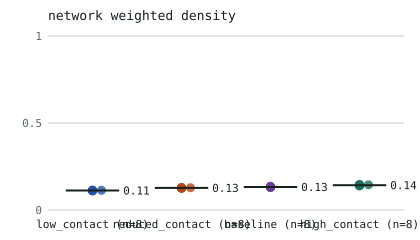
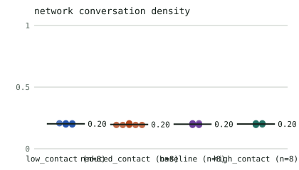
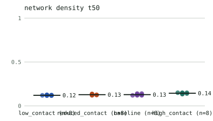
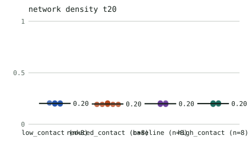
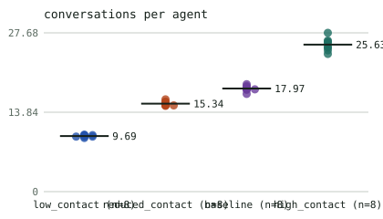
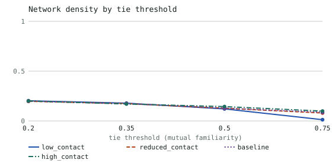
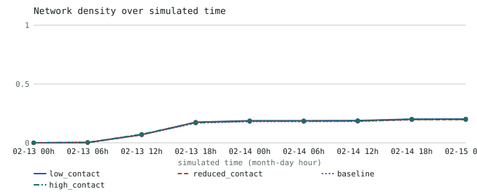

# Experiment: social_network_v2

In a 25-resident town over two days, how does contact opportunity change the social network when the measures do not depend on a single tie threshold, and does the dose-response found post hoc in round one hold when it is registered in advance?

**Hypothesis (fixed before running):** H1: weighted density rises monotonically with contact opportunity across the four cooldown levels (720 < 240 < 133 < 30 minutes of cooldown reversed: low < reduced < baseline < high). H2: density at threshold 0.5 and the share of pairs who talked are higher under high contact than under low contact. H3: density at threshold 0.2 differs between the extreme contact conditions by less than 0.05 (the saturation seen in round one).

> **MOCK RUNS.** These numbers exercise the pipeline with the offline mock; they say nothing about reflection.

## Conditions

* `low_contact`: `dialogue.cooldown_minutes=720`
* `reduced_contact`: `dialogue.cooldown_minutes=240`
* `baseline`: base configuration
* `high_contact`: `dialogue.cooldown_minutes=30`

Seeds [211, 212, 213, 214, 215, 216, 217, 218]. Runs are matched by seed; a hosted model does not reproduce identical samples, so matching is of the initial world, not of the randomness. Metrics: network, behavior, beliefs, usage.

Determinism check: the first configuration was run twice; committed state tables were **identical** (same seed and configuration run twice; state tables memories, plans, conversations, agent_state, spatial_memory, world_objects, relationships).

Each run links to its evaluation report when the `evaluation` metric ran.

| Run | Condition | Seed | Status | Weighted density (mean mutual familiarity over all pairs) | Pairs who talked (share of all pairs) | Density at tie threshold 0.50 | Density at tie threshold 0.20 | Conversations per agent | Calls | Runtime (s) |
| --- | --- | --- | --- | --- | --- | --- | --- | --- | --- | --- |
| low_contact-s211 | low_contact | 211 | completed | 0.1114 | 0.2 | 0.1267 | 0.2 | 9.6 | 27388 | 169.9 |
| reduced_contact-s211 | reduced_contact | 211 | completed | 0.1284 | 0.2033 | 0.1267 | 0.2033 | 15.2 | 30718 | 202.2 |
| baseline-s211 | baseline | 211 | completed | 0.1324 | 0.1967 | 0.14 | 0.1967 | 17.76 | 32799 | 229.9 |
| high_contact-s211 | high_contact | 211 | completed | 0.1449 | 0.2033 | 0.14 | 0.2033 | 25.92 | 38242 | 301.8 |
| low_contact-s212 | low_contact | 212 | completed | 0.1134 | 0.2033 | 0.12 | 0.2033 | 9.84 | 27600 | 164 |
| reduced_contact-s212 | reduced_contact | 212 | completed | 0.1276 | 0.1933 | 0.1333 | 0.1933 | 15.68 | 31643 | 311.4 |
| baseline-s212 | baseline | 212 | completed | 0.1366 | 0.2067 | 0.14 | 0.2067 | 18.72 | 33529 | 219.4 |
| high_contact-s212 | high_contact | 212 | completed | 0.1467 | 0.2067 | 0.1467 | 0.2067 | 27.68 | 40180 | 327.1 |
| low_contact-s213 | low_contact | 213 | completed | 0.1134 | 0.2067 | 0.1167 | 0.2067 | 9.76 | 27310 | 160.2 |
| reduced_contact-s213 | reduced_contact | 213 | completed | 0.1263 | 0.2 | 0.12 | 0.2 | 14.96 | 30936 | 201.5 |
| baseline-s213 | baseline | 213 | completed | 0.1294 | 0.1933 | 0.12 | 0.1933 | 17.84 | 33701 | 232.3 |
| high_contact-s213 | high_contact | 213 | completed | 0.1397 | 0.1933 | 0.14 | 0.1933 | 25.2 | 38155 | 285.4 |
| low_contact-s214 | low_contact | 214 | completed | 0.1132 | 0.2067 | 0.1167 | 0.2067 | 9.84 | 27205 | 153.6 |
| reduced_contact-s214 | reduced_contact | 214 | completed | 0.1284 | 0.2067 | 0.1233 | 0.2067 | 15.04 | 30856 | 189.6 |
| baseline-s214 | baseline | 214 | completed | 0.1327 | 0.2033 | 0.13 | 0.2033 | 17.84 | 32975 | 214.7 |
| high_contact-s214 | high_contact | 214 | completed | 0.1455 | 0.2033 | 0.15 | 0.2033 | 26.16 | 38798 | 291.4 |
| low_contact-s215 | low_contact | 215 | completed | 0.1138 | 0.2067 | 0.12 | 0.2067 | 9.92 | 27327 | 159.1 |
| reduced_contact-s215 | reduced_contact | 215 | completed | 0.1249 | 0.1933 | 0.1267 | 0.1933 | 15.12 | 30929 | 192.5 |
| baseline-s215 | baseline | 215 | completed | 0.1304 | 0.1967 | 0.1267 | 0.1967 | 17.04 | 32793 | 213.3 |
| high_contact-s215 | high_contact | 215 | completed | 0.1386 | 0.2 | 0.1333 | 0.2 | 24 | 36987 | 269.4 |
| low_contact-s216 | low_contact | 216 | completed | 0.1096 | 0.1967 | 0.1233 | 0.1967 | 9.36 | 27337 | 156.3 |
| reduced_contact-s216 | reduced_contact | 216 | completed | 0.1278 | 0.1933 | 0.13 | 0.1933 | 15.6 | 31722 | 200.2 |
| baseline-s216 | baseline | 216 | completed | 0.1321 | 0.1933 | 0.1267 | 0.1933 | 18.4 | 33404 | 217.8 |
| high_contact-s216 | high_contact | 216 | completed | 0.1402 | 0.1967 | 0.1433 | 0.1967 | 24.64 | 37611 | 272.6 |
| low_contact-s217 | low_contact | 217 | completed | 0.1111 | 0.1967 | 0.1233 | 0.1967 | 9.6 | 27494 | 162.1 |
| reduced_contact-s217 | reduced_contact | 217 | completed | 0.1254 | 0.1933 | 0.1233 | 0.1933 | 15.04 | 30714 | 184.5 |
| baseline-s217 | baseline | 217 | completed | 0.1334 | 0.2067 | 0.12 | 0.2067 | 18.24 | 33583 | 225 |
| high_contact-s217 | high_contact | 217 | completed | 0.1415 | 0.1967 | 0.15 | 0.1967 | 25.12 | 37956 | 279.4 |
| low_contact-s218 | low_contact | 218 | completed | 0.1107 | 0.2 | 0.12 | 0.2 | 9.6 | 27354 | 160.7 |
| reduced_contact-s218 | reduced_contact | 218 | completed | 0.1287 | 0.1933 | 0.1367 | 0.1933 | 16.08 | 31357 | 196.9 |
| baseline-s218 | baseline | 218 | completed | 0.1292 | 0.2 | 0.12 | 0.2 | 17.92 | 32874 | 208.8 |
| high_contact-s218 | high_contact | 218 | completed | 0.1449 | 0.2067 | 0.15 | 0.2067 | 26.32 | 38799 | 295.1 |

## By condition

| Outcome | low_contact | reduced_contact | baseline | high_contact |
| --- | --- | --- | --- | --- |
| **Weighted density (mean mutual familiarity over all pairs)** | 0.112 ± 0.002 (median 0.1123; 0.1096–0.1138; 95% CI 0.111 to 0.113; n=8) | 0.127 ± 0.001 (median 0.1277; 0.1249–0.1287; 95% CI 0.126 to 0.128; n=8) | 0.132 ± 0.002 (median 0.13225; 0.1292–0.1366; 95% CI 0.131 to 0.134; n=8) | 0.143 ± 0.003 (median 0.1432; 0.1386–0.1467; 95% CI 0.141 to 0.145; n=8) |
| **Pairs who talked (share of all pairs)** | 0.202 ± 0.004 (median 0.20165; 0.1967–0.2067; 95% CI 0.199 to 0.205; n=8) | 0.197 ± 0.005 (median 0.1933; 0.1933–0.2067; 95% CI 0.194 to 0.201; n=8) | 0.2 ± 0.005 (median 0.19835; 0.1933–0.2067; 95% CI 0.196 to 0.203; n=8) | 0.201 ± 0.005 (median 0.20165; 0.1933–0.2067; 95% CI 0.198 to 0.204; n=8) |
| **Density at tie threshold 0.50** | 0.121 ± 0.003 (median 0.12; 0.1167–0.1267; 95% CI 0.119 to 0.123; n=8) | 0.128 ± 0.006 (median 0.1267; 0.12–0.1367; 95% CI 0.124 to 0.131; n=8) | 0.128 ± 0.008 (median 0.1267; 0.12–0.14; 95% CI 0.123 to 0.134; n=8) | 0.144 ± 0.006 (median 0.145; 0.1333–0.15; 95% CI 0.14 to 0.148; n=8) |
| **Density at tie threshold 0.20** | 0.202 ± 0.004 (median 0.20165; 0.1967–0.2067; 95% CI 0.199 to 0.205; n=8) | 0.197 ± 0.005 (median 0.1933; 0.1933–0.2067; 95% CI 0.194 to 0.201; n=8) | 0.2 ± 0.005 (median 0.19835; 0.1933–0.2067; 95% CI 0.196 to 0.203; n=8) | 0.201 ± 0.005 (median 0.20165; 0.1933–0.2067; 95% CI 0.198 to 0.204; n=8) |
| **Conversations per agent** | 9.69 ± 0.184 (median 9.68; 9.36–9.92; 95% CI 9.57 to 9.81; n=8) | 15.34 ± 0.401 (median 15.16; 14.96–16.08; 95% CI 15.1 to 15.62; n=8) | 17.97 ± 0.502 (median 17.88; 17.04–18.72; 95% CI 17.63 to 18.28; n=8) | 25.63 ± 1.142 (median 25.56; 24–27.68; 95% CI 24.92 to 26.37; n=8) |
| Network density (mutual ties) | 0.202 ± 0.004 (median 0.20165; 0.1967–0.2067; 95% CI 0.199 to 0.205; n=8) | 0.197 ± 0.005 (median 0.1933; 0.1933–0.2067; 95% CI 0.194 to 0.201; n=8) | 0.2 ± 0.005 (median 0.19835; 0.1933–0.2067; 95% CI 0.196 to 0.203; n=8) | 0.201 ± 0.005 (median 0.20165; 0.1933–0.2067; 95% CI 0.198 to 0.204; n=8) |
| network edges | 60.625 ± 1.302 (median 60.5; 59–62; 95% CI 59.75 to 61.5; n=8) | 59.125 ± 1.642 (median 58; 58–62; 95% CI 58.25 to 60.25; n=8) | 59.875 ± 1.642 (median 59.5; 58–62; 95% CI 58.875 to 61; n=8) | 60.25 ± 1.488 (median 60.5; 58–62; 95% CI 59.375 to 61.125; n=8) |
| Network components | 6 ± 0 (median 6; 6–6; 95% CI 6 to 6; n=8) | 6 ± 0 (median 6; 6–6; 95% CI 6 to 6; n=8) | 6 ± 0 (median 6; 6–6; 95% CI 6 to 6; n=8) | 6 ± 0 (median 6; 6–6; 95% CI 6 to 6; n=8) |
| network largest component | 16 ± 0 (median 16; 16–16; 95% CI 16 to 16; n=8) | 16 ± 0 (median 16; 16–16; 95% CI 16 to 16; n=8) | 16 ± 0 (median 16; 16–16; 95% CI 16 to 16; n=8) | 16 ± 0 (median 16; 16–16; 95% CI 16 to 16; n=8) |
| network isolates | 4 ± 0 (median 4; 4–4; 95% CI 4 to 4; n=8) | 4 ± 0 (median 4; 4–4; 95% CI 4 to 4; n=8) | 4 ± 0 (median 4; 4–4; 95% CI 4 to 4; n=8) | 4 ± 0 (median 4; 4–4; 95% CI 4 to 4; n=8) |
| Reciprocity | 1 ± 0 (median 1; 1–1; 95% CI 1 to 1; n=8) | 1 ± 0 (median 1; 1–1; 95% CI 1 to 1; n=8) | 1 ± 0 (median 1; 1–1; 95% CI 1 to 1; n=8) | 1 ± 0 (median 1; 1–1; 95% CI 1 to 1; n=8) |
| Clustering | 0.759 ± 0.016 (median 0.7554; 0.7366–0.7835; 95% CI 0.748 to 0.769; n=8) | 0.747 ± 0.016 (median 0.74635; 0.7259–0.7669; 95% CI 0.736 to 0.757; n=8) | 0.754 ± 0.017 (median 0.7514; 0.7255–0.7739; 95% CI 0.743 to 0.765; n=8) | 0.76 ± 0.015 (median 0.75925; 0.7409–0.7801; 95% CI 0.751 to 0.77; n=8) |
| Degree inequality (Gini) | 0.394 ± 0.007 (median 0.39225; 0.3873–0.4077; 95% CI 0.39 to 0.398; n=8) | 0.389 ± 0.006 (median 0.38825; 0.3814–0.3981; 95% CI 0.385 to 0.393; n=8) | 0.395 ± 0.003 (median 0.395; 0.3903–0.3981; 95% CI 0.392 to 0.397; n=8) | 0.396 ± 0.008 (median 0.39705; 0.3803–0.4058; 95% CI 0.391 to 0.401; n=8) |
| Mean familiarity | 0.513 ± 0.015 (median 0.5117; 0.4913–0.5421; 95% CI 0.504 to 0.523; n=8) | 0.596 ± 0.011 (median 0.5926; 0.5829–0.6145; 95% CI 0.59 to 0.604; n=8) | 0.612 ± 0.019 (median 0.6062; 0.5913–0.6506; 95% CI 0.601 to 0.625; n=8) | 0.638 ± 0.009 (median 0.6406; 0.6208–0.6488; 95% CI 0.632 to 0.643; n=8) |
| Mean valence | n/a | n/a | n/a | n/a |
| relationship records | 131.25 ± 3.845 (median 131; 126–136; 95% CI 128.75 to 133.75; n=8) | 128 ± 2.828 (median 129; 122–130; 95% CI 126 to 129.5; n=8) | 129.5 ± 2.976 (median 128; 126–134; 95% CI 127.75 to 131.75; n=8) | 134.25 ± 2.493 (median 134; 130–138; 95% CI 132.75 to 135.75; n=8) |
| Density at tie threshold 0.35 | 0.179 ± 0.007 (median 0.17835; 0.17–0.19; 95% CI 0.175 to 0.183; n=8) | 0.175 ± 0.004 (median 0.1767; 0.17–0.18; 95% CI 0.172 to 0.177; n=8) | 0.173 ± 0.006 (median 0.1733; 0.1633–0.18; 95% CI 0.169 to 0.177; n=8) | 0.17 ± 0.006 (median 0.17; 0.16–0.18; 95% CI 0.166 to 0.174; n=8) |
| Density at tie threshold 0.75 | 0.012 ± 0.002 (median 0.0133; 0.01–0.0133; 95% CI 0.011 to 0.013; n=8) | 0.08 ± 0.002 (median 0.08; 0.0767–0.0833; 95% CI 0.078 to 0.082; n=8) | 0.087 ± 0.006 (median 0.0867; 0.08–0.1; 95% CI 0.084 to 0.091; n=8) | 0.099 ± 0.002 (median 0.09835; 0.0967–0.1033; 95% CI 0.097 to 0.1; n=8) |
| Scheduled share of actions | 0.83 ± 0.005 (median 0.83025; 0.824–0.8381; 95% CI 0.827 to 0.833; n=8) | 0.768 ± 0.005 (median 0.768; 0.7612–0.7756; 95% CI 0.764 to 0.771; n=8) | 0.742 ± 0.008 (median 0.74125; 0.7307–0.7538; 95% CI 0.737 to 0.747; n=8) | 0.676 ± 0.007 (median 0.6762; 0.6631–0.688; 95% CI 0.672 to 0.681; n=8) |
| Plan adherence (hour blocks followed) | 1 ± 0 (median 1; 1–1; 95% CI 1 to 1; n=8) | 1 ± 0 (median 1; 1–1; 95% CI 1 to 1; n=8) | 1 ± 0 (median 1; 1–1; 95% CI 1 to 1; n=8) | 1 ± 0 (median 1; 1–1; 95% CI 1 to 1; n=8) |
| Idle share | 0 ± 0 (median 0; 0–0; 95% CI 0 to 0; n=8) | 0 ± 0 (median 0; 0–0; 95% CI 0 to 0; n=8) | 0 ± 0 (median 0; 0–0; 95% CI 0 to 0; n=8) | 0 ± 0 (median 0; 0–0; 95% CI 0 to 0; n=8) |
| Replans per agent | 9.69 ± 0.184 (median 9.68; 9.36–9.92; 95% CI 9.57 to 9.81; n=8) | 15.34 ± 0.401 (median 15.16; 14.96–16.08; 95% CI 15.1 to 15.62; n=8) | 17.97 ± 0.502 (median 17.88; 17.04–18.72; 95% CI 17.63 to 18.28; n=8) | 25.63 ± 1.142 (median 25.56; 24–27.68; 95% CI 24.92 to 26.37; n=8) |
| Reaction rate (non-continue) | 0.17 ± 0.007 (median 0.16985; 0.1598–0.1786; 95% CI 0.166 to 0.175; n=8) | 0.263 ± 0.014 (median 0.25845; 0.2466–0.2856; 95% CI 0.255 to 0.272; n=8) | 0.29 ± 0.016 (median 0.28395; 0.2756–0.3204; 95% CI 0.281 to 0.301; n=8) | 0.388 ± 0.007 (median 0.3917; 0.3721–0.393; 95% CI 0.383 to 0.392; n=8) |
| action failures | 0 ± 0 (median 0; 0–0; 95% CI 0 to 0; n=8) | 0 ± 0 (median 0; 0–0; 95% CI 0 to 0; n=8) | 0 ± 0 (median 0; 0–0; 95% CI 0 to 0; n=8) | 0 ± 0 (median 0; 0–0; 95% CI 0 to 0; n=8) |
| constraint refusals | 16 ± 0 (median 16; 16–16; 95% CI 16 to 16; n=8) | 16 ± 0 (median 16; 16–16; 95% CI 16 to 16; n=8) | 16 ± 0 (median 16; 16–16; 95% CI 16 to 16; n=8) | 16 ± 0 (median 16; 16–16; 95% CI 16 to 16; n=8) |
| plan failures | 0 ± 0 (median 0; 0–0; 95% CI 0 to 0; n=8) | 0 ± 0 (median 0; 0–0; 95% CI 0 to 0; n=8) | 0 ± 0 (median 0; 0–0; 95% CI 0 to 0; n=8) | 0 ± 0 (median 0; 0–0; 95% CI 0 to 0; n=8) |
| valentines holders pct | 36.5 ± 13.256 (median 36; 20–52; 95% CI 28 to 45; n=8) | 35.5 ± 16.345 (median 36; 12–52; 95% CI 25 to 46; n=8) | 26.5 ± 12.271 (median 24; 12–48; 95% CI 19 to 35; n=8) | 30.5 ± 10.889 (median 34; 12–44; 95% CI 23 to 37; n=8) |
| valentines knowledge coverage | 0.111 ± 0.03 (median 0.109; 0.067–0.154; 95% CI 0.091 to 0.13; n=8) | 0.109 ± 0.033 (median 0.109; 0.05–0.16; 95% CI 0.087 to 0.13; n=8) | 0.081 ± 0.043 (median 0.077; 0–0.142; 95% CI 0.052 to 0.11; n=8) | 0.096 ± 0.029 (median 0.0985; 0.056–0.152; 95% CI 0.077 to 0.116; n=8) |
| valentines conflicting details | 2 ± 0.756 (median 2; 1–3; 95% CI 1.5 to 2.5; n=8) | 2 ± 0.756 (median 2; 1–3; 95% CI 1.5 to 2.5; n=8) | 1.375 ± 0.744 (median 1.5; 0–2; 95% CI 0.875 to 1.75; n=8) | 1.875 ± 1.126 (median 1.5; 1–4; 95% CI 1.25 to 2.625; n=8) |
| mayor holders pct | 17 ± 8.485 (median 14; 8–32; 95% CI 12 to 23; n=8) | 19 ± 10.198 (median 16; 8–32; 95% CI 12.5 to 26; n=8) | 15 ± 5.555 (median 16; 8–24; 95% CI 11.5 to 18.5; n=8) | 10.5 ± 2.976 (median 10; 8–16; 95% CI 8.5 to 12.5; n=8) |
| mayor knowledge coverage | 0.074 ± 0.011 (median 0.075; 0.056–0.089; 95% CI 0.067 to 0.081; n=8) | 0.071 ± 0.01 (median 0.073; 0.056–0.089; 95% CI 0.064 to 0.078; n=8) | 0.073 ± 0.01 (median 0.071; 0.062–0.092; 95% CI 0.067 to 0.08; n=8) | 0.065 ± 0.017 (median 0.0655; 0.042–0.083; 95% CI 0.053 to 0.076; n=8) |
| mayor conflicting details | 0 ± 0 (median 0; 0–0; 95% CI 0 to 0; n=8) | 0 ± 0 (median 0; 0–0; 95% CI 0 to 0; n=8) | 0 ± 0 (median 0; 0–0; 95% CI 0 to 0; n=8) | 0 ± 0 (median 0; 0–0; 95% CI 0 to 0; n=8) |
| Model calls | 27,377 ± 120.855 (median 27,346; 27,205–27,600; 95% CI 27,301 to 27,459; n=8) | 31,109 ± 406.671 (median 30,932; 30,714–31,722; 95% CI 30,867 to 31,381; n=8) | 33,207 ± 383.681 (median 33,190; 32,793–33,701; 95% CI 32,950 to 33,455; n=8) | 38,341 ± 953.143 (median 38,198; 36,987–40,180; 95% CI 37,766 to 38,983; n=8) |
| Input tokens | 14,992,475 ± 152,627 (median 15,029,914; 14,684,951–15,160,574; 95% CI 14,876,354 to 15,080,424; n=8) | 17,240,368 ± 329,636 (median 17,316,944; 16,651,898–17,606,901; 95% CI 17,019,890 to 17,448,329; n=8) | 18,593,506 ± 315,596 (median 18,645,288; 18,122,308–19,135,947; 95% CI 18,393,821 to 18,795,052; n=8) | 21,601,296 ± 748,509 (median 21,377,478; 20,759,584–23,181,134; 95% CI 21,182,455 to 22,117,873; n=8) |
| Output tokens | 720,126 ± 5,413 (median 721,721; 711,085–727,148; 95% CI 716,303 to 723,410; n=8) | 817,523 ± 13,754 (median 820,004; 796,446–833,669; 95% CI 808,441 to 826,351; n=8) | 870,576 ± 11,800 (median 870,128; 852,765–893,492; 95% CI 863,117 to 878,590; n=8) | 1,002,841 ± 30,464 (median 995,581; 969,864–1,064,549; 95% CI 984,665 to 1,023,503; n=8) |
| Cost (USD) | unpriced | unpriced | unpriced | unpriced |
| Runtime (s) | 160.738 ± 4.929 (median 160.45; 153.6–169.9; 95% CI 157.65 to 164.15; n=8) | 209.85 ± 41.499 (median 198.55; 184.5–311.4; 95% CI 192.113 to 240.362; n=8) | 220.15 ± 8.261 (median 218.6; 208.8–232.3; 95% CI 214.925 to 225.575; n=8) | 290.275 ± 18.53 (median 288.4; 269.4–327.1; 95% CI 279.062 to 303.175; n=8) |

Mean ± SD (median; range; bootstrap 95% interval of the mean from three runs up; runs with a value). Primary outcomes, fixed in the protocol before running, are in bold.

## Planned contrasts (registered with the hypothesis)

| Contrast | Mean a | Mean b | a − b | Direction as predicted | Seeds agreeing | d_z | Paired p | Holm p |
| --- | --- | --- | --- | --- | --- | --- | --- | --- |
| H1 weighted density: high > baseline | 0.1427 | 0.132 | 0.0107 | yes | 8 of 8 | 3.9 | 0.00781 | 0.04686 |
| H1 weighted density: baseline > reduced | 0.132 | 0.1272 | 0.0048 | yes | 8 of 8 | 1.794 | 0.00781 | 0.04686 |
| H1 weighted density: reduced > low | 0.1272 | 0.1121 | 0.0151 | yes | 8 of 8 | 6.033 | 0.00781 | 0.04686 |
| H2 density at 0.5: high > low | 0.1442 | 0.1208 | 0.0233 | yes | 8 of 8 | 3.17 | 0.00781 | 0.04686 |
| H2 pairs who talked: high > low | 0.2008 | 0.2021 | -0.0013 | **no** | 3 of 8 | -0.196 | 0.6875 | 1 |
| H3 density at 0.2: high = low (within ±0.05) | 0.2008 | 0.2021 | -0.0013 | yes | n/a | -0.196 | 0.6875 | 1 |

Paired by seed (exact sign-flip permutation; smallest possible p = 0.00781), Holm-adjusted over these 6 contrasts only. "Direction as predicted" compares the observed mean difference with the registered expectation; for an expected equality it checks the stated band.

## Comparisons (exploratory)

* **network_weighted_density (low_contact vs reduced_contact)**: low_contact - reduced_contact = -0.015 (bootstrap 95% CI (-0.017, -0.014), exact permutation p = 0.0002, smallest possible 0.00016, n = [8, 8]); paired by seed: mean difference -0.0151 over 8 seeds (8 in the direction of the mean), d_z = -6.033, exact sign-flip p = 0.00781 (smallest possible 0.00781; Holm-adjusted 0.2343)
* **network_conversation_density (low_contact vs reduced_contact)**: low_contact - reduced_contact = 0.005 (bootstrap 95% CI (0.0, 0.009), exact permutation p = 0.0536, smallest possible 0.00016, n = [8, 8]); paired by seed: mean difference 0.005 over 8 seeds (6 in the direction of the mean), d_z = 0.942, exact sign-flip p = 0.03125 (smallest possible 0.00781; Holm-adjusted 0.46875)
* **network_density_t50 (low_contact vs reduced_contact)**: low_contact - reduced_contact = -0.007 (bootstrap 95% CI (-0.011, -0.002), exact permutation p = 0.0193, smallest possible 0.00016, n = [8, 8]); paired by seed: mean difference -0.0067 over 8 seeds (6 in the direction of the mean), d_z = -1.126, exact sign-flip p = 0.03125 (smallest possible 0.00781; Holm-adjusted 0.46875)
* **network_density_t20 (low_contact vs reduced_contact)**: low_contact - reduced_contact = 0.005 (bootstrap 95% CI (0.0, 0.009), exact permutation p = 0.0536, smallest possible 0.00016, n = [8, 8]); paired by seed: mean difference 0.005 over 8 seeds (6 in the direction of the mean), d_z = 0.942, exact sign-flip p = 0.03125 (smallest possible 0.00781; Holm-adjusted 0.46875)
* **conversations_per_agent (low_contact vs reduced_contact)**: low_contact - reduced_contact = -5.65 (bootstrap 95% CI (-5.95, -5.39), exact permutation p = 0.0002, smallest possible 0.00016, n = [8, 8]); paired by seed: mean difference -5.65 over 8 seeds (8 in the direction of the mean), d_z = -11.374, exact sign-flip p = 0.00781 (smallest possible 0.00781; Holm-adjusted 0.2343)
* **network_weighted_density (low_contact vs baseline)**: low_contact - baseline = -0.02 (bootstrap 95% CI (-0.022, -0.018), exact permutation p = 0.0002, smallest possible 0.00016, n = [8, 8]); paired by seed: mean difference -0.0199 over 8 seeds (8 in the direction of the mean), d_z = -7.263, exact sign-flip p = 0.00781 (smallest possible 0.00781; Holm-adjusted 0.2343)
* **network_conversation_density (low_contact vs baseline)**: low_contact - baseline = 0.003 (bootstrap 95% CI (-0.002, 0.007), exact permutation p = 0.352, smallest possible 0.00016, n = [8, 8]); paired by seed: mean difference 0.0025 over 8 seeds (5 in the direction of the mean), d_z = 0.343, exact sign-flip p = 0.40625 (smallest possible 0.00781; Holm-adjusted 1.0)
* **network_density_t50 (low_contact vs baseline)**: low_contact - baseline = -0.007 (bootstrap 95% CI (-0.013, -0.001), exact permutation p = 0.0511, smallest possible 0.00016, n = [8, 8]); paired by seed: mean difference -0.0071 over 8 seeds (6 in the direction of the mean), d_z = -0.904, exact sign-flip p = 0.04688 (smallest possible 0.00781; Holm-adjusted 0.56256)
* **network_density_t20 (low_contact vs baseline)**: low_contact - baseline = 0.003 (bootstrap 95% CI (-0.002, 0.007), exact permutation p = 0.352, smallest possible 0.00016, n = [8, 8]); paired by seed: mean difference 0.0025 over 8 seeds (5 in the direction of the mean), d_z = 0.343, exact sign-flip p = 0.40625 (smallest possible 0.00781; Holm-adjusted 1.0)
* **conversations_per_agent (low_contact vs baseline)**: low_contact - baseline = -8.28 (bootstrap 95% CI (-8.61, -7.92), exact permutation p = 0.0002, smallest possible 0.00016, n = [8, 8]); paired by seed: mean difference -8.28 over 8 seeds (8 in the direction of the mean), d_z = -13.726, exact sign-flip p = 0.00781 (smallest possible 0.00781; Holm-adjusted 0.2343)
* **network_weighted_density (low_contact vs high_contact)**: low_contact - high_contact = -0.031 (bootstrap 95% CI (-0.033, -0.028), exact permutation p = 0.0002, smallest possible 0.00016, n = [8, 8]); paired by seed: mean difference -0.0307 over 8 seeds (8 in the direction of the mean), d_z = -8.872, exact sign-flip p = 0.00781 (smallest possible 0.00781; Holm-adjusted 0.2343)
* **network_conversation_density (low_contact vs high_contact)**: low_contact - high_contact = 0.001 (bootstrap 95% CI (-0.003, 0.005), exact permutation p = 0.6076, smallest possible 0.00016, n = [8, 8]); paired by seed: mean difference 0.0013 over 8 seeds (3 in the direction of the mean), d_z = 0.196, exact sign-flip p = 0.6875 (smallest possible 0.00781; Holm-adjusted 1.0)
* **network_density_t50 (low_contact vs high_contact)**: low_contact - high_contact = -0.023 (bootstrap 95% CI (-0.028, -0.019), exact permutation p = 0.0002, smallest possible 0.00016, n = [8, 8]); paired by seed: mean difference -0.0233 over 8 seeds (8 in the direction of the mean), d_z = -3.17, exact sign-flip p = 0.00781 (smallest possible 0.00781; Holm-adjusted 0.2343)
* **network_density_t20 (low_contact vs high_contact)**: low_contact - high_contact = 0.001 (bootstrap 95% CI (-0.003, 0.005), exact permutation p = 0.6076, smallest possible 0.00016, n = [8, 8]); paired by seed: mean difference 0.0013 over 8 seeds (3 in the direction of the mean), d_z = 0.196, exact sign-flip p = 0.6875 (smallest possible 0.00781; Holm-adjusted 1.0)
* **conversations_per_agent (low_contact vs high_contact)**: low_contact - high_contact = -15.94 (bootstrap 95% CI (-16.71, -15.22), exact permutation p = 0.0002, smallest possible 0.00016, n = [8, 8]); paired by seed: mean difference -15.94 over 8 seeds (8 in the direction of the mean), d_z = -14.193, exact sign-flip p = 0.00781 (smallest possible 0.00781; Holm-adjusted 0.2343)
* **network_weighted_density (reduced_contact vs baseline)**: reduced_contact - baseline = -0.005 (bootstrap 95% CI (-0.007, -0.003), exact permutation p = 0.0002, smallest possible 0.00016, n = [8, 8]); paired by seed: mean difference -0.0048 over 8 seeds (8 in the direction of the mean), d_z = -1.794, exact sign-flip p = 0.00781 (smallest possible 0.00781; Holm-adjusted 0.2343)
* **network_conversation_density (reduced_contact vs baseline)**: reduced_contact - baseline = -0.003 (bootstrap 95% CI (-0.008, 0.002), exact permutation p = 0.3517, smallest possible 0.00016, n = [8, 8]); paired by seed: mean difference -0.0025 over 8 seeds (4 in the direction of the mean), d_z = -0.31, exact sign-flip p = 0.39062 (smallest possible 0.00781; Holm-adjusted 1.0)
* **network_density_t50 (reduced_contact vs baseline)**: reduced_contact - baseline = -0.0 (bootstrap 95% CI (-0.007, 0.006), exact permutation p = 0.9388, smallest possible 0.00016, n = [8, 8]); paired by seed: mean difference -0.0004 over 8 seeds (3 in the direction of the mean), d_z = -0.047, exact sign-flip p = 0.9375 (smallest possible 0.00781; Holm-adjusted 1.0)
* **network_density_t20 (reduced_contact vs baseline)**: reduced_contact - baseline = -0.003 (bootstrap 95% CI (-0.008, 0.002), exact permutation p = 0.3517, smallest possible 0.00016, n = [8, 8]); paired by seed: mean difference -0.0025 over 8 seeds (4 in the direction of the mean), d_z = -0.31, exact sign-flip p = 0.39062 (smallest possible 0.00781; Holm-adjusted 1.0)
* **conversations_per_agent (reduced_contact vs baseline)**: reduced_contact - baseline = -2.63 (bootstrap 95% CI (-3.04, -2.19), exact permutation p = 0.0002, smallest possible 0.00016, n = [8, 8]); paired by seed: mean difference -2.63 over 8 seeds (8 in the direction of the mean), d_z = -5.265, exact sign-flip p = 0.00781 (smallest possible 0.00781; Holm-adjusted 0.2343)
* **network_weighted_density (reduced_contact vs high_contact)**: reduced_contact - high_contact = -0.016 (bootstrap 95% CI (-0.018, -0.013), exact permutation p = 0.0002, smallest possible 0.00016, n = [8, 8]); paired by seed: mean difference -0.0156 over 8 seeds (8 in the direction of the mean), d_z = -7.0, exact sign-flip p = 0.00781 (smallest possible 0.00781; Holm-adjusted 0.2343)
* **network_conversation_density (reduced_contact vs high_contact)**: reduced_contact - high_contact = -0.004 (bootstrap 95% CI (-0.008, 0.001), exact permutation p = 0.1692, smallest possible 0.00016, n = [8, 8]); paired by seed: mean difference -0.0038 over 8 seeds (5 in the direction of the mean), d_z = -0.52, exact sign-flip p = 0.23438 (smallest possible 0.00781; Holm-adjusted 1.0)
* **network_density_t50 (reduced_contact vs high_contact)**: reduced_contact - high_contact = -0.017 (bootstrap 95% CI (-0.022, -0.011), exact permutation p = 0.0005, smallest possible 0.00016, n = [8, 8]); paired by seed: mean difference -0.0167 over 8 seeds (8 in the direction of the mean), d_z = -2.328, exact sign-flip p = 0.00781 (smallest possible 0.00781; Holm-adjusted 0.2343)
* **network_density_t20 (reduced_contact vs high_contact)**: reduced_contact - high_contact = -0.004 (bootstrap 95% CI (-0.008, 0.001), exact permutation p = 0.1692, smallest possible 0.00016, n = [8, 8]); paired by seed: mean difference -0.0038 over 8 seeds (5 in the direction of the mean), d_z = -0.52, exact sign-flip p = 0.23438 (smallest possible 0.00781; Holm-adjusted 1.0)
* **conversations_per_agent (reduced_contact vs high_contact)**: reduced_contact - high_contact = -10.29 (bootstrap 95% CI (-11.09, -9.52), exact permutation p = 0.0002, smallest possible 0.00016, n = [8, 8]); paired by seed: mean difference -10.29 over 8 seeds (8 in the direction of the mean), d_z = -10.01, exact sign-flip p = 0.00781 (smallest possible 0.00781; Holm-adjusted 0.2343)
* **network_weighted_density (baseline vs high_contact)**: baseline - high_contact = -0.011 (bootstrap 95% CI (-0.013, -0.008), exact permutation p = 0.0002, smallest possible 0.00016, n = [8, 8]); paired by seed: mean difference -0.0107 over 8 seeds (8 in the direction of the mean), d_z = -3.9, exact sign-flip p = 0.00781 (smallest possible 0.00781; Holm-adjusted 0.2343)
* **network_conversation_density (baseline vs high_contact)**: baseline - high_contact = -0.001 (bootstrap 95% CI (-0.006, 0.003), exact permutation p = 0.7209, smallest possible 0.00016, n = [8, 8]); paired by seed: mean difference -0.0013 over 8 seeds (4 in the direction of the mean), d_z = -0.235, exact sign-flip p = 0.625 (smallest possible 0.00781; Holm-adjusted 1.0)
* **network_density_t50 (baseline vs high_contact)**: baseline - high_contact = -0.016 (bootstrap 95% CI (-0.023, -0.009), exact permutation p = 0.0019, smallest possible 0.00016, n = [8, 8]); paired by seed: mean difference -0.0162 over 8 seeds (7 in the direction of the mean), d_z = -1.469, exact sign-flip p = 0.01562 (smallest possible 0.00781; Holm-adjusted 0.24992)
* **network_density_t20 (baseline vs high_contact)**: baseline - high_contact = -0.001 (bootstrap 95% CI (-0.006, 0.003), exact permutation p = 0.7209, smallest possible 0.00016, n = [8, 8]); paired by seed: mean difference -0.0013 over 8 seeds (4 in the direction of the mean), d_z = -0.235, exact sign-flip p = 0.625 (smallest possible 0.00781; Holm-adjusted 1.0)
* **conversations_per_agent (baseline vs high_contact)**: baseline - high_contact = -7.66 (bootstrap 95% CI (-8.54, -6.89), exact permutation p = 0.0002, smallest possible 0.00016, n = [8, 8]); paired by seed: mean difference -7.66 over 8 seeds (8 in the direction of the mean), d_z = -8.187, exact sign-flip p = 0.00781 (smallest possible 0.00781; Holm-adjusted 0.2343)

Paired p-values are Holm-adjusted over the 30 primary comparisons of this protocol. All tests are two-sided and descriptive.

One dot per run; the bar is the condition mean.

## Detail: the network at every threshold

Means over the runs of a condition. A tie is mutual familiarity at or above the threshold.

**Density by tie threshold**

| Condition | ≥ 0.2 | ≥ 0.35 | ≥ 0.5 | ≥ 0.75 |
| --- | --- | --- | --- | --- |
| low_contact | 0.202 | 0.179 | 0.121 | 0.012 |
| reduced_contact | 0.197 | 0.175 | 0.128 | 0.080 |
| baseline | 0.200 | 0.173 | 0.128 | 0.087 |
| high_contact | 0.201 | 0.170 | 0.144 | 0.099 |

**Largest component (agents) and number of components by tie threshold**

| Condition | ≥ 0.2 | ≥ 0.35 | ≥ 0.5 | ≥ 0.75 |
| --- | --- | --- | --- | --- |
| low_contact | 16.0 / 6.0 | 15.5 / 6.2 | 14.0 / 7.0 | 3.0 / 21.2 |
| reduced_contact | 16.0 / 6.0 | 15.8 / 6.1 | 14.0 / 7.0 | 7.4 / 8.5 |
| baseline | 16.0 / 6.0 | 16.0 / 6.0 | 16.0 / 6.0 | 7.6 / 8.2 |
| high_contact | 16.0 / 6.0 | 16.0 / 6.0 | 15.8 / 6.1 | 8.8 / 7.9 |

**Clustering against a random graph of the same density** (average local clustering / density; in a random graph the two are equal in expectation, so a ratio above 1 means more closed triangles than chance)

| Condition | ≥ 0.2 | ≥ 0.35 | ≥ 0.5 | ≥ 0.75 |
| --- | --- | --- | --- | --- |
| low_contact | 0.76 / 0.20 = 3.8× | 0.71 / 0.18 = 4.0× | 0.70 / 0.12 = 5.8× | 0.00 / 0.01 = 0.0× |
| reduced_contact | 0.75 / 0.20 = 3.8× | 0.69 / 0.17 = 3.9× | 0.69 / 0.13 = 5.4× | 0.54 / 0.08 = 6.7× |
| baseline | 0.75 / 0.20 = 3.8× | 0.69 / 0.17 = 4.0× | 0.63 / 0.13 = 5.0× | 0.63 / 0.09 = 7.2× |
| high_contact | 0.76 / 0.20 = 3.8× | 0.67 / 0.17 = 4.0× | 0.67 / 0.14 = 4.6× | 0.70 / 0.10 = 7.1× |

**Measures without a threshold**

| Condition | Weighted density | Pairs who talked | Mean familiarity (records) | Degree Gini at the configured threshold | Relationship records |
| --- | --- | --- | --- | --- | --- |
| low_contact | 0.112 | 0.202 | 0.513 | 0.394 | 131 |
| reduced_contact | 0.127 | 0.197 | 0.596 | 0.389 | 128 |
| baseline | 0.132 | 0.200 | 0.612 | 0.395 | 130 |
| high_contact | 0.143 | 0.201 | 0.638 | 0.396 | 134 |

**Density at the configured threshold over simulated time**

| Condition | 02-13 00h | 02-13 06h | 02-13 12h | 02-13 18h | 02-14 00h | 02-14 06h | 02-14 12h | 02-14 18h | 02-15 00h |
| --- | --- | --- | --- | --- | --- | --- | --- | --- | --- |
| low_contact | 0.000 | 0.002 | 0.069 | 0.176 | 0.188 | 0.188 | 0.189 | 0.201 | 0.202 |
| reduced_contact | 0.000 | 0.002 | 0.069 | 0.174 | 0.184 | 0.184 | 0.185 | 0.196 | 0.197 |
| baseline | 0.000 | 0.002 | 0.069 | 0.168 | 0.181 | 0.181 | 0.182 | 0.197 | 0.200 |
| high_contact | 0.000 | 0.002 | 0.073 | 0.171 | 0.185 | 0.185 | 0.186 | 0.200 | 0.201 |

_Run modes: mock × 32._

Simulated characters: plausible behavior here does not establish validity for real people.
